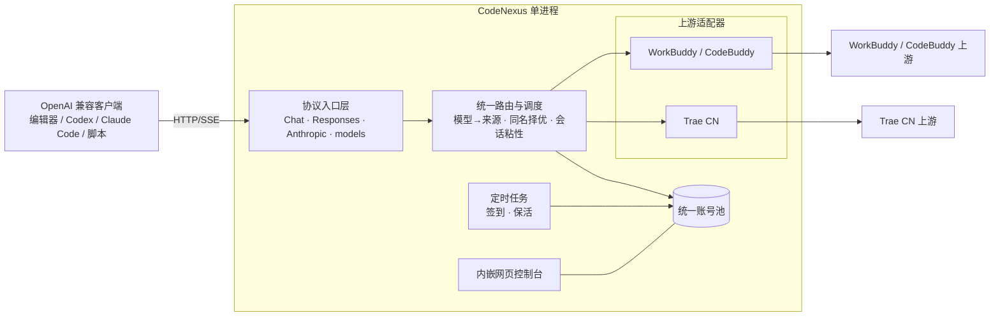

# CodeNexus

> **统一的 AI 编码账号网关** — 把 WorkBuddy / CodeBuddy 与 Trae CN 的账号池，汇聚成一个 OpenAI 兼容 API。
>
> **A unified gateway for AI coding accounts** — pool your WorkBuddy / CodeBuddy and Trae CN accounts behind a single OpenAI-compatible API.

<p align="center">
  
  
  
  
</p>

**中文** · [English](#english)

---

## ⚠️ 免责声明（请先阅读）

本项目是一个**非官方、本地自用**的账号网关，用于把**你个人账号**的既有额度集中暴露为 OpenAI 兼容接口，方便自用工具（编辑器、脚本、本地 Agent）统一调用。

- 仅限**你本人拥有并合法使用的账号**，且仅用于**本机 / 私有环境自用**；
- 明确**反对**：批量注册小号对外提供付费 API、共享账号池、二次加壳售卖、任何商业转售；
- 上游接口可能随时变更而失效，且可能**违反上游平台服务条款**，存在**账号封禁**风险；
- 凭证以**加密**方式落盘，请勿外传、勿提交到公开仓库、勿对外暴露监听端口。

**继续使用即代表你已知悉并自行承担上述风险。** The authors assume no liability for any account suspension or terms-of-service violation.

---

## 简介

`CodeNexus` 把两类 AI 编码账号池收敛进**一个进程、一个端口、一个面板、一个 `base_url`**：

| 来源 | 出口协议 | 备注 |
|---|---|---|
| WorkBuddy / CodeBuddy | OpenAI Chat | 账号池 + 定时任务 + 积分体系 |
| Trae CN | OpenAI Chat / Codex Responses / Anthropic Messages | 四类上游端点 + 五种认证来源 |

两者对外统一为 OpenAI 兼容接口，由网关屏蔽来源差异。

---

## 特性

> 状态：🚧 开发中（P0–P3 已完成）。以下为目标特性，实现进度见 [`docs/ROADMAP.md`](docs/ROADMAP.md)，完整执行计划见 [`docs/EXECUTION_PLAN.md`](docs/EXECUTION_PLAN.md)。

- **全协议超集（一个 `base_url`）**：OpenAI Chat（`/v1/chat/completions`）、OpenAI **Responses**（`/v1/responses`，Codex）、**Anthropic Messages**（`/v1/messages`，Claude Code）三类入口，均支持流式（SSE）与非流式。
- **多源账号池**：同一池内混合两类账号，按来源、额度、可用性调度。
- **扁平模型名 + 跨源自动择优**：同名模型在多来源间按健康度自动选择并可失败回退；另提供 `source/model` 别名精确指定。
- **上游适配器**：可插拔的上游接口，每个来源实现自己的鉴权、请求、流式解析与错误映射。
- **来源 B 全量认证来源**：本地凭证自动发现 / 环境变量 / 手工令牌 / 本地 CLI / 浏览器授权。
- **来源 B 全量四端点**：Remote / Solo / IDE Agent / Work Agent + 自动路由与失败回落，含风控退避与设备轮换。
- **调度与容错**：顺序 / 额度优先轮询、每账号并发槽位、429 冷却与指数退避、熔断、会话粘性。
- **统一网页控制台**：以「来源」为一等公民的单一面板 —— 账号、用量、额度、任务与签到、模型与档位、在线改配置、运行日志（前端 **Svelte** 构建后随二进制 embed）。
- **自动签到 / 保活**：按本地时区定时的签到、活跃、保活等任务（可逐项开关）。
- **凭证安全**：信封加密（数据密钥由 OS 密钥库保护：Windows DPAPI / macOS Keychain / Linux Secret Service），支持加密导出/导入迁移。
- **单文件部署**：Go 编译为单二进制，前端已内嵌，拷到任意机器即可运行。

---

## 设计决策摘要

关键方向已定稿（完整 ADR 见 [`docs/EXECUTION_PLAN.md`](docs/EXECUTION_PLAN.md) §4）：

| 决策 | 结论 |
|---|---|
| 技术栈 | **纯 Go 单二进制**，标准库优先，零运行时依赖 |
| 对外协议面 | **全协议超集**：OpenAI Chat + Responses（Codex）+ Anthropic Messages（Claude Code） |
| 模型路由 | **扁平名 + 同名跨源自动择优**，另设 `source/model` 别名精确通道 |
| 面板形态 | **统一重设计**，以「来源」为一等公民 |
| 来源 B 认证 | **全量五种** |
| 来源 B 端点 | **全量四端点 + 自动路由** |
| 凭证安全 | **信封加密 + OS 密钥库**，支持加密导出/导入 |
| 来源 B 桌面端能力 | **入站兼容纳入 v1**；**原生桥出站传输不纳入**（依赖私有 DLL，与单二进制目标冲突；列为 v2 可选） |
| 默认监听 | `127.0.0.1:6828` |

---

## 架构



设计要点：

1. **入口统一、出口适配**：对外只暴露统一协议；对内通过上游接口屏蔽差异。
2. **池与调度解耦**：账号池只关心「有哪些凭证、状态如何」，路由只关心「这次请求该选谁」。
3. **控制台与 API 同源**：单一二进制同时服务 API 与控制台，部署面最小。

---

## 支持的来源

| 来源 | 形态 | 出口协议 |
|---|---|---|
| WorkBuddy / CodeBuddy | 账号池 + 网页控制台 | OpenAI Chat |
| Trae CN | 账号池 + 网页控制台 | OpenAI Chat / Responses / Anthropic Messages |

---

## 项目状态

🚧 **开发中**：P0–P6 已完成（两个来源的账号体系、统一池与模型路由、签到/风控/额度结算、本机导入与 `cli` 上游模式、三线协议入口、用量落库、面板与配置热生效、打包与发布）。本仓库按 [`docs/EXECUTION_PLAN.md`](docs/EXECUTION_PLAN.md) 分阶段落地，进度勾选见 [`docs/ROADMAP.md`](docs/ROADMAP.md)。

从源码构建（需要 Go 1.26+）：

```bash
git clone https://github.com/ZicongCheung/CodeNexus.git
cd CodeNexus
bash scripts/build.sh build        # 本平台产物 → dist/<os>-<arch>/
# 或：go build -o codenexus ./cmd/codenexus
```

`scripts/build.sh` 是构建与发布的**唯一事实源**（CI 只调用它，不复制任何构建步骤）：

| 命令 | 作用 |
|---|---|
| `bash scripts/build.sh build` | 构建当前平台产物（面板前端已 embed） |
| `bash scripts/build.sh release` | 构建 6 平台（windows/linux/darwin × amd64/arm64）+ 归档 + `SHA256SUMS` |
| `bash scripts/build.sh docker` | 多架构镜像（`linux/amd64,linux/arm64`，需 buildx） |
| `bash scripts/build.sh test` | gofmt + `go vet` + 单元测试 |
| `bash scripts/build.sh icons` / `res` / `web` | 重新生成图标 / Windows 资源对象 / 面板前端 |

环境变量：`VERSION=`（覆盖版本号，默认取 `git describe`）、`SKIP_WEB=1`（跳过前端重建，用已提交的 bundle）。

发布由 CI 自动完成：推送形如 `v0.2.0` 的 tag 会触发 [`.github/workflows/release.yml`](.github/workflows/release.yml)，测试通过后构建全部平台并发布 GitHub Release（归档 + `SHA256SUMS`）。

### Docker

多阶段镜像（面板在镜像内构建，运行时基于 alpine、非 root、含 `HEALTHCHECK`）：

```bash
docker build -t codenexus .
docker run -d --name codenexus -p 6828:6828 -v "$PWD/data:/app/data" -v "$PWD/auths:/app/auths" codenexus
# 多架构：bash scripts/build.sh docker   （需 docker buildx，可选 IMAGE= / PUSH=1）
```

首次启动将在工作目录生成 `config.json`（含随机 `api_key`，仅在日志中打印一次），随后自动打开 `http://127.0.0.1:6828/panel/`。

### Windows 两个产物

发布包内有两个可执行文件，按用途区分：

- **`CodeNexus.exe`** — 双击即用，无控制台黑框；日志写入 `data_dir/codenexus.log`；启动后在系统托盘常驻图标。
- **`CodeNexus-console.exe`** — 保留控制台窗口，日志直接输出到终端，用于排障。

托盘菜单：**打开面板 / 状态 / 打开日志 / 打开配置目录 / 退出**。可用 `-no-tray` 关闭托盘、`-no-browser` 关闭首次自动开浏览器。

---

## 配置

`config.json` 字段：

```jsonc
{
  "listen": "127.0.0.1:6828",     // 监听地址，仅本机时用 127.0.0.1
  "api_key": "",                  // 客户端鉴权用；留空=不鉴权（危险，首启自动生成随机值）
  "auth_dir": "./auths",
  "data_dir": "./data",
  "pool": { "credit_floor": 100, "cooldown_seconds": 600 },
  "router": { "naming": "flat", "same_name_policy": "auto_healthy" },
  "upstreams": {
    "workbuddy": { "enabled": true },
    "trae-cn": {
      "enabled": true,
      // auto（本机客户端存储）/ manual / env / web-login；仅作展示，四种入口恒可用
      "auth_source": "auto",
      // remote | solo | ide | work-agent | auto-route | cli
      "upstream_mode": "remote",
      "auto_route": true,
      // 可执行文件与参数（也支持 CODENEXUS_TRAE_CLI_COMMAND / _CLI_ARGS 覆盖）
      "cli": {
        "model_mode": "default",     // default | config | flag | none
        "output_mode": "json",       // json（结构化，默认）| text
        "max_concurrency": 2,        // 同时最多几个子进程
        "timeout_seconds": 300,      // 两次读到数据之间的静默上限，超时 kill
        "disable_tools": true,       // 默认拒绝内置工具集，避免代理在本机执行命令
        "max_messages": 60,
        "max_prompt_chars": 20000
      },
      "checkin": {
        "enabled": true,
        "at": "08:30",               // 本地时间 HH:MM
        "interval_seconds": 60,      // 同一次巡检内多账号领奖间隔
        "retry_after_seconds": 60,   // 9074 退避基数
        "max_backoff_seconds": 3600,
        "backoff_exponent_cap": 3
      }
    }
  },
  "schedule": { "checkin_enabled": true, "keepalive_enabled": true }
}
```

> ⚠️ `api_key` 留空等于**完全不鉴权**，即使本机自用也务必设置。

### `upstream_mode: cli`（本机 Trae CLI）

把来源 B 的请求交给本机已安装并登录的 Trae CLI 子进程执行，**不需要任何令牌**：

- 可执行文件按 `cli.command` → `CODENEXUS_TRAE_CLI_COMMAND(S)` → 内置候选名 `traecli` / `trae-cli` / `traex` / `trae`（先按路径判断，再查 `PATH`）依次定位。
- **与账号池互斥**：CLI 自持登录态，面板会出现一个标记为「本机」的占位条目，它没有额度、不可展开任务、**也绝不写入 `auths/`**；该形态下面板会明确显示"无账号额度"，而不是拿 0 充数。
- CLI 返回的 `usage` / `credits_*` 会照常进入用量与结算记录。

### 从本机 Trae 导入账号

面板「添加账号 → 从本机导入」会读取本机 Trae 客户端存储（`%APPDATA%` 下 `Trae CN` / `TRAE SOLO CN` / `Trae` / `TRAE SOLO` 四个候选中首个令牌仍有效者），就地解密后**信封加密**入池。这是一次**显式点击**，网关不会在后台扫描本机磁盘；导入过程不产生任何明文中间文件。

### 环境变量

适合无头部署（凭证由平台的 Secret 管理，不落盘）：

| 变量 | 作用 |
|---|---|
| `CODENEXUS_LISTEN` | 覆盖监听地址 |
| `CODENEXUS_API_KEY` | 覆盖 `api_key` |
| `CODENEXUS_WORKBUDDY_TOKEN` / `_REFRESH_TOKEN` / `_UID` / `_DOMAIN` / `_EXPIRES_AT` / `_EXPIRES_IN` | 注入一个 WorkBuddy 账号 |
| `CODENEXUS_TRAE_TOKEN` / `_REFRESH_TOKEN` / `_UID` / `_LABEL` / `_EXPIRES_AT` / `_EXPIRES_IN` | 注入一个 Trae CN 账号（`_UID` 可省，网关会从 JWT 中读取） |
| `CODENEXUS_TRAE_CLI_COMMAND` | 覆盖 `upstreams.trae-cn.cli.command`（`cli` 模式使用） |
| `CODENEXUS_TRAE_CLI_ARGS` | 覆盖基础参数（逗号分隔或 JSON 数组；`cli` 模式使用） |

> 经环境变量注入的账号是**临时账号**：可用但不写入 `auths/`。

---

## 客户端接入

任何支持「自定义 `base_url` + API Key」的 OpenAI 兼容客户端均可接入：

- `base_url`：`http://127.0.0.1:6828/v1`
- `api_key`：`config.json` 中的 `api_key`
- `model`：从 `GET /v1/models` **动态获取**（上游模型目录随时变化，硬编码会 404）

```python
from openai import OpenAI

client = OpenAI(base_url="http://127.0.0.1:6828/v1", api_key="<your-key>")
print([m.id for m in client.models.list().data])  # 先取真实模型 id
resp = client.chat.completions.create(
    model="<上一步的某个 id>",
    messages=[{"role": "user", "content": "你好"}],
    stream=True,
)
for chunk in resp:
    print(chunk.choices[0].delta.content or "", end="")
```

---

## 项目结构

> 目标结构（实现中逐步创建）：

```
CodeNexus/
├── cmd/codenexus/         # 程序入口（含 tray / console / browser；Windows 资源 .syso）
├── internal/
│   ├── api/               # 协议入口：Chat / Responses / Anthropic / models / status / healthz
│   ├── upstream/          # 上游接口 + 注册表；workbuddy/ · traecn/
│   ├── account/           # 统一账号模型 + 凭证
│   ├── pool/              # 账号池 + 选号
│   ├── router/            # 模型 → 来源 路由
│   ├── scheduler/         # 定时任务
│   ├── panel/             # 内嵌控制台（go:embed dist）
│   ├── usagestore/        # 用量/积分持久化（SQLite）
│   ├── configschema/      # 配置元数据（热生效/危险字段）
│   ├── assets/            # 图标资产（go:embed）
│   ├── crypto/            # 信封加密 + OS 密钥库
│   └── logx/              # 日志与指标
├── web/                   # 面板前端源码（Svelte + Vite）
├── scripts/               # build.sh · package.py · checksums.py · make-icons.py
├── .github/workflows/     # ci.yml（push/PR）· release.yml（tag 发布）
├── docs/                  # 设计与路线图
├── go.mod
├── Dockerfile
└── README.md
```

---

## 路线图

见 [`docs/ROADMAP.md`](docs/ROADMAP.md)（渐进勾选）与 [`docs/EXECUTION_PLAN.md`](docs/EXECUTION_PLAN.md)（完整验收）。概览：

1. **P0 骨架** ✅ — 入口、配置、HTTP 服务、`/healthz`、上游接口与一条可运行闭环。
2. **P1 来源 A 适配** ✅ — WorkBuddy / CodeBuddy 上游实现（登录、签到、池调度、Chat）。
3. **P2 来源 B 基础链路** ✅ — 浏览器授权 / 手工 / 环境变量认证 + Remote 端点 + 统一池/路由 + 流式对话。
4. **P3 来源 B 认证补齐与风控** ✅ — 本机 `storage.json` 一键导入、`cli` 上游模式、签到与 `9074` 风控退避、回合级积分结算（三级取值 + 并发归属闸门）。
5. **P4 协议超集与高级能力** ✅ — 三线协议入口真机验收通过（chat / messages / responses，含 `previous_response_id` 续链）；**工具调用闭环真机通过**（非流式/流式/完整闭环）· 图片输入可用；用量/积分落 SQLite + 面板「用量」页；真机探测共修复 6 个协议缺陷（详见 EXECUTION_PLAN §9.9）。
6. **P5 统一面板 + 任务合并 + 配置热生效 + 凭证加密** ✅ — 面板「设置」页（表单 + JSON 双轨）在线改配置：分级热生效（55 项即时生效 / 6 项标「需重启」并给一键重启）、保存前自动快照 + 面板内一键回滚、危险字段二次确认；主题切换（亮/暗/跟随系统）与移动端/无障碍增强。
7. **P6 打包与发布** ✅ — 脚本为唯一事实源的构建/发布（`scripts/build.sh` + `package.py` + `checksums.py`）；6 平台（windows/linux/darwin × amd64/arm64）+ 多架构 Docker；Windows 双产物（GUI 无黑框 `CodeNexus.exe` + 控制台 `CodeNexus-console.exe`）与自研 Win32 托盘（五项菜单，零新增依赖）；图标与版本元数据；首次运行自动开浏览器；CI（push/PR 测试、tag 发布 GitHub Release）。

---

## 贡献

见 [`CONTRIBUTING.md`](CONTRIBUTING.md)。请勿在 issue / PR 中粘贴任何真实凭证。

---

## 许可证

[MIT](LICENSE) © 2026 ZicongCheung

---
---

# English

> **CodeNexus** — a gateway that pools your **WorkBuddy / CodeBuddy** and **Trae CN** accounts behind a single **OpenAI-compatible API**.

## ⚠️ Disclaimer

This is an **unofficial, local, self-hosted** account gateway that exposes **your own accounts'** quotas as an OpenAI-compatible endpoint for personal use.

- For **accounts you own and are legally allowed to use**, **locally / in private** only.
- Explicitly **opposed**: bulk-registering throwaway accounts to resell paid APIs, shared pools, repackaging/reselling.
- Upstream endpoints may break at any time and may **violate the upstream platform's Terms of Service**, risking **account suspension**.
- Credentials are stored **encrypted**. Never commit them, share them, or expose the listening port publicly.

**Use at your own risk.**

## Features

- **Full protocol superset (one `base_url`)** — OpenAI Chat, OpenAI **Responses** (Codex) and **Anthropic Messages** (Claude Code); streaming + non-streaming.
- **Multi-source account pool** — both account types in one pool, scheduled by source, credits and availability.
- **Flat model names + cross-source auto-select** — models sharing a name are picked from the healthiest source with automatic failover; `source/model` aliases pin an exact source.
- **Pluggable upstreams** — a single upstream interface; each source implements its own auth, request, streaming and error mapping.
- **Scheduling & resilience** — round-robin / credit-priority, per-account concurrency slots, 429 cooldown with exponential backoff, circuit breaking, session stickiness.
- **Unified web console** — a single panel with "source" as a first-class concept (Svelte, embedded into the binary).
- **Credential security** — envelope encryption backed by the OS keystore, with encrypted export/import.
- **Single-binary deployment** — Go single binary with the frontend embedded.

## Status & Quick Start

🚧 **In development** — P0–P6 are complete. See [`docs/EXECUTION_PLAN.md`](docs/EXECUTION_PLAN.md) for the full plan and [`docs/ROADMAP.md`](docs/ROADMAP.md) for progress.

Build from source (Go 1.26+):

```bash
git clone https://github.com/ZicongCheung/CodeNexus.git
cd CodeNexus
bash scripts/build.sh build       # current platform -> dist/<os>-<arch>/
bash scripts/build.sh release     # 6 platforms + archives + SHA256SUMS
bash scripts/build.sh test        # gofmt + go vet + unit tests
```

`scripts/build.sh` is the single source of truth for builds; CI only calls it. The Windows release ships two binaries: `CodeNexus.exe` (windowed, tray icon, logs to `data_dir/codenexus.log`) and `CodeNexus-console.exe` (keeps the console, for troubleshooting).

Open `http://127.0.0.1:6828/panel/`.

## Client Usage

- `base_url`: `http://127.0.0.1:6828/v1`
- `api_key`: the `api_key` from `config.json`
- `model`: fetch dynamically from `GET /v1/models`

## License

[MIT](LICENSE) © 2026 ZicongCheung
