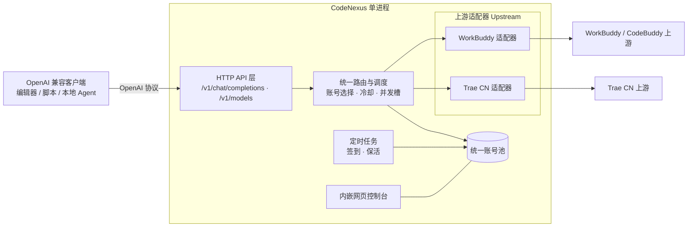

# CodeNexus

> **统一的 AI 编码账号网关** — 把 WorkBuddy / CodeBuddy 与 Trae CN 的账号池，汇聚成一个 OpenAI 兼容 API。
>
> **A unified gateway for AI coding accounts** — merge your WorkBuddy / CodeBuddy and Trae CN account pools into a single OpenAI-compatible API.

<p align="center">
  
  
  
  
</p>

**中文** · [English](#english)

---

## ⚠️ 免责声明（请先阅读）

本项目是一个**非官方、逆向实现**的本地网关，用于把**你个人账号**的既有额度集中暴露为 OpenAI 兼容接口，方便自用工具（编辑器、脚本、本地 Agent）统一调用。

- 仅限**你本人拥有并合法使用的账号**，且仅用于**本机 / 私有环境自用**；
- 明确**反对**：批量注册小号对外提供付费 API、共享账号池、二次加壳售卖、任何商业转售；
- 逆向接口随时可能被上游变更而失效，且可能**违反上游平台服务条款**，存在**账号封禁**风险；
- 凭证以**明文**落盘（见 `auths/` 等目录），请勿外传、勿提交到公开仓库、勿对外暴露监听端口。

**继续使用即代表你已知悉并自行承担上述风险。** The authors assume no liability for any account suspension or terms-of-service violation.

---

## 简介

`CodeNexus` 的目标是把两套已在用、各自成熟的工具**收敛为一个**：

| 来源 | 角色 | 现状 |
|---|---|---|
| [`linguo2625469/workbuddy2api-panel`](https://github.com/linguo2625469/workbuddy2api-panel) | WorkBuddy / CodeBuddy 账号 → OpenAI API | 已实测可用 |
| [`autumnsentiment/Trae2api-cn`](https://github.com/autumnsentiment/Trae2api-cn) | Trae CN 账号 → OpenAI API | 已实测可用 |

两者对外都已是 OpenAI 兼容接口，但各自独立运行、各自一套账号池与控制台。`CodeNexus` 以 `workbuddy2api-panel` 的**单二进制 + 内嵌网页控制台**架构为主要参考，引入**统一网关层**，让「一个进程、一个面板、一个 `base_url`」同时托管两类账号。

---

## 特性

> 状态：🚧 早期骨架。以下为目标特性，实现进度见 [`docs/ROADMAP.md`](docs/ROADMAP.md)。

- **统一 OpenAI 兼容 API**：`/v1/chat/completions`、`/v1/models`，流式（SSE）与非流式。
- **多源账号池**：同一池内混合 WorkBuddy/CodeBuddy 与 Trae CN 账号，按来源、积分、可用性调度。
- **上游适配器**：可插拔的 `Upstream` 接口，每个来源实现自己的鉴权、请求、流式解析与错误映射。
- **调度与容错**：顺序 / 积分优先轮询、每账号并发槽位、429 冷却与指数退避、熔断。
- **内嵌网页控制台**：账号管理、用量与积分看板、任务中心、在线改配置、运行日志（前端随二进制 embed）。
- **自动签到 / 保活**：按本地时区定时的签到、活跃、保活任务（可逐项开关）。
- **单文件部署**：Go 编译为单二进制，前端已内嵌，拷到任意机器即可运行。

---

## 架构



设计要点：

1. **入口统一、出口适配**：对外只暴露一套 OpenAI 协议；对内通过 `Upstream` 接口屏蔽两套上游的差异。
2. **池与调度解耦**：账号池只关心「有哪些凭证、状态如何」，调度器只关心「这次请求该选谁」。
3. **控制台与 API 同源**：单一二进制同时服务 API 与控制台，部署面最小。

---

## 支持的账号来源

| 来源 | 形态 | 出口协议 | 备注 |
|---|---|---|---|
| WorkBuddy / CodeBuddy | 账号池 + 网页控制台 | OpenAI Chat | 以 `workbuddy2api-panel` 为参考 |
| Trae CN | 账号池 + 网页控制台 | OpenAI Chat | 以 `Trae2api-cn` 为参考，含 9074 设备级风控退避 |

---

## 项目状态

🚧 **设计 / 骨架阶段**：本仓库当前**仅包含项目说明与文档，尚无可运行代码**。约定的技术栈（Go 单二进制 + 内嵌网页控制台 + 统一网关）与实现计划见 [`docs/ROADMAP.md`](docs/ROADMAP.md)。

规划中的使用方式：

```bash
git clone https://github.com/ZicongCheung/CodeNexus.git
cd CodeNexus
# 构建与启动命令将在 P0 阶段落地
```

首次启动将在工作目录生成 `config.json`（含随机 `api_key`，仅在日志中打印一次），随后浏览器打开 `http://127.0.0.1:7863/panel/`。

---

## 配置（规划）

`config.json` 预期字段（实现中会逐步补齐）：

```jsonc
{
  "listen": "127.0.0.1:7863",     // 监听地址，仅本机时用 127.0.0.1
  "api_key": "",                  // 客户端鉴权用；留空=不鉴权（危险）
  "pool": { "credit_floor": 100, "cooldown_seconds": 600 },
  "upstreams": ["workbuddy", "trae-cn"],
  "schedule": { "checkin_enabled": true, "keepalive_enabled": true }
}
```

> ⚠️ `api_key` 留空等于**完全不鉴权**，即使本机自用也务必设置。

---

## 客户端接入

任何支持「自定义 `base_url` + API Key」的 OpenAI 兼容客户端均可接入：

- `base_url`：`http://127.0.0.1:7863/v1`
- `api_key`：`config.json` 中的 `api_key`
- `model`：从 `GET /v1/models` **动态获取**（上游模型目录随时变化，硬编码会 404）

```python
from openai import OpenAI

client = OpenAI(base_url="http://127.0.0.1:7863/v1", api_key="<your-key>")
print([m.id for m in client.models.list().data])  # 先取真实模型 id
resp = client.chat.completions.create(
    model="<上一步的某个 id>",
    messages=[{"role": "user", "content": "你好"}],
    stream=True,
)
for chunk in resp:
    print(chunk.choices[0].delta.content or "", end="")
```

---

## 项目结构

> 当前为文档骨架；代码目录将在实现阶段按下方规划创建。

```
CodeNexus/
├── docs/                  # 设计与路线图文档
├── README.md
├── CONTRIBUTING.md
├── LICENSE
└── .gitignore

# 规划中（尚未创建）：
# ├── cmd/codenexus/        # 程序入口
# └── internal/            # 核心实现 api / router / pool / upstream / panel / store
```

---

## 路线图

见 [`docs/ROADMAP.md`](docs/ROADMAP.md)。概览：

1. **P0 骨架** — 目录、配置、HTTP 服务与 `/healthz`。
2. **P1 上游适配器** — 抽象 `Upstream` 接口，落地 WorkBuddy 与 Trae CN 两个实现。
3. **P2 账号池与调度** — 统一池、轮询、冷却、并发槽。
4. **P3 统一 API** — `/v1/models`、`/v1/chat/completions`（流式/非流式）。
5. **P4 控制台与任务** — 内嵌网页控制台、签到/保活调度。
6. **P5 打包** — 单二进制 + 前端 embed，跨平台构建。

---

## 贡献

见 [`CONTRIBUTING.md`](CONTRIBUTING.md)。请勿在 issue / PR 中粘贴任何真实凭证。

---

## 致谢

本项目建立在以下开源工作之上，特此致谢：

- [`linguo2625469/workbuddy2api-panel`](https://github.com/linguo2625469/workbuddy2api-panel) — 架构主要参考（Go 单文件 + 内嵌控制台 + 多账号池 + 自动签到）。
- [`autumnsentiment/Trae2api-cn`](https://github.com/autumnsentiment/Trae2api-cn) — Trae CN 上游适配与风控处理参考。

---

## 许可证

[MIT](LICENSE) © 2026 ZicongCheung

---
---

# English

> **CodeNexus** — A unified gateway that merges your **WorkBuddy / CodeBuddy** and **Trae CN** account pools into a single **OpenAI-compatible API**.

## ⚠️ Disclaimer

This is an **unofficial, reverse-engineered** local gateway that exposes **your own accounts'** quotas as an OpenAI-compatible endpoint for personal use.

- For **accounts you own and are legally allowed to use**, **locally / in private** only.
- Explicitly **opposed**: bulk-registering throwaway accounts to resell paid APIs, shared pools, repackaging/reselling.
- Reverse-engineered endpoints may break at any time and may **violate the upstream platform's Terms of Service**, risking **account suspension**.
- Credentials are stored in **plaintext** on disk. Never commit them, share them, or expose the listening port publicly.

**Use at your own risk.**

## Features

- **Unified OpenAI-compatible API** — `/v1/chat/completions`, `/v1/models` (streaming + non-streaming).
- **Multi-source account pool** — WorkBuddy/CodeBuddy and Trae CN in one pool, scheduled by source, credits and availability.
- **Pluggable upstreams** — an `Upstream` interface; each source implements its own auth, request, streaming and error mapping.
- **Scheduling & resilience** — round-robin / credit-priority, per-account concurrency slots, 429 cooldown with exponential backoff, circuit breaking.
- **Embedded web console** — account management, usage/credit dashboard, task center, live config, runtime logs.
- **Auto check-in / keep-alive** — scheduled tasks (individually toggleable).
- **Single-binary deployment** — Go single binary with the frontend embedded.

## Status & Quick Start

🚧 **Design / scaffolding stage** — this repository currently contains **documentation only; no runnable code yet**. See [`docs/ROADMAP.md`](docs/ROADMAP.md) for the planned Go-based stack and implementation phases.

```bash
git clone https://github.com/ZicongCheung/CodeNexus.git
cd CodeNexus
# build & run commands will land in the P0 phase
```

## Client Usage

- `base_url`: `http://127.0.0.1:7863/v1`
- `api_key`: the `api_key` from `config.json`
- `model`: fetch dynamically from `GET /v1/models`

## Credits

Built upon [`linguo2625469/workbuddy2api-panel`](https://github.com/linguo2625469/workbuddy2api-panel) (primary architectural reference) and [`autumnsentiment/Trae2api-cn`](https://github.com/autumnsentiment/Trae2api-cn).

## License

[MIT](LICENSE) © 2026 ZicongCheung
