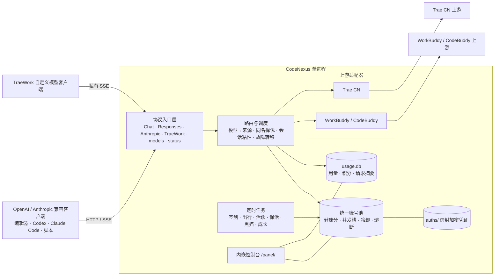

# CodeNexus

> **本机 AI 编码账号网关** — 把 WorkBuddy / CodeBuddy 与 Trae CN 的账号，汇聚成一个 OpenAI 兼容 API。
>
> **A local gateway for AI coding accounts** — pool your WorkBuddy / CodeBuddy and Trae CN accounts behind a single OpenAI-compatible API.

<p align="center">
  
  
  
  
  
</p>

**中文** · [English](#english)

---

## ⚠️ 免责声明（请先阅读）

本项目是一个**非官方、本地自用**的账号网关，用于把**你个人账号**的既有额度集中暴露为 OpenAI 兼容接口，方便自用工具（编辑器、脚本、本地 Agent）统一调用。

- 仅限**你本人拥有并合法使用的账号**，且仅用于**本机 / 私有环境自用**；
- 明确**反对**：批量注册小号对外提供付费 API、共享账号池、二次加壳售卖、任何商业转售；
- 上游接口可能随时变更而失效，且可能**违反上游平台服务条款**，存在**账号封禁**风险；
- 凭证以**信封加密**落盘，请勿外传、勿提交到公开仓库、勿对外暴露监听端口。

**继续使用即代表你已知悉并自行承担上述风险。** The authors assume no liability for any account suspension or terms-of-service violation.

---

## 简介

`CodeNexus` 是一个 **Go 单二进制**：一个进程、一个端口、一个控制台、一个 `base_url`，同时承载两类上游账号与三类对外协议。

| 来源 | 上游形态 | 对外协议 |
|---|---|---|
| WorkBuddy / CodeBuddy | 事件链对话（`eventchain`）+ 任务/额度接口 | OpenAI Chat |
| Trae CN | `remote` / `solo` / `ide` / `work-agent` + 自动路由 + 本机 `cli` | OpenAI Chat · Responses · Anthropic Messages |

对调用方而言来源是透明的：模型名扁平化，同名模型跨来源按健康度择优；需要固定来源时用 `source/model` 别名。

---

## 能力一览

**协议入口**

- OpenAI Chat、OpenAI **Responses**（Codex，含 `previous_response_id` 进程内续链）、**Anthropic Messages**（Claude Code），流式（SSE）与非流式全覆盖。
- `/v1/messages/count_tokens`：本地估算，不触达上游、不计费。
- **TraeWork「自定义模型」入站**：`/api/ide/v2/llm_raw_chat`、`/api/agent/v3/llm_raw_chat_custom_model`、`/api/agent/v3/custom_model_proxy/chat`、`/v1/traework/chat`，含连通性探测（`is_preset=false`）与私有累积 SSE 的完整契约对齐。
- 工具调用三向映射（`delta.tool_calls` / `tool_use` / `function_call`）、思考块、图片输入。

**账号池与调度**

- 混池调度：健康分加权（额度 0.35 / 空闲 0.25 / 成功率 0.25 / 临期 0.15），每账号并发槽 `max_in_flight`。
- 首字节前故障转移（默认 3 次）、429 冷却指数退避、熔断（连续 5 次 / 120 秒）、401 自愈换票、会话粘性（默认 30 分钟）。
- `reasoning_effort` 档位映射；**1M / Max 档位**只在账号目录确证 `max_mode=true` 时生效，绝不虚构档位；**自动续写**按阈值 + 相似度防重复，工具回合永不续写。
- 出站改写：指纹清洗（`sanitize_fingerprints`）与工具标记修复（`repair_tool_markup`）。

**账号接入**

- 交互式**设备授权**、**回环浏览器授权**、**手工令牌**（可只给刷新令牌当场换发）、**环境变量注入**、**本机客户端导入**（显式点击，就地解密、信封加密入池，无明文中间文件）；凭证可加密导出/导入迁移。
- 本机 `cli` 上游模式：把请求交给已登录的本机 CLI 子进程，不需要任何令牌，也不写入 `auths/`。

**定时任务**

- 六类任务：**签到 / 出行 / 活跃 / 保活 / 黑猫（`blackcat`）/ 成长**，按 `schedule.*_hours` 整点触发，按账号串行、可逐项开关、启动时补跑。
- 成长任务执行器 **25 项**（账号原生 4 + 桌面端事件链 13 + 小程序事件链 8）。
- 签到遇 `9074` 风控：指数退避 + 设备 ID 轮换重试。

**用量、积分与日志**

- 用量与积分落 SQLite（`modernc.org/sqlite`，纯 Go 无 CGO）：令牌 / 积分双档口径、同时刻环比、逐包明细与到期分布。
- 请求日志走内存环形缓冲 + SSE 流式推送（`Last-Event-ID` 断线续推），不记录提示词与回复内容。

**控制台**（Svelte 5，构建后 `go:embed` 进二进制）

- 六个页面：概览 / 用量管理 / 积分详情 / 任务中心 / 模型详情 / 设置；顶栏两个动作为「添加账号」与「日志抽屉」。
- **概览零上游调用**；模型页逐账号投影实时目录；积分页只展示快照，刷新才逐账号查上游。
- 设置页 **95 个字段**单轨表单（无原始 JSON 逃生口）：**84 项即时生效、11 项标「需重启」**，保存前自动快照 + 面板内一键回滚，危险字段二次确认，支持一键重启。
- 主题三态（跟随系统 / 浅色 / 深色）；深浅两套设计令牌唯一定义在 `web/src/theme.css`。

**部署**

- Go 单二进制（前端已 embed），零运行时依赖；Windows 另有托盘图标（打开面板 / 状态 / 打开日志 / 打开配置目录 / 退出）。
- 6 平台产物（windows / linux / darwin × amd64 / arm64）+ 多架构 Docker 镜像。

---

## 架构



设计要点：

1. **入口统一、出口适配**：对外只暴露统一协议；对内由 `upstream.Upstream` 接口屏蔽差异（鉴权、请求、流式解析、错误分类）。
2. **池与调度解耦**：池只回答「有哪些凭证、状态如何」，路由只回答「这次请求该选谁」。
3. **控制面与数据面同源**：同一二进制同时服务 API、控制台与静态资源，部署面最小。
4. **写操作串行**：同一账号的任务与改配置请求串行执行，重复提交会被拦下。

---

## 协议入口

| 入口 | 路径 | 鉴权 |
|---|---|---|
| OpenAI Chat | `POST /v1/chat/completions` | Bearer |
| OpenAI Responses | `POST /v1/responses` | Bearer |
| Anthropic Messages | `POST /v1/messages` | Bearer / `x-api-key` |
| Anthropic 计 token | `POST /v1/messages/count_tokens` | Bearer |
| 模型目录 | `GET /v1/models` | Bearer |
| TraeWork 入站 | `/api/ide/v2/llm_raw_chat`、`/api/agent/v3/llm_raw_chat_custom_model`、`/api/agent/v3/custom_model_proxy/chat`、`/v1/traework/chat` | Bearer |
| TraeWork 连通性探测 | `/api/agent/v3/custom_model_connectivity_check`、`/api/ide/v1/custom_model_connectivity_check`、`/v1/custom_model/connectivity` | 免鉴权（只回显模型身份） |
| 服务状态 | `GET /status` | Bearer |
| 健康检查 | `GET /healthz` | 免鉴权 |
| 控制台 | `/panel/` | 见下 |

> 监听在 `127.0.0.1` 时控制台开箱即用；一旦绑定非回环地址，管理面要求同一 `api_key`。`api_key` 留空等于**完全不鉴权**，即使本机自用也请务必设置。

---

## 项目结构

```
CodeNexus/
├── cmd/codenexus/     # 入口：main · 托盘 · 控制台窗口 · 自动开浏览器
├── internal/          # 全部后端逻辑：api（协议入口）· upstream（两个适配器）· pool · scheduler
│                      #   · growth · rewrite · usagestore · reqlog · config(configschema) · panel
├── web/               # 控制台前端（Svelte 5 + Vite），构建产物 embed 进 internal/panel/dist
├── scripts/           # build.sh（构建/发布唯一事实源）· package.py · checksums.py · make-icons.py
├── docs/              # EXECUTION_PLAN（ADR 与协议事实）· ROADMAP（分阶段进度）
├── .github/workflows/ # ci.yml（push / PR）· release.yml（tag 发布）
└── Dockerfile · go.mod · config.json（首启生成，不入库）· README.md
```

---

## 快速开始

### 源码构建

需要 **Go 1.26+**（前端构建另需 Node 22+）：

```bash
git clone https://github.com/ZicongCheung/CodeNexus.git
cd CodeNexus
bash scripts/build.sh build        # 本平台产物 → dist/<os>-<arch>/
# 或：go build -o codenexus ./cmd/codenexus
```

首次启动在工作目录生成 `config.json`（含随机 `api_key`，**仅在日志中打印一次**），随后自动打开 `http://127.0.0.1:6828/panel/`。

`scripts/build.sh` 是构建与发布的**唯一事实源**（CI 只调用它，不复制任何构建步骤）：

| 命令 | 作用 |
|---|---|
| `bash scripts/build.sh build` | 构建当前平台产物（先重建并 embed 控制台） |
| `bash scripts/build.sh release` | 构建 6 平台 + 归档 + `SHA256SUMS` |
| `bash scripts/build.sh docker` | 多架构镜像（`linux/amd64,linux/arm64`，需 buildx） |
| `bash scripts/build.sh test` | gofmt + `go vet` + `go test ./...` |
| `bash scripts/build.sh web` / `icons` / `res` | 重建控制台 / 图标 / Windows 资源对象 |
| `bash scripts/build.sh clean` | 删除 `dist/` |

环境变量：`VERSION=`（覆盖版本号，默认取 `git describe`，无 tag 时 `0.1.0`）、`SKIP_WEB=1`（跳过前端重建，用已提交的 bundle）。

### Windows 双产物

发布包内有两个可执行文件：

- **`CodeNexus.exe`** — 双击即用，无控制台黑框；日志写入 `data_dir/codenexus.log`；启动后托盘常驻。
- **`CodeNexus-console.exe`** — 保留控制台窗口，日志直出终端，用于排障。

托盘菜单：**打开面板 / 状态 / 打开日志 / 打开配置目录 / 退出**。命令行开关：`-config`、`-no-browser`、`-no-tray`、`-version`。

凭证可加密迁移（口令派生，另读 `CODENEXUS_PASSPHRASE`）：

```bash
codenexus auth export -config config.json -out bundle.json
codenexus auth import -config config.json -in  bundle.json
```

### Docker

多阶段镜像（面板在镜像内构建，运行时 alpine、非 root、含 `HEALTHCHECK`）：

```bash
docker build -t codenexus .
docker run -d --name codenexus -p 6828:6828 \
  -v "$PWD/data:/app/data" -v "$PWD/auths:/app/auths" codenexus
# 多架构：bash scripts/build.sh docker   （需 buildx，可选 IMAGE= / PUSH=1）
```

---

## 配置

`config.json` 在首次启动时自动生成（含随机 `api_key`，仅在日志中打印一次）。**字段的权威定义在 `internal/configschema`，编辑入口是控制台「设置」页** —— 95 个字段全部可视化，每一项都标注了「即时生效」还是「需重启」，所以这里只列最常改的几组：

| 组 | 关键字段 | 作用 |
|---|---|---|
| 服务 | `listen` · `api_key` · `auth_dir` · `data_dir` | 监听地址、客户端密钥、凭证与数据目录 |
| 账号池 | `pool.credit_floor` · `pool.max_in_flight` · `pool.failover_attempts` · `pool.breaker_*` | 额度下限、每账号并发槽、首字节前换号次数、熔断阈值 |
| 会话与路由 | `session_sticky` · `router` | 会话粘性（默认 30 分钟）、扁平命名与同名择优策略 |
| 定时任务 | `schedule.*_hours` · `schedule.*_enabled` | 签到 / 出行 / 活跃 / 保活 / 黑猫 / 成长的整点与开关 |
| 上游 | `upstreams.workbuddy` · `upstreams.trae-cn` | 启用、`upstream_mode`、超时、设备身份、签到退避、`auto_continue`、`max_mode` |
| 协议与流 | `responses.*` · `stream.stall_seconds` | `previous_response_id` 续链缓存、流式无进展看门狗 |
| 出站改写 | `features.sanitize_fingerprints` · `features.repair_tool_markup` | 指纹清洗、工具标记修复 |
| 观测 | `request_log` · `usage_store` | 内存日志条数、SQLite 用量库上限 |

一个最小可用配置就够跑起来（未写的字段一律取内置默认值，见 `internal/config/config.go` 的 `Default()`）：

```jsonc
{
  "listen": "127.0.0.1:6828",
  "api_key": "cnx-...",        // 留空等于完全不鉴权，首启自动生成
  "auth_dir": "./auths",
  "data_dir": "./data"
}
```

### 配置生效方式

设置页是编辑配置的**唯一入口**（没有原始 JSON 逃生口）。字段元数据集中在 `internal/configschema`，共 **95 项**：

- **84 项即时生效**：保存即写入 `config.json` 并热加载，无需重启；
- **11 项需重启**：`listen`、`api_key`、`data_dir`、`auth_dir`、`security.key_provider`、`security.encrypt_credentials`、`usage_store.path`、`responses.ttl_seconds`、`responses.max_entries`、`responses.max_bytes`、`responses.max_messages` —— 面板会标注并提供一键重启（含新监听地址试绑）。

每次保存前自动生成配置快照（`data_dir/config-snapshots/`），面板内可一键回滚到任意快照；危险字段保存需二次确认（后端 409 兜底）。

### 本机 Trae CLI 模式

把来源 B 的请求交给本机已安装并登录的 Trae CLI 子进程，**不需要任何令牌**：

- 可执行文件按 `cli.command` → `CODENEXUS_TRAE_CLI_COMMAND` → 内置候选名（`traecli` / `trae-cli` / `traex` / `trae`）依次定位。
- **与账号池互斥**：CLI 自持登录态，面板会显示一个标记为「本机」的占位条目——它没有额度、不可展开任务、**绝不写入 `auths/`**，面板明确显示「无账号额度」而不是拿 0 充数。
- 参数、输出模式、并发、超时、工具禁用清单、转录长度上限都是适配器内置默认，不暴露到面板。
- CLI 返回的 `usage` / `credits_*` 照常进入用量与结算记录。

### 从本机导入账号

面板「添加账号 → 从本机导入」读取本机 Trae 客户端存储（`%APPDATA%` 下 `Trae CN` / `TRAE SOLO CN` / `Trae` / `TRAE SOLO` 中首个令牌仍有效者），就地解密后**信封加密**入池。这是**显式点击**：网关不会在后台扫描本机磁盘，导入过程不产生明文中间文件。

---

## 环境变量

适合无头部署（凭证由平台 Secret 管理，不落盘）：

| 变量 | 作用 |
|---|---|
| `CODENEXUS_LISTEN` | 覆盖监听地址 |
| `CODENEXUS_API_KEY` | 覆盖 `api_key` |
| `CODENEXUS_WORKBUDDY_TOKEN` / `_REFRESH_TOKEN` / `_UID` / `_DOMAIN` / `_EXPIRES_AT` / `_EXPIRES_IN` | 注入一个 WorkBuddy 账号 |
| `CODENEXUS_TRAE_TOKEN` / `_REFRESH_TOKEN` / `_UID` / `_LABEL` / `_EXPIRES_AT` / `_EXPIRES_IN` | 注入一个 Trae CN 账号（`_UID` 可省，会从 JWT 读取） |
| `CODENEXUS_TRAE_CLI_COMMAND` / `_CLI_ARGS` | 覆盖 `cli` 模式的可执行文件与基础参数 |

> 经环境变量注入的账号是**临时账号**：可用但不写入 `auths/`，进程退出即消失。

---

## 客户端接入

任何支持「自定义 `base_url` + API Key」的客户端均可接入：

- `base_url`：`http://127.0.0.1:6828/v1`
- `api_key`：`config.json` 中的 `api_key`
- `model`：从 `GET /v1/models` **动态获取**（上游目录随时变化，硬编码会 404）

```python
from openai import OpenAI

client = OpenAI(base_url="http://127.0.0.1:6828/v1", api_key="<your-key>")
print([m.id for m in client.models.list().data])   # 先取真实模型 id

resp = client.chat.completions.create(
    model="<上一步的某个 id>",
    messages=[{"role": "user", "content": "你好"}],
    stream=True,
)
for chunk in resp:
    print(chunk.choices[0].delta.content or "", end="")
```

Claude Code / Codex 这类按协议区分的客户端：

```bash
# Anthropic Messages
export ANTHROPIC_BASE_URL=http://127.0.0.1:6828
export ANTHROPIC_AUTH_TOKEN=<your-key>

# OpenAI Responses（Codex）
export OPENAI_BASE_URL=http://127.0.0.1:6828/v1
export OPENAI_API_KEY=<your-key>
```

需要固定来源时用 `source/model` 别名（如 `trae-cn/<模型 id>`），否则走同名择优。

---

## 控制台

`http://127.0.0.1:6828/panel/` —— 围绕「这一页能回答什么问题」组织：

| 页面 | 回答的问题 | 数据来源 |
|---|---|---|
| **概览** | 池子现在健康吗？额度还够几天？队列堵不堵？ | **零上游调用**：池快照 + 本机指标 |
| **用量管理** | 谁在花令牌 / 积分？趋势与环比如何？ | `usage.db` 纯 SQL 聚合，令牌 / 积分双口径 |
| **积分详情** | 每个账号还有多少、哪些包快过期？ | 余额快照（刷新才逐账号查上游） |
| **任务中心** | 签到 / 出行 / 活跃 / 保活 / 黑猫 / 成长跑到哪了？ | 逐账号任务目录 + 待办队列 |
| **模型详情** | 每个账号能用哪些模型、多少上下文、什么档位？ | 逐账号投影实时目录 |
| **设置** | 改配置，什么时候生效？ | `configschema` 单轨表单 + 快照回滚 |

另有：顶栏「添加账号」（设备授权 / 令牌 / 批量导入）、「日志」抽屉（SSE 实时流，支持频道与级别筛选）、外观三态切换。

---

## 项目状态

**v0.1.0** — P0–P6 全部落地：两个来源的账号体系、统一池与模型路由、签到/风控/额度结算、本机导入与 `cli` 上游模式、三线协议入口 + TraeWork 入站、用量落库、控制台（含概览 / 模型 / 额度三类补齐）、配置热生效、打包与发布。

| 阶段 | 内容 | 状态 |
|---|---|---|
| P0 | 骨架与可运行闭环（入口、配置、`/healthz`、上游接口） | ✅ |
| P1 | 来源 A 完整实现（事件链、签到、任务、成长、额度、日志） | ✅ |
| P2 | 来源 B 基础链路（四种认证、Remote 端点、统一池） | ✅ |
| P3 | 来源 B 认证补齐与风控（本机导入、`cli`、`9074` 退避、回合级结算） | ✅ |
| P4 | 协议超集与高级能力（三线入口、工具闭环、图片、续写、1M 档） | ✅ |
| P5 | 统一控制台 + 任务合并 + 配置热生效 + 凭证加密 | ✅ |
| P6 | 打包与发布（6 平台 + Docker + 双 Windows 产物 + CI） | ✅ |

后续可选（v1 明确不做）：来源 B 桌面端原生桥出站传输（依赖私有 DLL，与单二进制目标冲突）。

发布由 CI 完成：推送形如 `v0.1.0` 的 tag 会触发 [`.github/workflows/release.yml`](.github/workflows/release.yml)，测试通过后构建全部平台并发布 GitHub Release（归档 + `SHA256SUMS`）。

---

## 贡献

见 [`CONTRIBUTING.md`](CONTRIBUTING.md)。请勿在 issue / PR 中粘贴任何真实凭证。

---

## 许可证

[MIT](LICENSE) © 2026 ZicongCheung

---
---

# English

> **CodeNexus** — a local gateway that pools your **WorkBuddy / CodeBuddy** and **Trae CN** accounts behind a single **OpenAI-compatible API**. One Go binary, one port, one console.

**v0.1.0**

## ⚠️ Disclaimer

This is an **unofficial, local, self-hosted** account gateway that exposes **your own accounts'** quotas as an OpenAI-compatible endpoint for personal use.

- For **accounts you own and are legally allowed to use**, **locally / in private** only.
- Explicitly **opposed**: bulk-registering throwaway accounts to resell paid APIs, shared pools, repackaging/reselling.
- Upstream endpoints may break at any time and may **violate the upstream platform's Terms of Service**, risking **account suspension**.
- Credentials are stored **encrypted**. Never commit them, share them, or expose the listening port publicly.

**Use at your own risk.**

## Features

- **Protocol superset** — OpenAI Chat, OpenAI **Responses** (Codex, with `previous_response_id` continuation), **Anthropic Messages** (Claude Code) and `count_tokens`; streaming and non-streaming.
- **TraeWork "custom model" ingress** — the raw-chat aliases plus the connectivity probe, matching the desktop client's contract frame by frame.
- **Mixed account pool** — health-weighted scheduling (credits / idle / success rate / expiring), per-account concurrency slots, pre-first-byte failover, 429 cooldown with exponential backoff, circuit breaking, session stickiness, 401 self-healing.
- **Model routing** — flat names with cross-source auto-select, `source/model` aliases to pin an exact source, dynamic catalogue from `GET /v1/models`.
- **Account onboarding** — device authorization, loopback browser login, manual token, environment variables, one-click import from the local client; all credentials sealed with envelope encryption (DPAPI / Keychain / Secret Service).
- **Local CLI upstream** — hand Trae requests to an already-logged-in local CLI subprocess; no token, nothing written to `auths/`.
- **Scheduled maintenance** — daily check-in, travel, activity, keepalive, blackcat and 25 growth-task executors, with `9074` risk-control backoff and device rotation.
- **Usage & credits** — SQLite (pure Go, no CGO) with token/credit dual accounting, daily trends, per-pack expiry, and an in-memory request log streamed over SSE.
- **Console** — six pages (overview / usage / credits / tasks / models / settings), theme switch, config snapshots, one-click restart, and 95 editable fields (84 hot-applied, 11 restart-only).
- **Single binary** — frontend embedded, no runtime dependencies; Windows ships a windowed build with a tray icon plus a console build.

## Status

P0–P6 are complete and the version is **0.1.0**. See [`docs/EXECUTION_PLAN.md`](docs/EXECUTION_PLAN.md) for the full plan and [`docs/ROADMAP.md`](docs/ROADMAP.md) for progress.

Build from source (Go 1.26+, Node 22+ for the console):

```bash
git clone https://github.com/ZicongCheung/CodeNexus.git
cd CodeNexus
bash scripts/build.sh build       # current platform -> dist/<os>-<arch>/
bash scripts/build.sh release     # 6 platforms + archives + SHA256SUMS
bash scripts/build.sh test        # gofmt + go vet + go test ./...
```

Open `http://127.0.0.1:6828/panel/`.

## Client Usage

- `base_url`: `http://127.0.0.1:6828/v1`
- `api_key`: the `api_key` from `config.json`
- `model`: fetch dynamically from `GET /v1/models`; use `source/model` to pin a source

## License

[MIT](LICENSE) © 2026 ZicongCheung
