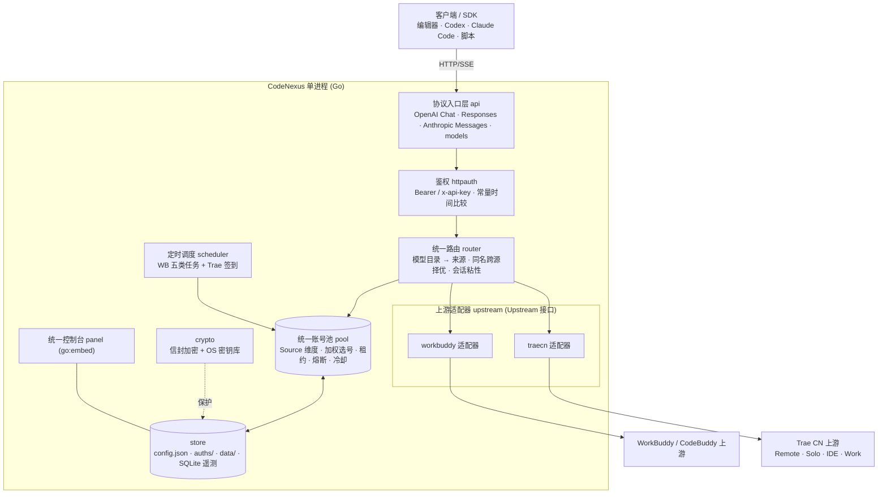

# CodeNexus 执行计划与产品落地文档

> **版本**：v1.0 · 立项定稿
> **日期**：2026-10-14
> **负责人**：张（产品/PM/最终决策）
> **文档状态**：✅ 关键方向已全部拍板，可作为分步开发依据
> **关联文档**：[`README.md`](../README.md) · [`ROADMAP.md`](./ROADMAP.md) · [`CONTRIBUTING.md`](../CONTRIBUTING.md)

---

## 0. 文档信息与修订记录

| 版本 | 日期 | 变更 | 决策人 |
|---|---|---|---|
| v1.0 | 2026-10-14 | 立项定稿；完成 4+3 轮方向拍板，确定纯 Go 单二进制路线 | 张 |
| v1.1 | 2026-10-14 | 追加 ADR-19~23（调度/可靠性）；P0、P1a 完成并入档 | 张 |
| v1.2 | 2026-10-14 | 追加 ADR-24~29（P1b 批次/授权/加密/面板/控制台访问/本机凭证）；P1b1 完成并入档 | 张 |
| v1.3 | 2026-10-14 | 追加 ADR-30~32（P1b2 交付节奏 / 调度时区 / 重启补跑） | 张 |
| v1.4 | 2026-10-15 | 追加 ADR-33~36（成长执行器保真度 / 默认开关 / 任务中心写入语义 / 补跑范围收敛）；P1b2 完成并入档 | 张 |
| v1.5 | 2026-10-15 | 追加 ADR-37~40（Trae 授权形态 / 端点范围 / 池语义统一 / 交付节奏）；P2 完成并入档 | 张 |

**阅读指引**

- 只想了解"做成什么样"：读 §1 愿景、§4 决策记录、§11 分期。
- 要动手开发：读 §6 架构、§7 数据模型、§8 协议面、§11 里程碑、§15 团队分工。
- 要评估风险：读 §14 风险登记册。

---

## 1. 项目愿景与定位

**CodeNexus** 是一个**统一的 AI 编码账号网关**：把 `WorkBuddy / CodeBuddy`（腾讯 CodeBuddy 系）与 `Trae CN`（字节 Trae 中国版）两套账号池，收敛进**一个进程、一个端口、一个面板、一个 `base_url`**，对外提供 **OpenAI 兼容 + Codex Responses + Anthropic Messages** 三类接口。

**一句话定位**：*你自有的多个 AI 编码账号，用一个本地网关统一调度，供任意编辑器 / Agent / SDK 直接调用。*

**产品原则（本项目所有取舍的最高依据，按优先级排序）**

1. **体验一致优先**：用户面对的永远是"一个东西"，来源差异被网关屏蔽。
2. **可靠即体验**：上游协议频繁变化时，工具不能"越用越不好用"；高保真与可维护性是体验的一部分。
3. **宁可多花实现成本，不做体验妥协**（用户明确指示：方向选择不考虑实现复杂度）。
4. **安全默认开启**：鉴权、凭证加密、响应安全头默认打开。
5. **合规边界清晰**：仅限自用账号、本机/私有环境。

---

## 2. 目标与非目标

### 2.1 目标（In Scope）

| 编号 | 目标 | 验收口径 |
|---|---|---|
| G1 | 单一进程托管两类账号池 | 一个 `codenexus(.exe)` 同时服务 WB 与 Trae |
| G2 | 对外全协议超集 | `/v1/chat/completions`、`/v1/responses`、`/v1/messages`、`/v1/models` 同时可用 |
| G3 | 模型扁平命名 + 跨源自动择优 | 同名模型按来源健康度自动选择，失败自动回退 |
| G4 | Trae 全量认证来源 | `auto`/`env`/`manual`/`cli`/`web-login` 五种均可添加账号 |
| G5 | Trae 全量四端点 + 自动路由 | Remote/Solo/IDE Agent/Work Agent 可切换，带工具自动走 IDE |
| G6 | WB 现有能力零回归 | WB 全部既有功能在新架构下行为等价 |
| G7 | 统一重设计控制台 | 以"来源"为一等公民的单一面板 |
| G8 | Windows 单机优先交付 | 干净 Windows 机器双击 exe 即可跑通 |
| G9 | 凭证信封加密 | 静态加密 + 可显式导出/导入迁移 |

### 2.2 非目标（Out of Scope，v1 明确不做）

| 编号 | 非目标 | 原因 |
|---|---|---|
| N1 | TraeWork 原生工具链（native bridge，即 `UPSTREAM_MODE=traework-native` 出站传输） | 依赖 Windows + pyzmq + TraeWork 私有 DLL，与"纯 Go 单二进制、零外部依赖"冲突；且**"对外提供 Trae API 给其它 agent/工具"完全不依赖它**（四端点纯 HTTP 即可）。列为 v2 可选。**注意**：TraeWork「自定义模型」入站兼容（纯协议翻译）不属此列，纳入 v1（见 §9.4）。 |
| N2 | 批量注册 / 账号共享池 / 付费转售 | 违反上游条款，项目红线 |
| N3 | 公网多租户 / 计费系统 | 定位为自用网关 |
| N4 | 挂载式插件市场 | 无产品需求 |
| N5 | 移动端 / 桌面 GUI 客户端 | 网页控制台已覆盖 |

---

## 3. 能力盘点（目标能力域）

> 本项目为**全新独立实现**：不复制代码、不逐行移植、不搬运文件；在**功能一致**的前提下做**独立重写、不雷同**（命名与代码结构自成一体）。
>
> **实现依据**：公开协议文档、官方/客户端行为观察、自行抓包与回放样本，**并允许查阅既有实现源码作为协议事实的参考**；但**不得复制其代码表达**（见 ADR-12）。

### 3.1 来源 A · WorkBuddy / CodeBuddy 系

| 维度 | 能力域 |
|---|---|
| 对外协议 | OpenAI Chat（`/v1/chat/completions`）、`/v1/models` |
| 账号 | 浏览器授权登录；多账号池 |
| 任务 | 签到、活跃上报、保活等定时任务 |
| 额度 | 积分 / 余额查询 |
| 可靠性 | 加权选号、会话粘性、429/402 冷却与指数退避、熔断 |
| 出站改写 | 强制流式、思维链注入与回填、指纹脱敏、原生工具标记还原 |

### 3.2 来源 B · Trae CN

| 维度 | 能力域 |
|---|---|
| 对外协议 | OpenAI Chat、Codex Responses、Anthropic Messages、`/v1/models` |
| 上游端点 | Remote / Solo / IDE Agent / Work Agent（四端）+ 自动路由 + 失败回落 |
| 认证 | 五种来源：本地凭证自动发现、环境变量、手工令牌、本地 CLI、浏览器授权 |
| 任务与风控 | 每日签到、风控码退避与设备标识轮换、后台错峰重试 |
| 额度 | 逐请求用量与积分结算（多重优先级 + 后台补偿） |
| 流式与高级 | SSE 心跳、thinking 分离、工具调用、1M 上下文、图片输入、截断自动续写、思考强度映射 |
| 并发 | 多账号顺序 / 额度优先轮询、每账号并发槽与排队 |

### 3.3 能力矩阵（实现总清单）

| 域 | 能力 | 目标期 |
|---|---|---|
| 认证 | 来源 A：浏览器授权；来源 B：本地凭证 / 环境变量 / 手工令牌 / 本地 CLI / 浏览器授权 | P1–P3 |
| 上游 | 两来源适配器；来源 B 四端点 + 自动路由 | P1–P3 |
| 协议 | Chat、Responses、Anthropic Messages、models | P1–P4 |
| 流式 | SSE 重建、心跳、thinking 分离、工具调用 delta | P2–P4 |
| 高级 | 自动续写、1M、图片、思考强度映射、未知模型透传 | P4 |
| 任务 | 签到 / 活跃 / 保活等；来源 B 风控退避 | P1–P3 |
| 用量 | 逐请求记录 + 每日汇总 + 额度结算 | P4 |
| 控制台 | 统一面板（来源为一等公民） | P5 |
| 打包 | Windows 单文件优先 + 跨平台 | P6 |

---

## 4. 关键决策记录（ADR 摘要）

> 以下为与产品负责人逐项确认后的**定稿决策**，开发过程中不得擅自偏移；如需变更须走"提问 → 拍板"流程。

| ID | 决策项 | 定稿结论 | 理由（用户视角） |
|---|---|---|---|
| **ADR-01** | 技术栈 | **纯 Go 单二进制**（标准库优先，零运行时依赖） | 交付形态最纯净、部署最简 |
| **ADR-02** | 对外协议面 | **全协议超集**（Chat + Responses + Anthropic Messages） | Codex / Claude Code / OpenAI SDK 均可直连，体验天花板 |
| **ADR-03** | 模型命名与路由 | **扁平名 + 同名跨源自动择优**，另设前缀别名精确通道 | 最贴近"一个池"直觉，客户端零改动 |
| **ADR-04** | 目标平台 | **Windows 单机优先，兼顾 Linux/macOS** | 匹配实际使用环境 |
| **ADR-05** | 面板形态 | **统一重设计**（来源为一等公民），否决增量扩展/双面板 | 信息架构不随来源增多而碎裂 |
| **ADR-06** | 来源 B 认证 | **全量五种** | 与上游能力对齐，不缩水 |
| **ADR-07** | 来源 B 上游端点 | **全量四端点 + 自动路由** | 工具调用与全模型可用 |
| **ADR-08** | 分期策略 | **双链路先通，能力后补** | 每步可运行验证、风险可控 |
| **ADR-09** | 来源 B 桌面端能力边界 | **原生桥出站传输 v1 不纳入**（v2 可选）；**入站兼容（自定义模型）纳入 v1** | "对外提供来源 B API"不依赖原生桥；入站兼容为纯协议翻译、零原生依赖 |
| **ADR-10** | 凭证安全 | **信封加密 + OS 密钥库（DPAPI/Keychain/Secret Service）**，一步到位取最优 | 静态最强保护 + 显式导出/导入迁移 |
| **ADR-11** | 工程统一源 | 配置/凭证**单一文件源**（`config.json` 双段 + 单一 `auths/`）；遥测**内嵌纯 Go SQLite** | 单一权威源 + 高频数据不膨胀 |
| **ADR-12** | 实现方式与知识产权 | **独立重写、不雷同**：可查阅既有实现源码作为协议事实参考，但**不复制代码、不逐行移植、不搬运文件**，命名与结构独立；**不保留归属、不注明来源** | 用户要求全新项目、功能一致即可；独立表达以规避衍生作品风险 |
| **ADR-13** | 控制台前端 | **Svelte 5 + Vite + TypeScript**，构建产物 `go:embed` 进二进制 | 编译后近乎零运行时开销，体验与性能综合最优 |
| **ADR-14** | 项目标识 | 二进制 / 服务名 `codenexus`；模块 `github.com/ZicongCheung/CodeNexus`；默认监听 `127.0.0.1:6828` | 与既有工具错开端口、默认仅本机更安全 |
| **ADR-15** | P1 账号接入范围 | **全量**：浏览器授权 + 手工导入 + 环境变量 + 指定路径导入（本机凭证自动发现由 ADR-29 收敛） | 体验优先，兼容存量账号 |
| **ADR-16** | P1 池调度策略 | **完整策略**：加权选号 + 冷却指数退避 + 熔断 + 并发槽 + 会话粘性 | 多账号成功率与上下文稳定性最高 |
| **ADR-17** | P1 出站改写管线 | **全量管线**：强制流式 + 角色归一 + 思维链 + 工具配对 + 指纹脱敏 + 标记还原 | 保真度最高，规避上游审核与工具丢失 |
| **ADR-18** | P1 定时任务范围 | **全量**：核心（签到/保活/活跃/余额）+ 成长类 | 功能齐备，对齐上游日常价值 |
| **ADR-19** | 单请求故障转移 | **仅“首字节前”换号重试**（流式一旦已输出首字节即不再换号，错误在流内收尾） | 偶发的单账号限流/超时对用户不可见，且不产生重复内容 |
| **ADR-20** | 会话粘性识别键 | **多信号融合**：`X-Session-Id` → `user` 字段 → （system + 首条 user + 工具集）指纹 | 覆盖面最广，客户端无会话头也能命中，长对话上下文与缓存最稳 |
| **ADR-21** | 选号目标函数 | **复合加权**（额度充足度 + 闲置时长 + 近期成功率）→ Top-K 加权随机 | 既不榨干单一账号，也不冷落闲置账号 |
| **ADR-22** | 全池不可用时的行为 | **短暂等待最早恢复的账号**（上限 `wait_max_seconds`，默认 8s），超时才返回错误并带 `Retry-After` | 多数冷却很短，用户基本感知不到中断 |
| **ADR-23** | 脱敏与标记还原的默认值 | **均默认开启**，按 `features.sanitize_fingerprints` / `features.repair_tool_markup` 可一键关闭；规则保守（拿不准一律原文透出，绝不吞字节） | 默认即获得防护；误伤可即时关闭，标记还原不覆盖真实工具调用 |
| **ADR-24** | P1b 批次切分 | **拆两批**：P1b1 账号接入与自愈 → P1b2 价值与可视（定时任务 + 额度 + 面板） | 账号是一切的输入；先打通真实主链路，避免对着空池开发 |
| **ADR-25** | 浏览器授权形态 | **面板内嵌设备码授权**（面板展示验证码 + 授权链接 → 后台轮询 → 自动入池） | 全程不离开浏览器、零命令行；CLI 子命令仅作后续无头补充 |
| **ADR-26** | 凭证加密落地时点 | **提前到 P1b**：信封加密 + OS 密钥库（DPAPI/Keychain/Secret Service）+ 显式导出/导入 | 账号一落盘即受保护；导出/导入保证跨机迁移，避免明文中间态 |
| **ADR-27** | 面板形态 | **直接按统一信息架构落地**（来源为一等公民的骨架），P5 仅做视觉与交互增强、**不重构** | 避免"过渡视图→推倒重做"的浪费，面板自始即为最终 IA |
| **ADR-28** | 控制台管理面访问控制 | **回环豁免 + 非回环强制 `api_key`**（`Bearer`）；默认 `127.0.0.1` 监听即刻可用，暴露到 LAN 时自动受保护 | 单机零配置可用与远程安全兼得，不牺牲开箱体验 |
| **ADR-29** | 本机客户端凭证自动发现 | **不做自动探测/解密**，对齐参考实现（其亦无此能力）；改为**面板内「指定路径导入」**：读取用户本机导出的凭证 JSON（数组或单对象）→ 校验 → 加密入池；导入支持「粘贴 / 本地路径 / 加密包」三种模式 | 避免对上层客户端私有存储格式的脆弱耦合与合规风险；用户显式导出即意图明确，路径导入同样"少手工" |
| **ADR-30** | P1b2 交付节奏 | **全量一次交付**：调度框架 + 核心任务 + 成长类 + 额度可视 + 请求日志 + 批量运维 | 调度器成本几乎全在框架本身，任务执行体只是增量挂载；分两步会二次改造框架，反而更贵更易回归 |
| **ADR-31** | 定时任务调度时区基准 | **可配置时区，默认 `Asia/Shanghai`**（上游签到/连登按北京时间日界结算） | 日界正确即不漏签/不断连；跨部署环境（如 UTC 云主机）仍正确；无 DST 实际成本 |
| **ADR-32** | 服务停机后的任务补跑 | **持久化 last-run，重启后按宽限窗口补跑一次**（幂等键防重复），落在现有 `data/` 目录 | 停机跨过签到点不再永久漏签；复用本就需要的"迟到补跑宽限"逻辑，边际成本极低 |
| **ADR-33** | 成长类执行器保真度 | **全量对齐参考 25 项**：账号原生 4 + 桌面端事件链 13 + 小程序事件链 8；含事件链协议层（桌面/小程序/Web 指纹与遥测）、专家市场、真实对话取服务端 `requestId`、反作弊节流。**仅排除参考自身也不做的两项**（真实捐赠 `Expert_Philanthropy`、灯塔连接器授权） | 这些"任务"其实是唯一能让账号真正涨额度的路径；少做一项就少一份可用额度。不引入参考回避的高风险动作（真实付费/连接器授权），合规与账号安全不降级 |
| **ADR-34** | 成长任务默认开关 | **全部默认开启**，与参考行为完全一致 | 开箱即得全部收益，用户零配置；面板提供逐项/逐账号手动触发作为可控兜底 |
| **ADR-35** | 面板任务中心写入语义 | **全写入**：目录 + 任务列表 + 接取 + 领取 + 单任务执行 + 单账号执行全部 + 整池批量（签到/活跃/额度/出行/保活）+ 待办队列执行，与参考对齐 | 面板即"运维台"，与 CLI/调度同权；免去 SSH 与命令行，全部操作在一个页面闭环 |
| **ADR-36** | 启动补跑范围收敛（细化 ADR-32） | **仅保号/维护类**（签到、活跃、保活、出行）在宽限窗口内补跑一次；**成长类不补跑** | 成长进度由"行为事件"驱动，事后补跑既无意义又可能触发反作弊；保号类漏一天就真的断签/失效，补跑收益确定 |
| **ADR-37** | 来源 B 授权形态 | **面板内嵌 + 本机回环回调**：面板点「开始授权」→ 网关在回环地址起一次性 `http.Server` 监听回调 → 面板展示授权链接 → 浏览器登录后自动重定向回环地址 → 网关换取令牌入池；另在面板提供「粘贴令牌」通道 | 与来源 A 的设备码体验完全一致（都是"点一下、浏览器登一次、页面自动收号"），零命令行、零手工转贴；回调落在本机回环而非公网，无证书/无端口暴露；粘贴通道覆盖"已从 IDE 取到令牌"的老用户 |
| **ADR-38** | 来源 B 上游端点范围 | **直接全量四端点 + 自动路由**（Remote 会话事件流 / Agent 单跳流式 / IDE 平台 / Work 代理），**一次性实现**，不做"先 Remote 后补" | 端点差异对用户不可见，但决定了"带工具调用是否可用"；先只做 Remote 会静默吞掉调用方工具（会话自带工作区会自行满足文件/Shell 工具），属于体验陷阱；一次做全才能保证"任何客户端形态都可用" |
| **ADR-39** | 来源 B 账号池语义统一 | **统一到池现有语义，不新增并行概念**：来源 B 的积分映射为池的 `credits`；上游 `9074`（设备维度节流）按 **软冷却 + 指数退避** 处理，走与 `429` 完全相同的路径；额度耗尽 `4008` 归为账号级失效，切换账号而非同号重放 | 池里只有一份"健康/额度/冷却"真相，择优、熔断、故障转移对两个来源行为一致；面板与遥测不需要为来源 B 造第二套指标；软冷却让"设备抖动"自我恢复，不误伤账号 |
| **ADR-40** | P2 交付节奏 | **全量一次交付**：四端点 + 自动路由 + 认证（回环/粘贴/环境变量）+ 模型目录 + 跨源模型路由 + 面板接入 | 四端点共享同一套凭证、设备指纹与错误分类，拆开做会二次改造共享层；目录与跨源路由是"能选到模型"的前置，缺一则 P2 无法端到端验收 |

---

## 5. 总体架构

### 5.1 架构图



### 5.2 分层与目录结构（目标）

```text
CodeNexus/
├── cmd/
│   └── codenexus/              # 主服务入口（原 cmd/server）
│       ├── main.go
│       ├── config.go           # 配置加载（双段）
│       └── wiring.go           # 依赖装配 / 适配器注册
├── internal/
│   ├── api/                    # 统一协议入口层
│   │   ├── openai_chat.go      # /v1/chat/completions
│   │   ├── responses.go        # /v1/responses (Codex)
│   │   ├── anthropic.go        # /v1/messages (+count_tokens)
│   │   ├── models.go           # /v1/models
│   │   ├── status.go           # /status · /healthz
│   │   └── ssewriter.go        # 统一 SSE 出站（心跳、delta 组装）
│   ├── upstream/
│   │   ├── upstream.go         # ★ Upstream 接口 + 注册表
│   │   ├── types.go            # 统一请求/响应/事件类型
│   │   ├── sse.go              # 共享 SSE 重建（复用 WB）
│   │   ├── thinking.go         # 思维链（复用 WB）
│   │   ├── sanitize.go         # 指纹脱敏（复用 WB）
│   │   ├── payload.go          # 出站改写（复用 WB）
│   │   ├── workbuddy/          # WB 实现（原 upstream 包体迁入）
│   │   │   ├── client.go
│   │   │   └── {desktop,dsml,streak,travel,report,school,global_models,...}.go
│   │   └── traecn/             # Trae 实现（自 Python 移植）
│   │       ├── client.go
│   │       ├── remote.go       # chat_sessions + events 协议
│   │       ├── ide.go          # IDE Agent 端点
│   │       ├── solo.go         # Solo 端点
│   │       ├── work_agent.go   # Work Agent 端点
│   │       ├── route.go        # 自动路由 + 失败回落
│   │       ├── auth.go         # 5 种认证来源
│   │       ├── decrypt.go      # storage.json AES-128-CBC
│   │       ├── checkin.go      # 9074 设备轮换 + 指数退避
│   │       ├── usage.go        # 用量/积分结算
│   │       ├── images.go       # 图片输入
│   │       └── continuation.go # 截断自动续写
│   ├── pool/                   # 统一账号池（新增 Source 维度）
│   ├── router/                 # 模型→来源 路由与择优（新增）
│   ├── scheduler/              # 合并后的定时任务（P1b2 已落地：槽位对齐 + 分段等待 + 补跑 + last-run 持久化）
│   ├── growth/                 # 成长任务执行器 25 项（账号原生 / 桌面端事件链 / 小程序事件链）
│   ├── panel/                  # 统一控制台（go:embed）；含任务中心与管理接口
│   ├── store/                  # 单一权威源：config/凭证/状态/SQLite
│   ├── crypto/                 # 信封加密 + OS 密钥库（P1b1 已落地）
│   ├── authstore/              # 凭证存储（加密落盘 / 迁移 / 导出导入 / 环境变量）
│   ├── authrefresh/            # 会话令牌刷新与失效自愈（单飞 + 预刷新 + 401 自愈）
│   ├── httpauth/               # 复用
│   ├── reqlog/                 # 每请求日志（P1b2 已落地：内存环形 + stdout，不含提示词与凭据）
│   ├── usage/                  # 用量（并入 SQLite）
│   └── logfmt/                 # 复用
├── web/                        # 面板前端源码（构建后 embed 进 panel）
├── docs/                       # 文档（本文件、ROADMAP 等）
├── scripts/                    # 便携脚本
├── Dockerfile
├── docker-compose.yml
├── go.mod
└── README.md
```

### 5.3 核心接口抽象（★ 关键设计）

新增 Trae 上游的前提是把 WB 的"具体客户端"抽成接口。定稿接口：

```go
// internal/upstream/upstream.go
type Source string
const (
    SourceWorkBuddy Source = "workbuddy"
    SourceTraeCN    Source = "trae-cn"
)

// Upstream 定义"一个来源"必须具备的能力。
// 各来源在 workbuddy/ 与 traecn/ 下实现，通过 registry 注册。
type Upstream interface {
    Source() Source

    // —— 模型与推理 ——
    ListModels(ctx context.Context) ([]ModelSpec, error)
    Chat(ctx context.Context, acc *pool.Account, req *ChatRequest) (*ChatResponse, error)
    ChatStream(ctx context.Context, acc *pool.Account, req *ChatRequest, emit EmitFunc) error

    // —— 账号生命周期 ——
    AuthModes() []AuthMode                                   // 该来源支持的认证来源
    BeginLogin(ctx context.Context, mode AuthMode) (LoginFlow, error)
    Refresh(ctx context.Context, acc *pool.Account) error
    Probe(ctx context.Context, acc *pool.Account) (*AccountProbe, error) // 余额/积分/健康

    // —— 来源特有任务（可选实现）——
    SupportTasks() []TaskKind
    RunTask(ctx context.Context, acc *pool.Account, kind TaskKind) (*TaskResult, error)

    // —— 错误语义归一 ——
    Classify(err error) UpstreamError                        // → 冷却/熔断/禁用 的统一分类
}
```

**设计要点**

1. **入口统一、出口适配**：协议层只认 `Upstream` 接口，不感知 WB/Trae 差异。
2. **池与调度解耦**：`pool` 只管"有哪些凭证、状态如何"；`router` 只管"这次选谁"。
3. **管线复用**：`sse.go`/`thinking.go`/`sanitize.go`/`payload.go` 提为包级公共函数，两来源共用。
4. **来源特有逻辑内聚**：`desktop.go`/`dsml.go`/`travel.go` 归 `workbuddy/`；`remote.go`/`ide.go`/`9074` 归 `traecn/`。

---

## 6. 统一数据模型

### 6.1 统一账号模型

```go
// internal/pool/entry.go（扩展）
type Account struct {
    Source   upstream.Source // workbuddy | trae-cn
    UID      string          // 来源内唯一
    Label    string          // 昵称/备注
    Enabled  bool
    Enterprise bool          // WB 企业版标记（Trae 语义不同，按来源解释）

    Creds    CredentialRef   // 指向 auths/ 下的加密凭证文件
    Meta     AccountMeta     // 账号级元信息（到期、模型开关等）

    // 运行态（可持久化到 state）
    Health        Health       // healthy | degraded | disabled | cooling
    CooldownUntil time.Time
    InFlight      int32
    Credits       int64        // WB 积分 / Trae 通用积分（统一为"额度"抽象）
    LastError     string
    SuccessCount  int64
    FailCount     int64
}
```

**统一"额度"抽象**：WB 用 credits、Trae 用通用积分，语义相近但量纲不同 → 池内统一为 `Credits int64` + `CreditUnit string`（展示层按来源格式化），**不做跨来源额度换算**（避免误导）。

### 6.2 统一凭证存储

```text
auths/
├── workbuddy-<uid>.json.enc     # 信封加密：{wrapped_dek, nonce, ciphertext, alg, kid}
└── trae-<uid>.json.enc
```

- 明文凭证仅在**内存**中存在；落盘一律加密（ADR-10）。
- 解密流程：OS 密钥库取 KEK → 解 `wrapped_dek` → AES-256-GCM 解 `ciphertext`。
- 密钥库不可用时：降级为**用户口令派生密钥**（PBKDF2/Argon2id），并在面板显式告警（不静默降级为明文）。
- **导出/导入**：面板提供"加密导出包"（口令保护，`age` 或 PBKDF2+AES-GCM），用于跨机迁移。

### 6.3 统一配置（单一权威源）

`config.json`（**顶层为共享配置，`upstreams` 为双来源分节**）：

```jsonc
{
  "$schema": "./docs/config.schema.json",
  "listen": "127.0.0.1:7863",
  "api_key": "",                       // 留空=不鉴权（危险，首次启动自动生成随机值）
  "auth_dir": "./auths",
  "data_dir": "./data",
  "sqlite_file": "./data/codenexus.db",

  "pool":   { "credit_floor": 100, "max_in_flight": 3, "breaker_threshold": 3, ... },
  "router": { "naming": "flat", "same_name_policy": "auto_healthy", "alias_prefix": true },
  "crypto": { "backend": "os_keystore", "fallback": "passphrase" },
  "schedule": { "checkin_enabled": true, "keepalive_enabled": true, ... },

  "upstreams": {
    "workbuddy": {
      "enabled": true,
      "user_agent": "",
      "prompt": { "mode": "custom", "file": "" },
      "cooldown": { "soft_rate": "600s", "soft_rate_max": "2h" },
      "schedule": { "checkin_hours": [9,21], "travel_hours": [9,21], "activity_hours": [10],
                    "keepalive_hours": [22], "blackcat_hours": [23] },
      "features": { "sanitize_blacklist_fingerprints": true }
    },
    "trae-cn": {
      "enabled": true,
      "auth_source": "auto",             // auto|env|manual|cli|web-login
      "upstream_mode": "remote",         // remote|solo|ide|work-agent|cli
      "auto_route": true,
      "parallel_limit": 2,
      "slot_timeout_seconds": 60,
      "reasoning_verbose": false,
      "auto_continue": { "enabled": true, "max_rounds": 3 },
      "max_mode": { "enabled": false, "models": [] },
      "checkin": { "enabled": true, "time": "08:30", "device_ids": {} },
      "usage": { "session_query": true, "max_history": 1000 }
    }
  }
}
```

**热生效字段**（面板保存后无需重启）：`api_key`、`pool.*`、`router.*`、`schedule.*`、`upstreams.*.auto_route`/`auth_source`/`auto_continue`/`max_mode`/`checkin` 等。
**需重启字段**：`listen`、`auth_dir`、`data_dir`、`crypto.backend`、`upstreams.*.timeout` 等进程装配期依赖项——面板保存时明确提示。

### 6.4 遥测存储（SQLite）

高频数据从 JSONL/JSON 迁入内嵌 **纯 Go SQLite**（`modernc.org/sqlite`，无 CGO，保持单二进制）：

```sql
CREATE TABLE request_log (
  id INTEGER PRIMARY KEY, ts TEXT, source TEXT, account_uid TEXT,
  model TEXT, endpoint TEXT, stream INTEGER,
  prompt_tokens INTEGER, completion_tokens INTEGER, total_tokens INTEGER,
  credits REAL, status TEXT, latency_ms INTEGER, ttfb_ms INTEGER, error TEXT
);
CREATE TABLE usage_daily (
  day TEXT, source TEXT, model TEXT,
  prompt_tokens INTEGER, completion_tokens INTEGER, cache_tokens INTEGER,
  requests INTEGER, credits REAL, PRIMARY KEY(day, source, model)
);
CREATE TABLE task_log (id INTEGER PRIMARY KEY, ts TEXT, source TEXT, uid TEXT,
  kind TEXT, ok INTEGER, detail TEXT);
```

保留策略：`request_log` 默认 7 天 / 100 MiB（沿用 WB 语义）；`usage_daily` 保留 400 天（沿用 Trae 语义）。

---

## 7. 对外协议面设计（ADR-02）

### 7.1 端点矩阵

| 端点 | 方法 | 协议 | 鉴权 | 适用来源 | 阶段 |
|---|---|---|---|---|---|
| `/v1/models` | GET | OpenAI | Bearer | 全 | P1 |
| `/v1/chat/completions` | POST | OpenAI Chat | Bearer | 全 | P1/P2 |
| `/v1/responses` | POST | OpenAI Responses (Codex) | Bearer | 全（Trae 优先） | P4 |
| `/v1/messages` | POST | Anthropic Messages | `x-api-key` 或 Bearer | 全 | P4 |
| `/v1/messages/count_tokens` | POST | Anthropic | 同上 | 全 | P4 |
| `/v1/chat`、`/v1` | POST | OpenAI 兼容别名 | Bearer | 全 | P4 |
| `/status` | GET | 自定义 | Bearer | 全 | P1 |
| `/healthz` | GET | 自定义 | 无 | 全 | P0 |
| `/panel/`、`/panel/api/*` | — | 控制台 | Bearer | 全 | P5 |
| `/web/login*` | — | 浏览器授权 | 无/回调 | Trae | P2 |
| `/v1/traework/chat` 等入站别名 | POST | TraeWork 自定义模型入站（§9.4-A） | Bearer | Trae | P3（可选） |
| `/…/custom_model_connectivity_check` | POST | TraeWork 连通性探测（§9.4-A） | 公开 | Trae | P3（可选） |

### 7.2 协议归一策略

- **统一内部中间表示**：所有入站协议先解析为内部 `ChatRequest`（消息数组 + tools + reasoning 参数 + 图片），再交给 `Upstream`。
- **出站形态按入站协议回填**：
  - 入站 OpenAI Chat → 出站 OpenAI Chat（含 `delta.tool_calls`）。
  - 入站 Responses → 出站 Responses 事件（`function_call`、`*_call_output`、`previous_response_id`）。
  - 入站 Anthropic → 出站 `content_block` 流式事件（`tool_use`/`thinking`）。
- **能力不匹配降级**：某来源不支持某协议特性时，返回**明确的结构化错误**（而非静默改写），并在 `/v1/models` 元数据标注能力位。

### 7.3 模型命名、路由与择优（ADR-03）

```text
GET /v1/models
 → 汇总各来源模型目录（WB: console/enterprises/personal/models；Trae: Remote+Solo 合并目录）
 → 扁平名去重：同名模型合并为一条，附 sources: ["workbuddy","trae-cn"]
 → 同时提供别名通道：workbuddy/<model>、trae-cn/<model>（精确指定用）
```

**路由决策（`internal/router`）**

1. 请求模型为 `source/model` 别名 → 直连该来源。
2. 请求模型为扁平名：
   - 仅一个来源有 → 直连。
   - 多来源有 → 按 `same_name_policy=auto_healthy`：**在健康账号中按加权选号联合择优**；首选失败自动回退到次源（可配置回退开关与回退上限）。
3. 未知模型 → 按 `passthrough` 语义透传到默认来源（可配置）。

---

## 8. 控制台设计（ADR-05：统一重设计）

### 8.1 信息架构（来源为一等公民）

```text
顶部：[全部] [WorkBuddy] [Trae CN]   ← 全局来源切换（贯穿所有视图）
侧栏：
  ├── 概览        统一仪表盘（合并两来源的 tokens/额度/账号健康/任务状态）
  ├── 账号        账号表（按来源分组/筛选）+ 添加账号（按来源选认证方式）+ 批量运维
  ├── 用量        Token 时序 + 明细（按来源/模型/端点维度）
  ├── 额度        积分构成（WB 到期分布 / Trae 通用积分）+ 消费记录
  ├── 任务与签到   合并任务中心（WB 五类任务 + Trae 签到）+ 队列执行
  ├── 模型与档位   模型目录（含来源标记、能力位）+ 思考档位 + 连通性测试
  ├── 配置        在线编辑（共享段 + 双来源分节）+ 热生效提示
  └── 日志        请求日志 + 任务/对话/系统分频道 + 归档检索
```

### 8.2 关键交互原则

- **来源可筛不可乱**：所有列表默认"全部"，来源列为独立标签；切换顶部来源即全局过滤。
- **添加账号向导按来源分流**：选来源 → 展示该来源支持的认证方式（WB: OAuth 浏览器授权；Trae: 五选一）→ 落盘 → 热加载进池。
- **能力位可视化**：模型列表标注 `stream/tools/vision/reasoning/max`，避免用户调用到不支持的能力。
- **安全头沿用 WB**：CSP `default-src 'none'`、无内联脚本、`X-Frame-Options: DENY` 等。

### 8.3 落地进度（相对 §8.1 蓝图）

| 蓝图视图 | 现状 |
|---|---|
| 账号 + 添加账号 + 导入 | ✅ P1b1 已落地（来源分组、健康徽标、设备授权向导、三模式导入）；**P2 扩展**：添加账号页新增「粘贴令牌」通道，来源下拉按后端实际能力（`device_sources`/`manual_sources`）过滤 |
| 任务与签到（合并任务中心） | ✅ P1b2 已落地（批量维护 / 待办队列 / 执行器目录 / 逐账号任务表）；Trae 签到待 P3 并入同一视图 |
| 日志（请求日志） | ✅ P1b2 已落地（统计卡 + 最近请求，3s 轮询；不含提示词与凭据） |
| 概览 / 用量 / 额度 / 模型与档位 / 配置 | ⏳ P4~P5（用量与额度明细依赖 SQLite 迁库） |

> 当前控制台是单页 + 顶部标签（账号 / 任务中心 / 运行日志 / 添加账号 / 导入），与 §8.1 的"侧栏多视图"是同一套 IA 的渐进形态，P5 只做视觉与交互增强，**不重构**（ADR-27）。

---

## 9. Trae 适配器设计要点（移植清单）

### 9.1 认证来源（ADR-06：全量五种）

| 来源 | 机制 | Go 实现要点 | 阶段 |
|---|---|---|---|
| `web-login` | 浏览器授权 → 回调拿 JWT | 内嵌授权助手（Go 重写原 Python helper）：本地 127.0.0.1 回环回调监听 + 面板展示授权链接 + 非阻塞轮询 | ✅ P2 |
| `manual` | 面板粘贴 `Cloud-IDE-JWT`（可只给刷新令牌，网关当场换取） | `upstream.CredentialAcceptor` 校验/派生用户 ID/落盘 | ✅ P2 |
| `env` | 环境变量 `CODENEXUS_TRAE_TOKEN` / `_REFRESH_TOKEN` / `_UID` / `_LABEL`（临时态，不落盘） | 读取 + 归一 + 从 JWT 回读用户 ID | ✅ P2 |
| `auto` | 解密本机 `storage.json` | AES-128-CBC，key=SHA512(salt+machine_id)[:16]，4 组盐，IV=密文前 16B；路径探测 | P3 |
| `cli` | 本地 Trae CLI 子进程 | `os/exec` 启动 CLI，按协议收发（禁本机工具 `Read,Bash,...` 默认项） | P3 |

> 说明：`web-login` 的"轮询"是**面板轮询网关**（`GET /panel/api/auth/poll`），网关自身由回环回调**推**结果，不存在对上游的轮询——上游授权页只做一次重定向。环境变量刻意不使用 Trae 客户端自身的 `TRAE_*` 命名，避免与同机运行的 IDE 互相串号。

### 9.2 四端点与自动路由（ADR-07）

```text
remote      默认；纯聊天走 Agent，创建失败/空响应回落 Work（同账号一次）
solo        Solo 原生端点
ide-agent   带 tools/tool_choice 或工具历史时首选（避免远端工具误报本地文件操作）
work-agent  无工具请求的备选执行器
auto_route  请求带工具 → IDE Agent；纯聊天 → Remote；失败一律回落 Remote
```

**P2 落地形态（两个物理面，覆盖四个逻辑端点）**

| 逻辑端点 | 物理面 | 请求 | 备注 |
|---|---|---|---|
| `remote` / `solo` / `work-agent` | **Remote 会话面**：`POST {RemoteBase}/chat_sessions` → `GET {RemoteBase}/chat_sessions/{id}/events` | 两步：建会话拿 `chat_session_id`/`message_id`；再读事件流 | `mode` = `code` \| `work`，`agent_type` = `solo_agent_remote` \| `solo_work_remote` |
| `ide-agent` | **Agent 单跳面**：`POST {Base}/api/agent/v3/llm_utils_chat` | 一次流式请求，原生接受 `tools` | 带工具时唯一不会"吞掉"调用方工具的面 |

`auto_route`（`upstream_mode: auto-route`，默认）判定规则：请求体带工具协议（`tools` / `tool_choice` / `parallel_tool_calls` / `functions` / `function_call`、`tool`/`function` 角色、`tool_use`/`tool_call`/`tool_result` 内容块）→ 走 Agent 单跳面；否则走 Remote 会话面。**Agent 面失败且属可重试、且尚未向客户端吐出任何首字节时，同账号回落 Remote 一次**；已吐字节则不再重放（沿用 ADR-19 的"仅首字节前换号/换面"原则）。

### 9.3 风控与任务

- **9074 风控码**：签到遇 9074 → 轮换设备 ID（`TRAE_CHECKIN_DEVICE_IDS_JSON` 可指定真实设备 ID）→ 指数退避（基准 60s，封顶 3600s）→ 后台按 `auto_retry_interval`(60s) 错峰重试。
- **定时签到**：默认 `08:30`（北京时间），晚于该时间启动当天补签一次；多账号间间隔 60s；"立即执行"不占用当天定时名额。
- **用量结算**：三重优先级（上游 usage → 回合级 credits_float → 账号差值），账单未落库标"结算中"并后台退避，**不得把未知值伪装成 0**。

### 9.4 TraeWork 能力边界（ADR-09 落地说明）

TraeWork（Trae 桌面 Agent 客户端）相关能力是**两件方向相反的事**，必须区分：

| 场景 | 方向 | 机制 | v1 |
|---|---|---|---|
| **A. 自定义模型入站兼容** | TraeWork 客户端 **→** CodeNexus | 纯协议翻译（`traework_compat` 等价物，**无网络 I/O**）：识别 TraeWork 入站路径/头，解析其请求形状，转成内部 `ChatRequest`，默认经 **remote HTTP** 上游发出 | ✅ **纳入**（成本极低，属"全套功能"；实现为空可整体裁剪） |
| **B. native bridge 出站传输** | CodeNexus **→** 本机 TraeWork 原生运行时 | 加载 `ai_agent.dll` 等私有 DLL + ZeroMQ AHA IPC + JSON-RPC `request_stream`，需独立 Windows helper 进程 | ❌ **不纳入**（v2 可选） |

**A 项入站路径（可选实现）**：`POST /api/ide/v2/llm_raw_chat`、`/api/agent/v3/llm_raw_chat_custom_model`、`/api/agent/v3/custom_model_proxy/chat`、`/v1/traework/chat`，以及 `/api/agent/v3/custom_model_connectivity_check`、`/api/ide/v1/custom_model_connectivity_check`、`/v1/custom_model/connectivity`（连通性探测，可公开）。

**结论（用户已确认）**："把 Trae 的 API 给其它 agent/工具使用" 走的是**四端点纯 HTTP**，与 native bridge 无关；故 B 不影响核心目标，**不引入**。

### 9.5 P2 协议事实与池映射（as-built）

以下为 P2 实现过程中核实并固化的上游事实，后续（P3 风控/任务）在此之上扩展，**不得重新猜测**。

**凭证与刷新**

- 凭证是 `Cloud-IDE-JWT`（三段 JWT，长度 ≥128）。发送时三种头同时带：`Authorization: Cloud-IDE-JWT <tok>`、`X-Cloudide-Token: <tok>`（裸值）、`x-ide-token: <tok>`；`GetUserInfo` 只认 `x-cloudide-token`。
- **过期时间绝不读 JWT 的 `exp`**：一律以上游返回的 `expiredAt`/`TokenExpireAt` 为准（提前 30 分钟刷新，留 5 分钟有效性缓冲）。
- 刷新：`POST {AuthBase}/cloudide/api/v3/trae/oauth/ExchangeToken`，体 `{"ClientID","RefreshToken","ClientSecret":"-","UserID"}`，取 `Result.{Token,RefreshToken,TokenExpireAt}`；无刷新令牌时归为认证类错误（`KindAuth`），不重试。

**Remote 会话面**

- 建会话体（顶层）：`mode`（`code`\|`work`）、`environment_id:"default"`、`initial_message`、`env:"remote"`、`auto_create_project:false`、`origin:"web"`；`initial_message` 内含 `chat_session_id:""`、`content:[]`、`query`（JSON 编码后的扁平对话文本）、`model_name`、`agent_type`、`agent_id`、`model_selection_strategy:"manual"`、`model_config_source:1`。
- 事件流：SSE。事件名 `heartbeat`/`keepalive`/`ping`、`error`、`token_usage`、`plan_item`、`message`/`assistant_message`/`response`/`text`/`output`、`done`、`model_config`、`request_wait_in_queue`；别名 `modelconfig→model_config`、`planitem→plan_item`、`responsedone`/`streamdone`/`response_done`/`stream_done→done`、`tokenusage→token_usage`。
- **快照是累积的**：解析器按"前缀差"只把新增部分吐给客户端；`model_config`/心跳/排队提示属于元数据，**不计入首字节、不产生内容**。终止信号 = 显式 `done` 事件或 `data: [DONE]`。

**Agent 单跳面**

- 体：`{messages, config_name, model, function:"solo_work_lite", stream:true, request_id, session_id, max_tokens?, tools?, tool_choice?, parallel_tool_calls?}`；头含 `x-app-id`、`x-ide-version[-code|-type]`、`x-device-id`、`x-machine-id`、`x-request-id`、`x-device-cpu/brand/type`、`x-os-version`、`x-system-type`、空 `User-Agent`。
- 工具调用在流内以增量形式下发（`tool_call_info` / `tool_call` / `message.tool_calls` / `choices[0].delta.tool_calls` 四种形状），按 index 累积后**去重**只吐一次。

**设备身份**

- IDE 面：`machine_id` = 32 位十六进制、`device_id` = 18~19 位数字，每 3~5 次请求轮换（P3 风控使用）。
- Remote/Web 面：由账号派生，`device_id` 先定，`machine_id = sha256(account_id + device_id + "traework-linux-probe")`，`local_device_id = "aha-" + sha256(...)[:32]`。

**错误分类（映射到池行为，ADR-39）**

| 上游码 | 含义 | 池行为 |
|---|---|---|
| `1001` | 服务端 token 失效 | 认证类错误 → 触发刷新/换号 |
| `4008` | 额度耗尽（账号级） | 账号级失效 → **换号**，不对同账号重放 |
| `4028` | 模型执行器拒绝 | 归为服务端错误 → 可换面/换号 |
| `9074` | 设备维度节流 | **软冷却 + 指数退避**（与 `429` 同路径，≤3600s） |
| `429` / `solo_agent_parallel_limit` | 并发受限 | 冷却（短）+ 换号 |
| `2001` | 应用配置类原始失败 | 服务端错误 |
| `9095` | 签到设备维度拦截（**绝不等于"已签到"**） | P3 处理，轮换设备 ID 重试 |

**用量结算（三重优先级）**

1. 上游显式字段（`credits_consumed` / `consumed_credits` / `credit_cost` / `credits_float`）→ 标 `upstream`；
2. 回合级 `credits_float`：`POST {UsageBase}/api/v1/commercial/get_session_usage`，体 `{"session_id"}`，按 `usage_turn_id`（= `reply_to_message_id`）对齐 → 标 `session_usage`；
3. 同账号快照差值 → 标 `snapshot_delta`；仍无法确定 → `pending`/`unknown`。

**绝不把未知值伪装成 0。**

---

## 10. 调度、可靠性与安全（合并策略）

### 10.1 定时任务合并

| 任务 | 来源 | 默认时刻 | 开关 |
|---|---|---|---|
| 签到 + 余额 | WB | 09/21 整点 | `schedule.checkin_enabled` |
| 连登管家 | WB | 签到末尾 | 随签到 |
| 活跃上报 | WB | 10 整点 | `schedule.activity_enabled` |
| 猫猫旅行 | WB | 09/21 整点 | `schedule.travel_enabled` |
| 保活（刷新 token） | WB | 22 整点 | `schedule.keepalive_enabled` |
| 夜猫子 | WB | 23 整点 | `schedule.blackcat_enabled` |
| 签到（Trae） | Trae | 08:30 | `upstreams.trae-cn.checkin.enabled` |
| 余额后台刷新 | 全 | 每 5 分钟 | `balance_refresh_minutes` |

统一为 `scheduler.Task{Source, Kind, Hours, Enabled}` 注册；空数组/null 表示"回落默认"，禁用须显式 `*_enabled: false`。

**保号类与成长类的分工（P1b2 定稿）**

| 类别 | 族 | 触发方式 | 启动补跑 |
|---|---|---|---|
| 保号/维护类 | 签到、活跃、保活、出行、夜猫子、余额刷新 | 整点槽位（按 `schedule.timezone`，默认 `Asia/Shanghai`） | ✅ 宽限窗口内补跑一次（ADR-32/36） |
| 成长类 | `internal/growth` 的 25 个执行器 | 同上整点槽位，逐个账号串行执行 | ❌ 不补跑（ADR-36） |

调度实现要点：

- **槽位对齐**：`nextFire` 用 `time.Date(y,m,d,h,0,0,0,loc)` 求下一个整点，因此跨时区、跨 DST 都落在"当地整点"；同一小时的多族任务合并成一批并行 `runBatch`。
- **抗睡眠**：把一次长等待切成 60s 的分段墙钟探测，系统休眠/时钟跳变后不会被"睡过头"错过整点。
- **迟到宽限**：醒来晚于计划时刻超过 1s 判为迟到，再给 5s 网络宽限（`wakeupGraceDelay`）供 DNS/连接就绪，然后照样执行。
- **幂等与留痕**：每族每天只跑一次，`last-run` 落 `data/scheduler-state.json`（原子写），重启后据此补跑或跳过。

### 10.2 可靠性

- **错误分类统一**（`Upstream.Classify`）：余额耗尽→硬冷却至次日 04:00；频控(429/6004)→软冷却指数退避；session 失效→连续 3 次才禁用；404→固定 60s；5xx→熔断；内容拦截→不罚账号。
- **会话粘性**：`conversation_id`/`previous_response_id` → 绑定账号，TTL 滚动，失败解绑。
- **租约与并发**：每账号 `max_in_flight`，Trae 另受 `parallel_limit` 会话槽约束。

### 10.3 安全

- 鉴权：Bearer + 常量时间比较 + uid 白名单（防路径穿越）。
- 凭证：信封加密（ADR-10），文件 0600，目录 0700。
- 传输：进程仅明文本机 HTTPS 建议反代；监听默认 `127.0.0.1`。
- 面板：CSP 等安全响应头；`/healthz` 恒无鉴权。

---

## 11. 分期里程碑与验收标准（ADR-08：双链路先通，能力后补）

> 每期结束必须满足"可运行 + 可验证"，并更新 `docs/ROADMAP.md` 勾选状态。

### P0 · 骨架与可运行闭环 ✅（已完成）

| 项 | 内容 |
|---|---|
| 任务 | ① Go 模块 + `cmd/codenexus` 入口（`-config`/`-version`）；② `internal/config`（随机 `api_key` 首启生成/原子写/环境变量覆盖）；③ `internal/httpauth`；④ `internal/upstream` 接口 + 注册表；⑤ `internal/account` + `internal/pool`；⑥ `internal/api` 协议入口；⑦ `internal/upstream/workbuddy` 首个适配器；⑧ `internal/panel` + `web/`（Svelte 脚手架）；⑨ `Dockerfile`/`.dockerignore` |
| 验收 | ✅ **已通过**：`go build/vet/test` 全绿；`/healthz` 200；`/panel/` 200；`/v1/models` 授权 200 / 未授权 401；本地启动端到端闭环验证 |

### P1 · 来源 A（WorkBuddy / CodeBuddy）完整实现

> **P1 范围决策（ADR-15~18，用户拍板：全部取最大范围 / 体验优先）**
> - ADR-15 账号接入：**全量**（浏览器授权 + 手工导入 + 环境变量 + 指定路径导入，见 ADR-29）
> - ADR-16 池调度：**完整策略**（加权选号 + 冷却指数退避 + 熔断 + 并发槽 + 会话粘性）
> - ADR-17 出站改写：**全量管线**（强制流式 + 角色归一 + 思维链 + 工具配对 + 指纹脱敏 + 标记还原）
> - ADR-18 定时任务：**全量**（核心 + 成长类）

| 工作包 | 内容 |
|---|---|
| P1-1 账号接入 | 浏览器授权流程；手工凭证导入；环境变量来源；本机客户端凭证自动发现；凭证落盘（0600，信封加密见 P5）+ token 刷新 |
| P1-2 账号池调度 | 加权选号（额度/闲置）、429/402 冷却指数退避、熔断、每账号并发槽、会话粘性 |
| P1-3 出站改写管线 | 强制 `stream:true`、角色归一、思维链注入/回填、工具配对修复、内容指纹脱敏、原生工具标记还原 |
| P1-4 定时任务 | 签到、保活(token 刷新)、活跃上报、余额后台刷新 + 成长类（旅行/夜猫子/连登/抽奖等），逐项开关 |
| P1-5 额度与可观测 | 积分/余额查询、每请求日志（内存 + stdout；SQLite 落库见 P4） |
| P1-6 面板（来源 A 视图） | 账号列表、添加账号、批量运维（P5 统一重设计前的过渡） |

#### P1a 实现记录（引擎与接入）

| 交付物 | 落地位置 | 状态 |
|---|---|---|
| 凭证存储（0600 原子落盘、校验、来源推断） | `internal/authstore` | ✅ |
| 池状态机（健康/冷却/熔断/模型冷却/并发槽/持久化） | `internal/pool/{entry,pool,lease,persist}.go` | ✅ |
| 自适应选号（复合加权 + Top-K 加权随机 + 额度保底） | `internal/pool/pool.go` | ✅ |
| 会话粘性（多信号融合键 + TTL + GC） | `internal/api/handlers.go` + `internal/pool` | ✅ |
| 单请求故障转移（首字节前换号重试、非重试类不重试） | `internal/api/handlers.go` | ✅ |
| 全池不可用等待最早恢复（上限 + `Retry-After`） | `internal/pool/pool.go` | ✅ |
| 出站改写管线（强制流式 / 角色归一 / token 归一 / 思维链 / 工具配对） | `internal/rewrite` | ✅（核心） |
| 内容指纹脱敏（header 键值/裸键名、`cc_*` 参数、客户端模板句、反探测码） | `internal/rewrite/sanitize.go` | ✅ |
| 原生工具标记还原（非流式 + 跨分片流式缓冲重写器） | `internal/rewrite/markup.go` | ✅ |
| 错误分类核心（kind / 可重试性 / 关键词与状态码映射） | `internal/upstream/classify.go` | ✅ |
| 适配器接入管线与分类 | `internal/upstream/workbuddy/client.go` | ✅ |
| 端到端测试（故障转移 / 粘性 / 冷却 / 熔断 / 持久化） | `internal/**/*_test.go` | ✅ |

| 项 | 内容 |
|---|---|
| 验收 | `go build/vet/test` 全绿；真实账号可完成：登录 → 入池 → 流式对话 → 定时签到/保活 → 面板可见额度；429 触发冷却并能自动恢复；会话粘性命中率可观测 |

#### P1b 批次拆解（ADR-24~27）

> **P1b 决策（用户拍板：全部取推荐档 / 体验优先）**
> - ADR-24 批次切分：**P1b1 账号接入与自愈 → P1b2 价值与可视**
> - ADR-25 授权形态：**面板内嵌设备码授权**
> - ADR-26 凭证加密：**提前到 P1b**（信封加密 + OS 密钥库 + 导出/导入）
> - ADR-27 面板形态：**直接统一信息架构**（来源为一等公民骨架），P5 仅增强

**P1b1 · 账号接入与自愈（先做）**

| 序号 | 任务 | 产出 |
|---|---|---|
| 1 | `internal/crypto` 密钥库：OS 密钥库后端（Windows DPAPI / macOS Keychain / Linux Secret Service）+ 内存降级 | 平台抽象 + 单测（含降级） |
| 2 | 信封加密落盘：每凭证独立 AES-256-GCM 数据密钥，数据密钥由密钥库保护 | `internal/authstore` 升级 + 兼容读取旧的明文凭证（自动迁移加密） |
| 3 | 导出/导入：`codenexus auth export/import`（口令派生密钥包裹） | 跨机迁移闭环 |
| 4 | token 刷新与失效自愈：每账号单飞刷新 + 请求前检查 + 401 自动刷新重试一次 + 原子写回 | `internal/authrefresh`（或并入 authstore）+ 单测 |
| 5 | 授权流程：面板内嵌设备码授权（`/panel/api/auth/start`、`/panel/api/auth/poll`）+ 授权向导 UI | 端到端：面板点添加 → 验证码/链接 → 自动入池 |
| 6 | 手工导入：粘贴 JWT / 完整凭证 JSON，校验后加密落盘 | 面板 + 接口 |
| 7 | 环境变量来源：`CODENEXUS_WORKBUDDY_TOKEN*` 首启注入 | 配置 + 装配 |
| 8 | 本机凭证自动发现 → **改为「指定路径导入」**（ADR-29） | 面板导入（粘贴 / 本地路径 / 加密包三模式） |

**P1b1 实现记录（账号接入与自愈）** ✅

| 交付物 | 落地位置 | 状态 |
|---|---|---|
| OS 密钥库后端（Windows DPAPI / macOS Keychain / Linux Secret Service）+ 文件与内存降级 | `internal/crypto/{keeper,keeper_dpapi_windows,keeper_dpapi_other,keeper_oscli,keeper_file}.go` | ✅ |
| 信封加密核心（AES-256-GCM 数据密钥 + KEK 包裹；PBKDF2 口令模式） | `internal/crypto/envelope.go` | ✅ |
| 加密落盘 + 旧明文自动迁移 + 导出/导入（口令派生密钥包裹） | `internal/authstore/authstore.go` | ✅ |
| 会话令牌刷新与失效自愈（单飞去重 + 后台预刷新 + 请求路径 401 自愈重试一次 + 原子写回） | `internal/authrefresh/authrefresh.go` + `internal/api/handlers.go` | ✅ |
| 设备码授权协议（state / token / account / refresh，cn/global 双区域） | `internal/upstream/workbuddy/auth.go` | ✅ |
| 面板管理接口（会话 / 账号列表 / 移除 / 授权 start+poll / 导入三模式） | `internal/panel/api.go` | ✅ |
| 控制台访问控制（回环豁免 + 非回环 `api_key`）+ 响应安全头 | `internal/panel/panel.go` | ✅ |
| 环境变量来源（`CODENEXUS_WORKBUDDY_*`，以临时账号注入、不落盘） | `internal/authstore/env.go` | ✅ |
| 控制台 UI（来源分组账号表 + 健康徽标 + 设备授权向导 + 导入面板） | `web/src/App.svelte` → `internal/panel/dist` | ✅ |
| CLI 子命令 `codenexus auth export/import` | `cmd/codenexus/main.go` | ✅ |
| 单测（加密往返/降级、迁移幂等、导出导入、单飞刷新、面板接口、设备授权） | `internal/**/*_test.go` | ✅ |

| 项 | 内容 |
|---|---|
| 验收 | `go build/vet/test` 全绿；启动冒烟通过（`/healthz`、`/panel/` 静态资源、`/panel/api/session`、`/panel/api/accounts` 均 200；非回环访问受 `api_key` 保护）；无账号时面板可完成设备授权与三模式导入 |

**P1b2 · 价值与可视（后做）**

> **P1b2 决策（用户拍板：全部取推荐档，体验优先）**
> - ADR-30 交付节奏：**全量一次交付**（调度框架 + 核心任务 + 成长类 + 额度可视 + 请求日志 + 批量运维）
> - ADR-31 调度时区：**可配置时区，默认 `Asia/Shanghai`**（上游签到/连登按北京时区日界结算）
> - ADR-32 重启补跑：**持久化 last-run，宽限窗口内补跑一次**（幂等键防重复，状态落 `data/`）
> - ADR-33 成长执行器保真度：**全量对齐参考 25 项**（含桌面/小程序/Web 事件链协议层、专家市场、真实对话取 `requestId`、反作弊节流）
> - ADR-34 默认开关：**成长任务全部默认开启**（与参考一致），面板提供逐项手动触发兜底
> - ADR-35 任务中心写入语义：**全写入**（接取 / 领取 / 单任务 / 单账号全部 / 整池批量 / 队列执行）
> - ADR-36 补跑范围收敛：**仅保号类**（签到/活跃/保活/出行）补跑，成长类不补跑
> - 其余默认：请求日志为**内存环形 + stdout**（不落 SQLite，待 P4 用量迁库时统一）；面板仅补**批量运维 + 额度可视**（分组/列表/添加已于 P1b1 落地）

| 序号 | 任务 | 产出 |
|---|---|---|
| 1 | 定时任务框架：整点对齐调度 + 抗睡眠分段等待 + 迟到补跑宽限 + 逐项开关 + 可配置时区（ADR-31）+ last-run 持久化与重启补跑（ADR-32/36） | `internal/scheduler` |
| 2 | 核心任务：签到 / 保活(token 刷新) / 活跃上报 / 余额后台刷新 | 任务执行体 + 单测 |
| 3 | 成长类任务：旅行 / 夜猫子 / 连登 / 抽奖 | 任务执行体 |
| 3b | 成长类执行器全量：桌面端/小程序/Web 事件链协议层 + 专家市场 + 真实对话取 `requestId` + 反作弊节流（ADR-33/34） | `internal/upstream/events.go`、`internal/upstream/workbuddy/eventchain.go`、`internal/growth` |
| 4 | 额度与积分查询：账号余额 / 积分构成 | `upstream` 方法 + 接口 |
| 5 | 每请求日志：TTFB / token 速率 / 账号 / 来源（内存环形 + stdout） | `internal/reqlog` |
| 6 | 面板（统一 IA 骨架）：来源分组 + 顶部来源切换 + 账号列表/添加/批量运维 + 任务中心 + 运行日志（ADR-35） | `web/` + `/panel/api/*` |

**P1b2 实现记录（价值与可视）** ✅

| 交付物 | 落地位置 | 状态 |
|---|---|---|
| 调度框架：整点槽位对齐（`nextFire` 以 `time.Date` 按配置时区取整点）+ 抗睡眠分段等待（60s 墙钟探测）+ 迟到补跑宽限（>1s 判迟到，5s 网络宽限）+ 六族并行 `runBatch` | `internal/scheduler/scheduler.go` | ✅ |
| last-run 持久化与启动补跑：`scheduler-state.json` 原子写、幂等；仅维护类补跑（ADR-36），成长类不补跑 | `internal/scheduler/{state,scheduler}.go` | ✅ |
| 维护类执行体：签到（含余额回填）/ 活跃上报 / 保活（token 刷新）/ 出行（领养→到站领取→空转换乘）/ 夜猫子 / 余额刷新 | `internal/scheduler/sweeps.go` | ✅ |
| 成长执行器 25 项（账号原生 4 / 桌面端事件链 13 / 小程序事件链 8） | `internal/growth/{growth,tasks,actions,mini}.go` | ✅ |
| 事件链协议层：桌面/小程序/Web 三套指纹与遥测（`/v2/report`）、外观主题 `user-asset/appearance/set`、专家市场列表、SSE 真实对话取服务端 `requestId` | `internal/upstream/events.go`、`internal/upstream/workbuddy/eventchain.go` | ✅ |
| 反作弊节流与验证：活跃上报 1.05s 间隔、小程序对话 45s±10s 抖动、专家召唤 6s、异步结算轮询与自动领奖 | `internal/growth/growth.go` | ✅ |
| 额度明细：`Credits`（余额/总量/窗口内过期/最早到期），写入池并驱动"最早到期优先"路由 | `internal/upstream/tasks.go`、`internal/pool` | ✅ |
| 每请求日志：TTFB / token 速率 / 账号 / 来源 / 结果分类；内存环形 + stdout，**不含提示词与凭据** | `internal/reqlog`、`internal/api/recording.go` | ✅ |
| 面板任务中心接口：目录 / 任务列表（默认+小程序合并）/ 接取 / 领取 / 单任务 / 单账号全部 / 整池批量 / 队列 / 扫描 / 状态开关 / 额度 | `internal/panel/{panel,tasks}.go` | ✅ |
| 面板可观测接口：`/api/observability/metrics`、`/api/observability/logs` | `internal/panel/tasks.go` | ✅ |
| 控制台 UI：新增「任务中心」（批量维护 / 待办队列 / 执行器目录 / 逐账号任务表与执行结果）与「运行日志」（统计卡 + 最近请求表，3s 轮询） | `web/src/App.svelte` → `internal/panel/dist` | ✅ |
| 装配：调度器随服务启动、余额后台刷新、面板与 API 共用请求日志记录器 | `cmd/codenexus/main.go` | ✅ |
| 单测：调度槽位/补跑/状态持久化、25 执行器表与依赖序、事件链载荷与传输、面板任务中心接口、请求日志结算 | `internal/**/*_test.go` | ✅ |

| 项 | 内容 |
|---|---|
| 验收 | `go build/vet/test` 全绿；启动冒烟通过（`/panel/api/session` 报告 `tasks`/`reqlog` 均可用、`/panel/api/tasks/catalog` 返回 25 项、`/panel/api/tasks/queue` 与 `/panel/api/observability/metrics` 正常、`/panel/` 静态资源为新构建产物）；任务中心可对单账号与整池触发维护/成长任务，运行日志实时可见 |

### P2 · Trae 基础链路打通 ✅（已完成）

| 项 | 内容 |
|---|---|
| 任务 | ① 认证：`web-login`（Go 重写授权助手）、`manual`、`env`；② 上游：Remote 端点 + 模型目录；③ 统一池（Source 维度）+ 模型路由（扁平名 + 同名择优）；④ `/v1/chat/completions` 流式/非流式 |
| 验收 | 从面板添加 Trae 账号 → 通过 CodeNexus 完成一次流式对话；同名模型跨源择优生效 |

**P2 决策（ADR-37~40，用户拍板：全部取推荐档 / 体验优先）**

> - ADR-37 授权形态：**面板内嵌 + 本机回环回调**（另附「粘贴令牌」通道）
> - ADR-38 端点范围：**直接全量四端点 + 自动路由**，一次实现
> - ADR-39 池语义：**统一到池现有语义**（积分→`credits`；`9074`→软冷却 + 指数退避，与 `429` 同路径）
> - ADR-40 交付节奏：**全量一次交付**

**P2 实现记录（Trae 基础链路）** ✅

| 交付物 | 落地位置 | 状态 |
|---|---|---|
| 模型目录与别名（34 项内置 + 家族展开；大小写敏感的上游 `config_name` 映射；未知名透传） | `internal/upstream/traecn/model.go` | ✅ |
| 凭证原语：`LooksLikeToken`、`TokenUserID`（JWT 内多路径读 uid）、时间戳多形态解析、设备标识生成 | `internal/upstream/traecn/auth.go` | ✅ |
| 令牌刷新：`ExchangeToken` 单飞；无刷新令牌 → 认证类错误；提前 30 分钟刷新 | `internal/upstream/traecn/{auth,client}.go` | ✅ |
| 回环授权助手：`127.0.0.1` 一次性监听 + `/authorize` 回调 + `/healthz` + TTL 过期 + 自关闭结果页；19 项桌面端 query 参数 | `internal/upstream/traecn/weblogin.go` | ✅ |
| 粘贴令牌入池：`upstream.CredentialAcceptor` + 仅给刷新令牌时当场换发令牌 | `internal/upstream/traecn/client.go`、`internal/upstream/upstream.go` | ✅ |
| Remote 会话面：建会话（两步）+ SSE 事件流 + **累积快照前缀差** + 心跳/元数据不计首字节 + `[DONE]`/`done` 终止 | `internal/upstream/traecn/remote.go` | ✅ |
| Agent 单跳面：`llm_utils_chat` 原生工具数组 + 四种工具增量形状归一 + 去重 | `internal/upstream/traecn/ide.go` | ✅ |
| 自动路由与回落：带工具协议 → Agent 面；否则 Remote 面；Agent 面可重试且未吐字节时同账号回落 Remote 一次 | `internal/upstream/traecn/traecn.go` | ✅ |
| 错误分类：`1001`/`4008`/`4028`/`9074`/`429`/`2001`/`9095` 映射到统一 `ErrorKind` | `internal/upstream/traecn/errors.go` | ✅ |
| 环境变量来源（临时态、不落盘）：`CODENEXUS_TRAE_*`；无 uid 时从 JWT 回读 | `internal/authstore/env.go`、`identifyEnvAccounts` | ✅ |
| 池：`PickOptions.Sources` 允许名单（替换单一 `Source`），同名模型跨源在同一权重尺度上择优 | `internal/pool/pool.go` | ✅ |
| 跨源模型路由：前缀通道 + 扁平名按目录声明顺序 + 未知来源跳过不猜测 + 空计划回落首个来源（由池给 503 而非 400） | `internal/api/router.go`、`internal/api/server.go`、`internal/api/handlers.go` | ✅ |
| 面板：`POST /panel/api/auth/token`（粘贴令牌）、`/auth/start`/`/auth/poll` 尊重所选来源、`/api/session` 暴露 `device_sources`/`manual_sources` | `internal/panel/{panel,api}.go` | ✅ |
| 控制台 UI：添加账号页新增「设备授权登录 / 粘贴令牌」双通道，来源下拉按后端能力过滤 | `web/src/App.svelte` → `internal/panel/dist` | ✅ |
| 单测：令牌/uid/时间戳、目录与别名、工具协议识别、Remote 流式前缀差与元数据不计数、Agent 工具去重、Agent→Remote 回落、自动路由分流、刷新与无刷新令牌、回环授权全流程（含无凭据回调/未知 state/过期）、粘贴令牌四条路径 | `internal/upstream/traecn/traecn_test.go` | ✅ |
| 单测：环境变量来源（含临时态标记）、面板手动入池/拒绝非法凭据/拒绝不支持来源/未注册来源的设备授权 | `internal/authstore/encryption_test.go`、`internal/panel/api_test.go` | ✅ |

| 项 | 内容 |
|---|---|
| 验收 | `go build/vet/test` 全绿；启动冒烟通过（`/panel/api/session` 报告 `sources` 含 `trae-cn` 且 `device_sources`/`manual_sources` 正确、`/v1/models` 含 Trae 目录、面板可经「回环授权」或「粘贴令牌」添加 Trae 账号并完成一次流式对话）；同名模型（如 `glm-5.2`）在两来源间按池复合权重择优 |

### P3 · Trae 认证补齐 + 端点扩展 + 风控

| 项 | 内容 |
|---|---|
| 任务 | ① 认证补齐：`auto`(storage.json 解密)、`cli`(子进程)；② 四端点 Remote/Solo/IDE/Work + 自动路由 + 回落；③ 签到 + 9074 设备轮换退避 + 定时补签 |
| 验收 | 五种认证来源均可添加账号；四端点可切换且自动路由正确；制造 9074 后可自动恢复 |

### P4 · 协议超集与高级能力

| 项 | 内容 |
|---|---|
| 任务 | ① `/v1/responses`（含 `previous_response_id`）；② `/v1/messages` + `count_tokens`（Anthropic）；③ 工具调用（`delta.tool_calls`/`tool_use`/`function_call`）；④ thinking 分离；⑤ 自动续写、1M Max、图片输入、`reasoning_effort` 映射；⑥ 用量与积分记录（SQLite） |
| 验收 | **Claude Code / Codex / OpenAI SDK 三客户端直连成功**；工具调用端到端闭环；用量记录正确 |

### P5 · 统一面板重设计 + 任务合并 + 配置热生效

| 项 | 内容 |
|---|---|
| 任务 | ① 面板**视觉与交互增强**（IA 骨架已于 P1b1 落地，见 ADR-27，**不重构**）；② ~~定时任务合并入统一任务中心~~（**已于 P1b2 完成**，见 ADR-35）；③ 在线配置编辑热生效；④ ~~信封加密 + OS 密钥库 + 导出/导入~~（**已于 P1b1 完成**，见 ADR-26） |
| 验收 | 面板全功能可用；热生效字段保存即生效；重启后加密凭证可正常解密（P1b1 已验） |

### P6 · 打包与发布

| 项 | 内容 |
|---|---|
| 任务 | ① Windows 单 exe（前端 embed、无 CGO）；② Linux/macOS 构建；③ Docker 镜像；④ Release 资产 + 校验和；⑤ 用户文档 |
| 验收 | 干净 Windows 机器：双击 exe → 生成 `config.json`（随机 `api_key` 打印一次）→ 打开 `http://127.0.0.1:7863/panel/` → 添加账号 → 调用成功 |

---

## 12. 测试策略

| 层级 | 范围 | 手段 |
|---|---|---|
| 单元 | 池选号/冷却/熔断、路由器择优、配置解析、SSE 帧重建、解密 | Go `testing` + 表驱动 |
| 协议一致性 | Chat/Responses/Anthropic 出站事件与官方规范对齐 | 录制上游 SSE 回放（离线）；三方 SDK 实测 |
| 端到端 | 两来源各一条真实链路（流式/非流式/工具调用） | 冒烟脚本（手动触发，凭证不外泄） |
| 回归 | 面板、调度、签到、风控退避 | 定时/手动触发；日志断言 |
| 打包 | 三平台构建、embed 完整性、密钥库可用性 | CI 构建 + 干净机验收 |

**红线**：任何测试与日志**不得包含真实凭证**；离线回放数据须脱敏。

---

## 13. 风险登记册

| ID | 风险 | 概率 | 影响 | 缓解 |
|---|---|---|---|---|
| R1 | 上游协议（Trae/WB）漂移导致失效 | 高 | 高 | 适配器内聚、错误分类统一、快速定位；保留上游版本指纹日志 |
| R2 | 纯 Go 移植保真度（SSE/Responses/Anthropic） | 中 | 高 | 协议一致性测试 + 三方 SDK 实测 + 录制回放 |
| R3 | `storage.json` 加密变更致 `auto` 失效 | 中 | 中 | 解密失败给出明确提示并引导改用 web-login/manual |
| R4 | 9074 风控策略突变 | 中 | 中 | 设备轮换 + 退避可配置；后台错峰重试 |
| R5 | 账号封禁 / 条款风险 | 中 | 高 | 严格自用定位；README/面板显著免责声明；禁止批量注册 |
| R6 | 凭证泄露 | 低 | 高 | 信封加密 + OS 密钥库 + 0600/0700 + 不提交 |
| R7 | 跨平台密钥库实现差异 | 中 | 中 | 抽象 `crypto.Keystore` 接口 + 口令派生兜底（显式告警） |
| R8 | 单二进制体积膨胀 | 中 | 低 | 纯 Go SQLite（无 CGO）；`-ldflags="-s -w"`；必要时裁剪 |
| R9 | 同名模型跨源质量不一致 | 中 | 中 | 提供前缀别名精确通道；可关闭自动择优 |
| R10 | 移植周期长、中途不可用 | 中 | 中 | 分期交付 (ADR-08)，每期可运行 |

---

## 14. 团队分工（RACI）

> 本项目由产品负责人（张）决策，AI 团队成员执行。下表的"角色"映射到协作 Agent / 后续会话。

| 角色 | 职责 | 关键产出 |
|---|---|---|
| **PM / 产品决策**（张） | 方向拍板、验收、优先级裁决 | ADR、里程碑验收 |
| **架构负责人**（Go） | 接口抽象、包结构、装配、跨模块设计 | `upstream.Upstream`、`router`、`pool` 扩展 |
| **Trae 移植工程师** | Python → Go 协议移植（认证/端点/SSE/工具/风控） | `internal/upstream/traecn/*` |
| **WB 维护工程师** | WB 接口化改造、零回归保障 | `internal/upstream/workbuddy/*` |
| **前端面板工程师** | 统一面板重设计、来源维度 IA | `web/` + `internal/panel` |
| **平台/安全工程师** | 凭证信封加密、密钥库、打包分发 | `internal/crypto`、构建流水线 |
| **QA / 测试** | 测试矩阵、协议一致性、打包验收 | 测试用例、验收报告 |

| 阶段 | PM | 架构 | Trae 移植 | WB 维护 | 前端 | 平台/安全 | QA |
|---|---|---|---|---|---|---|---|
| P0 | A | **R** | C | **R** | C | C | C |
| P1 | A | C | I | **R** | C | I | **R** |
| P2 | A | C | **R** | I | C | I | **R** |
| P3 | A | C | **R** | I | I | I | **R** |
| P4 | A | **R** | **R** | C | I | I | **R** |
| P5 | A | C | C | C | **R** | **R** | **R** |
| P6 | A | C | I | I | C | **R** | **R** |

> R=负责执行 · A=最终批准 · C=被咨询 · I=被知会

---

## 15. 协作与工作流约定

- **语言**：文档与沟通一律简体中文。
- **汇报格式**：表格 + 状态图标（✅/⚠️/ℹ️）+「位置 / 改动 / 结果」三段式；显式标注「待拍板」「刻意保留」。
- **提交规范**：Conventional Commits（`feat:`/`fix:`/`docs:`/`refactor:`/`chore:`）；分支 `feat/...`、`fix/...`、`docs/...`。
- **决策纪律**：遇到多方向分叉，**先给 pros/cons 矩阵 + 最优推荐 → 用户拍板 → 再动手**；不得静默选型。
- **安全红线**：任何 issue/PR/日志不得出现真实凭证；`auths/`、`data/`、`config.json` 永不提交。
- **验证纪律**：每期以 `go build/vet/test` 全绿 + 对应验收项为准，方可进入下一期。

### 15.1 工作区约定

- **`.workbuddy/`**：本地 AI 记忆 / 工具目录，**已加入 `.gitignore`**，永不提交。
- **第三方源码副本**：早期调研把两个参考项目克隆到仓库外目录（`D:/PycharmProjects/_deps/`）；依 ADR-12，可**查阅其源码作为协议事实参考**，但实现须独立重写、不雷同（副本不入库，可保留供查阅）。
  - 处置计划：P2 完成后副本即"可移除"；**实际移除时点在 P3 拍板**（P3 的 `auto`/`cli` 认证仍需查证本机 `storage.json` 解密与 CLI 协议细节）。无论何时移除，均不影响仓库完整性——副本始终在仓库外、不入版本控制。

---

## 16. 附录

### 16.1 上游端点映射表（Trae CN）

| 域 | 端点 | 用途 |
|---|---|---|
| Remote 会话面 | `POST {RemoteBase}/chat_sessions` → `GET {RemoteBase}/chat_sessions/{id}/events?reply_to_message_id=` | 聊天补全（SSE，两步：建会话 + 读事件流） |
| Agent 单跳面 | `POST {Base}/api/agent/v3/llm_utils_chat` | 带工具调用的一次性流式补全 |
| 鉴权换发 | `POST {AuthBase}/cloudide/api/v3/trae/oauth/ExchangeToken` | 刷新令牌换发访问令牌 |
| 授权页 | `https://www.trae.cn/authorization`（回调 `http://127.0.0.1:<port>/authorize`） | 回环授权登录 |
| 模型目录 | 适配器内置静态目录（`internal/upstream/traecn/model.go`） | `/v1/models` 合并来源；未知名透传 |
| 签到 | TraeWork 签到接口 | 每日签到（含 9074 风控）——P3 |
| 用量 | `POST {UsageBase}/api/v1/commercial/get_session_usage` | 回合级积分查询 |

### 16.2 术语表

| 术语 | 含义 |
|---|---|
| 来源 Source | 账号所属上游平台：`workbuddy` / `trae-cn` |
| 适配器 Upstream | 某来源在网关内的实现，向协议层屏蔽差异 |
| 统一账号池 Pool | 跨来源的账号集合，含运行态与调度所需信息 |
| 扁平命名 | 模型名不带来源前缀；同名模型跨源合并 |
| 后缀别名 | `source/model` 形式，用于精确指定来源 |
| 信封加密 | 用数据密钥加密凭证，数据密钥再由外部密钥（OS 密钥库）保护 |
| 9074 | Trae 上游签到风控业务码，触发设备 ID 轮换与退避 |

### 16.3 免责声明（摘要，详见 README）

本项目为非官方、逆向实现的本地网关，仅限**你本人拥有并合法使用的账号**、**本机 / 私有环境自用**；明确反对批量注册、共享池、二次售卖；逆向接口随时可能失效且可能违反上游条款，存在账号封禁风险；凭证请勿外传、勿公开监听端口。**继续使用即代表已知悉并自行承担风险。**

---

*—— 本文档为 CodeNexus 项目的单一执行依据；任何方向变更须经产品负责人拍板后更新本文件并记录 ADR。*
