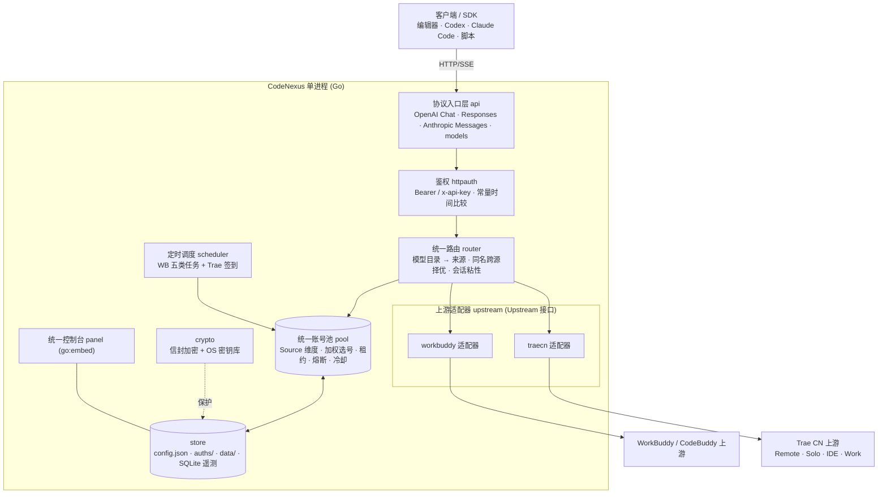

# CodeNexus 执行计划与产品落地文档

> **版本**：v1.0 · 立项定稿
> **日期**：2026-10-14
> **负责人**：张（产品/PM/最终决策）
> **文档状态**：✅ 关键方向已全部拍板，可作为分步开发依据
> **关联文档**：[`README.md`](../README.md) · [`ROADMAP.md`](./ROADMAP.md) · [`CONTRIBUTING.md`](../CONTRIBUTING.md)

---

## 0. 文档信息与修订记录

| 版本 | 日期 | 变更 | 决策人 |
|---|---|---|---|
| v1.0 | 2026-10-14 | 立项定稿；完成 4+3 轮方向拍板，确定纯 Go 单二进制路线 | 张 |
| v1.1 | 2026-10-14 | 追加 ADR-19~23（调度/可靠性）；P0、P1a 完成并入档 | 张 |
| v1.2 | 2026-10-14 | 追加 ADR-24~29（P1b 批次/授权/加密/面板/控制台访问/本机凭证）；P1b1 完成并入档 | 张 |
| v1.3 | 2026-10-14 | 追加 ADR-30~32（P1b2 交付节奏 / 调度时区 / 重启补跑） | 张 |
| v1.4 | 2026-10-15 | 追加 ADR-33~36（成长执行器保真度 / 默认开关 / 任务中心写入语义 / 补跑范围收敛）；P1b2 完成并入档 | 张 |
| v1.5 | 2026-10-15 | 追加 ADR-37~40（Trae 授权形态 / 端点范围 / 池语义统一 / 交付节奏）；P2 完成并入档 | 张 |
| v1.6 | 2026-10-15 | 追加 ADR-41~44（`auto` 一键导入 / `cli` 作为上游模式 / `cli` 输出来自原生 JSON / P3 全量一次交付）；新增 §9.6 P3 调研事实（**修正旧文档中 `storage.json` 解密的错误描述**） | 张 |
| v1.7 | 2026-10-15 | 追加 ADR-45（结算三级取值全量对齐参考，含**并发归属闸门**）；补全 §9.7 结算小节（快照差值的闸门、before 快照不阻塞首字节、`used` 取值口径）；新增 §9.8 P3 实现纪实 | 张 |
| v1.8 | 2026-10-15 | P3 完成并入档；追加 ADR-46~49（P4 交付节奏 / Responses 会话状态 / Anthropic 保真度 / 遥测落库范围） | 张 |
| v1.9 | 2026-10-15 | P4 第一块（协议中立对话核心）与 #43（工具与 thinking 中立下层）完成并入档；记录第二轮 P4 决策与 P4 实现纪实 | 张 |
| v1.10 | 2026-10-15 | #42 完成并入档；记录第三轮 P4 决策（`count_tokens` 估算 / 图片透传 / 校验从宽 / `signature` 空串 / 看门狗保活）；**按参考实现修订 ADR-48 为「形状严格、校验从宽」** | 张 |
| v1.11 | 2026-10-15 | #41 完成并入档；记录第四轮 P4 决策（推理默认隐藏 / 孤儿工具输出保留为惰性块 / 工具类型全量 / LRU 参数与哨兵）；**P4 三客户端直连的协议面至此补齐** | 张 |
| v1.12 | 2026-10-15 | #44 完成并入档；记录第五轮 P4 决策（纯 SQL 聚合 / 明细 10 万条 / 面板最小可用含趋势 / 与 reqlog 各司其职）；**P4 全部编码工作至此完成，仅剩真机探测项** | 张 |
| v1.14 | 2026-10-16 | **P5 完成**：面板「设置」页（表单 + JSON 双轨）· 配置热生效（分级：55 项即时 / 6 项需重启）· 保存前快照与一键回滚 · 危险字段二次确认 · 一键重启（含监听预检）· 主题切换与视觉/无障碍增强 | 张 |
| v1.13 | 2026-10-15 | **P4 真机探测完成**（本机已登录 Trae CN，`auto` 一键导入 uid 2561221162711115）；发现并修复 **4 个真实协议缺陷**；三线协议入口真机验收通过；新增 `debug_upstream` 调试开关；遗留 2 个带证据的开放项（§9.9） | 张 |
| v1.16 | 2026-10-16 | **§4.2 残留项收口**（ADR-53~56）：`reasoning_effort` 原生档位映射 · 1M Max 档位（含实时目录子系统，绝不虚构账号未标记的档位）· 截断自动续写（**全启发式**）· `previous_response_id` LRU 参数暴露为配置 · **TraeWork 自定义模型入站完整契约对齐**（私有累积 SSE + 连接性探测 `is_preset=false`，忽略入站 `Cloud-IDE-JWT`）；新增 §9.10 协议事实与 §9.11 实现纪实；用**差分测试**对参考逐帧比对 | 张 |
| v1.15 | 2026-10-16 | **P6 完成**：脚本为唯一事实源的构建/发布（`build.sh` + `package.py` + `checksums.py`）· 6 平台多架构产物 · 双 Windows 产物 + 自研 Win32 托盘（五项菜单、零新增依赖）· 图标与版本元数据（纯标准库合成 + `go-winres` `.syso`）· 首次运行自动开浏览器 · CI（`ci.yml`/`release.yml`）· 多架构 Docker；追加 ADR-50~52 | 张 |

**阅读指引**

- 只想了解"做成什么样"：读 §1 愿景、§4 决策记录、§11 分期。
- 要动手开发：读 §6 架构、§7 数据模型、§8 协议面、§11 里程碑、§15 团队分工。
- 要评估风险：读 §14 风险登记册。

---

## 1. 项目愿景与定位

**CodeNexus** 是一个**统一的 AI 编码账号网关**：把 `WorkBuddy / CodeBuddy`（腾讯 CodeBuddy 系）与 `Trae CN`（字节 Trae 中国版）两套账号池，收敛进**一个进程、一个端口、一个面板、一个 `base_url`**，对外提供 **OpenAI 兼容 + Codex Responses + Anthropic Messages** 三类接口。

**一句话定位**：*你自有的多个 AI 编码账号，用一个本地网关统一调度，供任意编辑器 / Agent / SDK 直接调用。*

**产品原则（本项目所有取舍的最高依据，按优先级排序）**

1. **体验一致优先**：用户面对的永远是"一个东西"，来源差异被网关屏蔽。
2. **可靠即体验**：上游协议频繁变化时，工具不能"越用越不好用"；高保真与可维护性是体验的一部分。
3. **宁可多花实现成本，不做体验妥协**（用户明确指示：方向选择不考虑实现复杂度）。
4. **安全默认开启**：鉴权、凭证加密、响应安全头默认打开。
5. **合规边界清晰**：仅限自用账号、本机/私有环境。

---

## 2. 目标与非目标

### 2.1 目标（In Scope）

| 编号 | 目标 | 验收口径 |
|---|---|---|
| G1 | 单一进程托管两类账号池 | 一个 `codenexus(.exe)` 同时服务 WB 与 Trae |
| G2 | 对外全协议超集 | `/v1/chat/completions`、`/v1/responses`、`/v1/messages`、`/v1/models` 同时可用 |
| G3 | 模型扁平命名 + 跨源自动择优 | 同名模型按来源健康度自动选择，失败自动回退 |
| G4 | Trae 全量认证来源 | `auto`/`env`/`manual`/`cli`/`web-login` 五种均可添加账号 |
| G5 | Trae 全量四端点 + 自动路由 | Remote/Solo/IDE Agent/Work Agent 可切换，带工具自动走 IDE |
| G6 | WB 现有能力零回归 | WB 全部既有功能在新架构下行为等价 |
| G7 | 统一重设计控制台 | 以"来源"为一等公民的单一面板 |
| G8 | Windows 单机优先交付 | 干净 Windows 机器双击 exe 即可跑通 |
| G9 | 凭证信封加密 | 静态加密 + 可显式导出/导入迁移 |

### 2.2 非目标（Out of Scope，v1 明确不做）

| 编号 | 非目标 | 原因 |
|---|---|---|
| N1 | TraeWork 原生工具链（native bridge，即 `UPSTREAM_MODE=traework-native` 出站传输） | 依赖 Windows + pyzmq + TraeWork 私有 DLL，与"纯 Go 单二进制、零外部依赖"冲突；且**"对外提供 Trae API 给其它 agent/工具"完全不依赖它**（四端点纯 HTTP 即可）。列为 v2 可选。**注意**：TraeWork「自定义模型」入站兼容（纯协议翻译）不属此列，纳入 v1（见 §9.4）。 |
| N2 | 批量注册 / 账号共享池 / 付费转售 | 违反上游条款，项目红线 |
| N3 | 公网多租户 / 计费系统 | 定位为自用网关 |
| N4 | 挂载式插件市场 | 无产品需求 |
| N5 | 移动端 / 桌面 GUI 客户端 | 网页控制台已覆盖 |

---

## 3. 能力盘点（目标能力域）

> 本项目为**全新独立实现**：不复制代码、不逐行移植、不搬运文件；在**功能一致**的前提下做**独立重写、不雷同**（命名与代码结构自成一体）。
>
> **实现依据**：公开协议文档、官方/客户端行为观察、自行抓包与回放样本，**并允许查阅既有实现源码作为协议事实的参考**；但**不得复制其代码表达**（见 ADR-12）。

### 3.1 来源 A · WorkBuddy / CodeBuddy 系

| 维度 | 能力域 |
|---|---|
| 对外协议 | OpenAI Chat（`/v1/chat/completions`）、`/v1/models` |
| 账号 | 浏览器授权登录；多账号池 |
| 任务 | 签到、活跃上报、保活等定时任务 |
| 额度 | 积分 / 余额查询 |
| 可靠性 | 加权选号、会话粘性、429/402 冷却与指数退避、熔断 |
| 出站改写 | 强制流式、思维链注入与回填、指纹脱敏、原生工具标记还原 |

### 3.2 来源 B · Trae CN

| 维度 | 能力域 |
|---|---|
| 对外协议 | OpenAI Chat、Codex Responses、Anthropic Messages、`/v1/models` |
| 上游端点 | Remote / Solo / IDE Agent / Work Agent（四端）+ 自动路由 + 失败回落 |
| 认证 | 五种来源：本地凭证自动发现、环境变量、手工令牌、本地 CLI、浏览器授权 |
| 任务与风控 | 每日签到、风控码退避与设备标识轮换、后台错峰重试 |
| 额度 | 逐请求用量与积分结算（多重优先级 + 后台补偿） |
| 流式与高级 | SSE 心跳、thinking 分离、工具调用、1M 上下文、图片输入、截断自动续写、思考强度映射 |
| 并发 | 多账号顺序 / 额度优先轮询、每账号并发槽与排队 |

### 3.3 能力矩阵（实现总清单）

| 域 | 能力 | 目标期 |
|---|---|---|
| 认证 | 来源 A：浏览器授权；来源 B：本地凭证 / 环境变量 / 手工令牌 / 本地 CLI / 浏览器授权 | P1–P3 |
| 上游 | 两来源适配器；来源 B 四端点 + 自动路由 | P1–P3 |
| 协议 | Chat、Responses、Anthropic Messages、models | P1–P4 |
| 流式 | SSE 重建、心跳、thinking 分离、工具调用 delta | P2–P4 |
| 高级 | 自动续写、1M、图片、思考强度映射、未知模型透传 | P4 |
| 任务 | 签到 / 活跃 / 保活等；来源 B 风控退避 | P1–P3 |
| 用量 | 逐请求记录 + 每日汇总 + 额度结算 | P4 |
| 控制台 | 统一面板（来源为一等公民） | P5 |
| 打包 | Windows 单文件优先 + 跨平台 | P6 |

---

## 4. 关键决策记录（ADR 摘要）

> 以下为与产品负责人逐项确认后的**定稿决策**，开发过程中不得擅自偏移；如需变更须走"提问 → 拍板"流程。

| ID | 决策项 | 定稿结论 | 理由（用户视角） |
|---|---|---|---|
| **ADR-01** | 技术栈 | **纯 Go 单二进制**（标准库优先，零运行时依赖） | 交付形态最纯净、部署最简 |
| **ADR-02** | 对外协议面 | **全协议超集**（Chat + Responses + Anthropic Messages） | Codex / Claude Code / OpenAI SDK 均可直连，体验天花板 |
| **ADR-03** | 模型命名与路由 | **扁平名 + 同名跨源自动择优**，另设前缀别名精确通道 | 最贴近"一个池"直觉，客户端零改动 |
| **ADR-04** | 目标平台 | **Windows 单机优先，兼顾 Linux/macOS** | 匹配实际使用环境 |
| **ADR-05** | 面板形态 | **统一重设计**（来源为一等公民），否决增量扩展/双面板 | 信息架构不随来源增多而碎裂 |
| **ADR-06** | 来源 B 认证 | **全量五种** | 与上游能力对齐，不缩水 |
| **ADR-07** | 来源 B 上游端点 | **全量四端点 + 自动路由** | 工具调用与全模型可用 |
| **ADR-08** | 分期策略 | **双链路先通，能力后补** | 每步可运行验证、风险可控 |
| **ADR-09** | 来源 B 桌面端能力边界 | **原生桥出站传输 v1 不纳入**（v2 可选）；**入站兼容（自定义模型）纳入 v1** | "对外提供来源 B API"不依赖原生桥；入站兼容为纯协议翻译、零原生依赖 |
| **ADR-10** | 凭证安全 | **信封加密 + OS 密钥库（DPAPI/Keychain/Secret Service）**，一步到位取最优 | 静态最强保护 + 显式导出/导入迁移 |
| **ADR-11** | 工程统一源 | 配置/凭证**单一文件源**（`config.json` 双段 + 单一 `auths/`）；遥测**内嵌纯 Go SQLite** | 单一权威源 + 高频数据不膨胀 |
| **ADR-12** | 实现方式与知识产权 | **独立重写、不雷同**：可查阅既有实现源码作为协议事实参考，但**不复制代码、不逐行移植、不搬运文件**，命名与结构独立；**不保留归属、不注明来源** | 用户要求全新项目、功能一致即可；独立表达以规避衍生作品风险 |
| **ADR-13** | 控制台前端 | **Svelte 5 + Vite + TypeScript**，构建产物 `go:embed` 进二进制 | 编译后近乎零运行时开销，体验与性能综合最优 |
| **ADR-14** | 项目标识 | 二进制 / 服务名 `codenexus`；模块 `github.com/ZicongCheung/CodeNexus`；默认监听 `127.0.0.1:6828` | 与既有工具错开端口、默认仅本机更安全 |
| **ADR-15** | P1 账号接入范围 | **全量**：浏览器授权 + 手工导入 + 环境变量 + 指定路径导入（本机凭证自动发现由 ADR-29 收敛） | 体验优先，兼容存量账号 |
| **ADR-16** | P1 池调度策略 | **完整策略**：加权选号 + 冷却指数退避 + 熔断 + 并发槽 + 会话粘性 | 多账号成功率与上下文稳定性最高 |
| **ADR-17** | P1 出站改写管线 | **全量管线**：强制流式 + 角色归一 + 思维链 + 工具配对 + 指纹脱敏 + 标记还原 | 保真度最高，规避上游审核与工具丢失 |
| **ADR-18** | P1 定时任务范围 | **全量**：核心（签到/保活/活跃/余额）+ 成长类 | 功能齐备，对齐上游日常价值 |
| **ADR-19** | 单请求故障转移 | **仅“首字节前”换号重试**（流式一旦已输出首字节即不再换号，错误在流内收尾） | 偶发的单账号限流/超时对用户不可见，且不产生重复内容 |
| **ADR-20** | 会话粘性识别键 | **多信号融合**：`X-Session-Id` → `user` 字段 → （system + 首条 user + 工具集）指纹 | 覆盖面最广，客户端无会话头也能命中，长对话上下文与缓存最稳 |
| **ADR-21** | 选号目标函数 | **复合加权**（额度充足度 + 闲置时长 + 近期成功率）→ Top-K 加权随机 | 既不榨干单一账号，也不冷落闲置账号 |
| **ADR-22** | 全池不可用时的行为 | **短暂等待最早恢复的账号**（上限 `wait_max_seconds`，默认 8s），超时才返回错误并带 `Retry-After` | 多数冷却很短，用户基本感知不到中断 |
| **ADR-23** | 脱敏与标记还原的默认值 | **均默认开启**，按 `features.sanitize_fingerprints` / `features.repair_tool_markup` 可一键关闭；规则保守（拿不准一律原文透出，绝不吞字节） | 默认即获得防护；误伤可即时关闭，标记还原不覆盖真实工具调用 |
| **ADR-24** | P1b 批次切分 | **拆两批**：P1b1 账号接入与自愈 → P1b2 价值与可视（定时任务 + 额度 + 面板） | 账号是一切的输入；先打通真实主链路，避免对着空池开发 |
| **ADR-25** | 浏览器授权形态 | **面板内嵌设备码授权**（面板展示验证码 + 授权链接 → 后台轮询 → 自动入池） | 全程不离开浏览器、零命令行；CLI 子命令仅作后续无头补充 |
| **ADR-26** | 凭证加密落地时点 | **提前到 P1b**：信封加密 + OS 密钥库（DPAPI/Keychain/Secret Service）+ 显式导出/导入 | 账号一落盘即受保护；导出/导入保证跨机迁移，避免明文中间态 |
| **ADR-27** | 面板形态 | **直接按统一信息架构落地**（来源为一等公民的骨架），P5 仅做视觉与交互增强、**不重构** | 避免"过渡视图→推倒重做"的浪费，面板自始即为最终 IA |
| **ADR-28** | 控制台管理面访问控制 | **回环豁免 + 非回环强制 `api_key`**（`Bearer`）；默认 `127.0.0.1` 监听即刻可用，暴露到 LAN 时自动受保护 | 单机零配置可用与远程安全兼得，不牺牲开箱体验 |
| **ADR-29** | 本机客户端凭证自动发现 | **不做自动探测/解密**，对齐参考实现（其亦无此能力）；改为**面板内「指定路径导入」**：读取用户本机导出的凭证 JSON（数组或单对象）→ 校验 → 加密入池；导入支持「粘贴 / 本地路径 / 加密包」三种模式 | 避免对上层客户端私有存储格式的脆弱耦合与合规风险；用户显式导出即意图明确，路径导入同样"少手工" |
| **ADR-30** | P1b2 交付节奏 | **全量一次交付**：调度框架 + 核心任务 + 成长类 + 额度可视 + 请求日志 + 批量运维 | 调度器成本几乎全在框架本身，任务执行体只是增量挂载；分两步会二次改造框架，反而更贵更易回归 |
| **ADR-31** | 定时任务调度时区基准 | **可配置时区，默认 `Asia/Shanghai`**（上游签到/连登按北京时间日界结算） | 日界正确即不漏签/不断连；跨部署环境（如 UTC 云主机）仍正确；无 DST 实际成本 |
| **ADR-32** | 服务停机后的任务补跑 | **持久化 last-run，重启后按宽限窗口补跑一次**（幂等键防重复），落在现有 `data/` 目录 | 停机跨过签到点不再永久漏签；复用本就需要的"迟到补跑宽限"逻辑，边际成本极低 |
| **ADR-33** | 成长类执行器保真度 | **全量对齐参考 25 项**：账号原生 4 + 桌面端事件链 13 + 小程序事件链 8；含事件链协议层（桌面/小程序/Web 指纹与遥测）、专家市场、真实对话取服务端 `requestId`、反作弊节流。**仅排除参考自身也不做的两项**（真实捐赠 `Expert_Philanthropy`、灯塔连接器授权） | 这些"任务"其实是唯一能让账号真正涨额度的路径；少做一项就少一份可用额度。不引入参考回避的高风险动作（真实付费/连接器授权），合规与账号安全不降级 |
| **ADR-34** | 成长任务默认开关 | **全部默认开启**，与参考行为完全一致 | 开箱即得全部收益，用户零配置；面板提供逐项/逐账号手动触发作为可控兜底 |
| **ADR-35** | 面板任务中心写入语义 | **全写入**：目录 + 任务列表 + 接取 + 领取 + 单任务执行 + 单账号执行全部 + 整池批量（签到/活跃/额度/出行/保活）+ 待办队列执行，与参考对齐 | 面板即"运维台"，与 CLI/调度同权；免去 SSH 与命令行，全部操作在一个页面闭环 |
| **ADR-36** | 启动补跑范围收敛（细化 ADR-32） | **仅保号/维护类**（签到、活跃、保活、出行）在宽限窗口内补跑一次；**成长类不补跑** | 成长进度由"行为事件"驱动，事后补跑既无意义又可能触发反作弊；保号类漏一天就真的断签/失效，补跑收益确定 |
| **ADR-37** | 来源 B 授权形态 | **面板内嵌 + 本机回环回调**：面板点「开始授权」→ 网关在回环地址起一次性 `http.Server` 监听回调 → 面板展示授权链接 → 浏览器登录后自动重定向回环地址 → 网关换取令牌入池；另在面板提供「粘贴令牌」通道 | 与来源 A 的设备码体验完全一致（都是"点一下、浏览器登一次、页面自动收号"），零命令行、零手工转贴；回调落在本机回环而非公网，无证书/无端口暴露；粘贴通道覆盖"已从 IDE 取到令牌"的老用户 |
| **ADR-38** | 来源 B 上游端点范围 | **直接全量四端点 + 自动路由**（Remote 会话事件流 / Agent 单跳流式 / IDE 平台 / Work 代理），**一次性实现**，不做"先 Remote 后补" | 端点差异对用户不可见，但决定了"带工具调用是否可用"；先只做 Remote 会静默吞掉调用方工具（会话自带工作区会自行满足文件/Shell 工具），属于体验陷阱；一次做全才能保证"任何客户端形态都可用" |
| **ADR-39** | 来源 B 账号池语义统一 | **统一到池现有语义，不新增并行概念**：来源 B 的积分映射为池的 `credits`；上游 `9074`（设备维度节流）按 **软冷却 + 指数退避** 处理，走与 `429` 完全相同的路径；额度耗尽 `4008` 归为账号级失效，切换账号而非同号重放 | 池里只有一份"健康/额度/冷却"真相，择优、熔断、故障转移对两个来源行为一致；面板与遥测不需要为来源 B 造第二套指标；软冷却让"设备抖动"自我恢复，不误伤账号 |
| **ADR-40** | P2 交付节奏 | **全量一次交付**：四端点 + 自动路由 + 认证（回环/粘贴/环境变量）+ 模型目录 + 跨源模型路由 + 面板接入 | 四端点共享同一套凭证、设备指纹与错误分类，拆开做会二次改造共享层；目录与跨源路由是"能选到模型"的前置，缺一则 P2 无法端到端验收 |
| **ADR-41** | 来源 B `auto` 认证形态 | **自动发现 + 就地解密 + 面板「从本机 Trae 导入」一键导入**：面板点一下 → 网关按 `cn→solo→sg→solo-sg` 探测本机 `storage.json` → 按 `tc` 格式解密 → 校验（`SHA512` 哈希自校验）→ 信封加密入池；**不引入"指定路径导入"作为第二入口**。凭据**一律信封加密落盘**，不落任何明文中间态（参考实现会把明文 token 写进 `.env`，本项目刻意不照搬） | 这是五种来源里**唯一零操作**的入口：点一下就得到账密，体验天花板最高；解密算法**不依赖 machine_id/注册表**，是一份自包含密文，实现风险远低于早先估计；做成"一次显式点击"而非静默扫描，把"读取本机客户端凭据"的同意动作显式化（参考实现没有这道门禁）。不做第二入口是因为一键导入完全覆盖其场景，双入口只会带来两套错误提示 |
| **ADR-42** | 来源 B `cli` 认证形态 | **作为 `upstream_mode` 的一个取值**（`cli`，与 `remote`/`solo`/`ide`/`work-agent`/`auto-route` 并列），**不建池内伪账号** | 已核实参考实现中 `cli` 是与 `remote`/`ide`/`solo` 并列的**全局上游模式**（`UPSTREAM_MODE=cli`），且 CLI 路径会主动摘掉账号与令牌——CLI 与账号池本就是互斥关系。我们的 `upstream_mode` 字段已存在，`cli` 只是**同一条机制的又一个取值**（不违反 ADR-39 的"不新增并行概念"）；反之若在池里塞一个"无凭证伪账号"，会让池出现一个不对应任何凭据的成员，且与跨源择优、额度结算语义都错位 |
| **ADR-43** | 来源 B `cli` 输出保真度 | **只解析原生 JSON 字段**（内容 / thinking / usage / 工具 / credits）+ **保留文本模式开关** + **复用既有 `internal/rewrite` 标记还原管线**；**不重写**参考里约 1600 行的"文本内 XML/OpenCode/Kimi/ZedeX 工具块"多方言解析 | CLI 默认就是 JSON 模式（结构化字段，工具不会丢），多方言解析只对很旧的 CLI 版本有价值，却是一整块高维护成本的方言解析器（上游一改就碎）。我们已有的标记还原管线本就覆盖"工具被写成文本标记"的通用情形，复用它即可拿到大部分收益。`src/auth_cli.py`（OAuth 设备码流程）因上游 `Authorize` 端点 404、源码自述不可用，**不纳入** |
| **ADR-44** | P3 交付节奏 | **全量一次交付**：`auto` 解密导入 + `cli` 上游模式 + 签到 + 风控设备轮换退避 + 回合级积分结算 | `auto`/`cli` 都是"新增一条上游/入池通路"，与签到/风控共享设备身份与错误分类层；拆开做会二次改造该共享层（与 ADR-40 同一理由）。积分结算是"面板能看额度"的最后一环，P2 已把三重优先级与字段名固化（§9.5），此时接入成本最低 |
| **ADR-45** | 结算三级取值的完整度 | **全量对齐参考，含第三级快照差值**，并且**必须连同并发归属闸门一起照抄**：以每账号"在飞请求数"为闸门，只有该账号**独享**一个回合时才允许用「本账号已用额度前后差」结算；`begin` 时若已有在飞请求则该账号标记为不可归属（**连 before 快照都不读**），结算前复查一次，不通过即退回 `pending`；before 快照走**后台任务**、不阻塞首字节；`after < before` 直接放弃；**额度读取走适配器直连，绝不写回池** | 初判认为第三级"多一跳 + 污染路由状态 + 并发记错账"，逐行读参考后三条**全部被推翻**：①before 读是后台任务，`begin()` 只让出一次事件循环，**不延迟首字节**；②参考的额度读直连 `trae_client`，**完全不碰账号池状态**，观测不会影响择优/冷却；③并发错配正是参考显式防住的——闸门保证只有独享回合才做差值，落在并发里就退回 `session_usage`，再不行退回 `pending`，**从不写错的数字**。因此第三级是"诚实度提升"而非"拿观测去凑数"。两条铁律仍守住：ADR-39「池里只有一份额度真相」（差值只进日志、不回写池）与「绝不把未知值伪装成 0」（读不到就 `pending`） |
| **ADR-46** | P4 交付节奏 | **全量一次交付**：Responses + Anthropic 两个入站入口 + 工具调用 + thinking 分离 + 用量/日志落库一次做完 | 两个入站协议共用同一套"入站协议 → 统一 `ChatRequest` → 出站事件流"翻译层，工具调用与 thinking 分离又是它们的**共同下层**；拆开做会让 `api` 层与事件模型改两遍，且 Anthropic 的 `tool_use`/`tool_result` 与 Responses 的 `function_call` 分两次落地必然返工（同 ADR-40/44 的理由） |
| **ADR-47** | Responses `previous_response_id` 的状态 | **内存有界 LRU**：缓存上一轮的 input+output 以重建上下文，**TTL 过期即弃、绝不落盘**；未命中时提示客户端带全量 `input` 重试 | Codex 确实会用该字段做同进程多轮，纯无状态会直接断掉体验；而磁盘持久化等于让网关在**磁盘上存提示词与回答**，与"日志绝不记正文"的红线正面冲突。内存 + TTL 是唯一同时满足"能用"与"不留痕"的档位 |
| **ADR-48** | Anthropic 入站保真度 | **形状严格对齐官方、入站校验从宽**：`tool_use`/`tool_result` 配对校验（不合法则自动修复并记日志）、`thinking` 块按官方形态回传（`signature` 空串）、`stop_reason` 全枚举映射、`count_tokens` 按**参考口径的本地估算**实现（图片按固定值计，不把 base64 当文本） | Claude Code 对配对与终止原因很敏感，"够用"实现的典型症状是**能连上但一用工具就崩**，届时排查成本远高于一次做对。但**"严格"只适用于我们自己吐出的形状**：入站校验若照官方 400，会让手写调用与宽松客户端突然失败，而 relay 的价值在于让一轮请求跑完 —— 参考实现在这一点上也是从宽的（`max_tokens` 缺失填默认值、`budget_tokens` 映射档位）。`count_tokens` 更是物理上做不到"真实"：官方用的是私有 tokenizer，参考只能用启发式估算，我们照此并**明示为估算** |
| **ADR-49** | 遥测落库范围 | **用量/积分 + 请求日志摘要落 SQLite**（承接 ADR-11 的 `modernc.org/sqlite`，纯 Go 无 CGO）：表存的是现有窄字段（时间/来源/账号标签/模型/token/积分/耗时/状态）；**提示词、回答正文与凭证永不落库** | 面板的「用量 / 额度」页要有趋势与明细就只能落库；只落用量而请求日志留内存，会让"这条积分记在哪次请求上"在重启后失去对应关系。字段沿用既有窄集，红线不动 |
| **ADR-50** | P6 构建与发布的事实源 | **脚本为唯一事实源，CI 只调用**：`scripts/build.sh`（`build`/`release`/`docker`/`icons`/`res`/`web`/`test`/`clean`）承载全部构建逻辑，GitHub Actions 只做 `bash scripts/build.sh test|release` 与产物上传，**不复制任何构建步骤** | "本地能出包、CI 出不了"几乎总是两份构建逻辑漂移的结果（漏 `-trimpath`、漏双产物、漏校验和）。让 CI 调用同一脚本，则"笔记本上失败"与"发布会失败"是同一件事，且任何一次构建都能在本地逐字复现。代价是脚本必须跨 Windows(Git Bash) 与 Linux 可用——因此打包用 Python 标准库（`zip`/`tarfile`）而非 shell 外部命令 |
| **ADR-51** | Windows 桌面呈现形态 | **双产物 + 自研 Win32 托盘 + 首次运行自动开浏览器**：`CodeNexus.exe`（`-H=windowsgui`，无黑框，双击即用，日志落 `DataDir/codenexus.log`）+ `CodeNexus-console.exe`（保留控制台，排障用）；托盘用 `golang.org/x/sys/windows` 直接调 `Shell_NotifyIcon`，**零新增依赖**；首次运行（无 `config.json`）自动打开 `http://127.0.0.1:6828/panel/` | 目标用户是双击 exe 的开发者，一个常驻网关没有托盘就只能靠任务管理器停，且面板地址无处可寻。"无黑框"与"能看日志"是两个互相冲突的诉求——控制台被 `windowsgui` 关掉后无法再开，因此只能出两个产物而不是一个开关。托盘不引第三方库是因为它已经在依赖树的 `x/sys` 里就能做到，多一个库只为省几十行并不划算 |
| **ADR-53** | 可选档位的生效条件 | **只对账号目录确证的档位生效**：`reasoning_effort` 与 1M Max 都必须先在实时模型目录里找到该模型条目（前者要求 `reasoning_effort_config.support_thinking`，后者要求 `max_mode=true`）；**目录不可达或未列出该模型时一律不改请求**；1M 还要求 agent 档（work 档无该档位）。为此新增**按账号拉取实时目录并保留原始 `custom_model`** 的缓存子系统 | 这两项都是**账号权益**而非客户端参数。若凭请求里的字段就加档位，上游要么拒绝、要么按更小的档位静默执行——后者会让用户以为在用 1M 却在用 200K，正是"绝不把未知能力假装成可用"要防的。目录另有一层必要性：`reasoning_effort` 的档位值写在 `custom_model` 对象上，而我方此前的目录是静态的，根本不携带该对象 |
| **ADR-54** | 截断自动续写的判定口径 | **对齐参考的完整启发式**（`finish_reason` 长度集合 + 未闭合代码围栏 + 括号不平衡 + 结尾字符 + 「思考很长但正文仅碎片」），并以**相似度 0.5 防重复**、**最多 3 轮**封顶；**带工具调用的回合永不续写**；流式中**中间轮不吐 `finish_reason`**（否则客户端会提前停止渲染） | 只认 `finish_reason` 的保守口径在真机上行不通：P4 已实测 SOLO 面常以 `stop` 结束。而用户拿到半截答案的体验损失，远大于多跑一轮的积分成本。因此采用参考口径，但用相似度闸门与轮数上限把"误判成本"封顶；工具回合**必须**原样交给调用方执行，续写会破坏工具协议 |
| **ADR-55** | TraeWork 自定义模型入站的实现档位 | **完整契约对齐**（非最小可用）：三重识别（路径/头/体，且不劫持普通 OpenAI 调用）· 6 层嵌套展开 · **`config_name` 优先于展示名** · `Extra` 头解析 · 私有累积 SSE（`output`/`token_usage`/`done`/`error`，`tool_calls` 增量 + `tool_call_info` 快照）· 连接性探测 **`is_preset=false`** · **忽略入站 `Cloud-IDE-JWT`**（一律走池内凭证） | 参考实现读完后确认：入站**不是独立上游协议**，而是复用既有 dispatch 的第三种线格式，工具由**桌面客户端**执行。因此"精简版"的失败模式全是**静默的**——静默回落原生通道（连接性 advertising 成 preset）、中途停渲染（中间帧吐出 `finish_reason`）、显示空回答（干净的空回合直接 `done`）、工具参数错位（增量当全量）。逐项对齐后这些都不发生。忽略 `Cloud-IDE-JWT` 是为守住 ADR-39「池里只有一份额度真相」：旁路凭证的请求会同时从计费、冷却、熔断与用量页消失 |
| **ADR-56** | `previous_response_id` 缓存参数的暴露方式 | **暴露为配置（`responses.*`）并标记为需重启**，默认值保持保守（TTL 3600s / 1024 条 / 2MiB / 256 条消息） | 原计划"待 Codex 实测多轮间隔分布后再定"，但阻塞发版不值得：把参数交给运维比等一个可能永远不来的样本更务实。标记**需重启**而非热生效，是因为就地更换缓存会静默丢弃客户端正在续的会话——"改一个上限导致对话断掉"不是可接受的流畅性代价 |
| **ADR-52** | 图标与版本元数据 | **图标纯标准库合成、资源用 `go-winres` 生成 `.syso` 提交入库**：`scripts/make-icons.py` 只依赖 Python 标准库从源 PNG 合成多尺寸 `.ico` → `internal/assets/`（`go:embed`）；`go-winres` 一次性生成 `cmd/codenexus/rsrc_windows_{amd64,arm64}.syso`（图标 + 版本信息 + `manifest cli`），提交后可脱离工具链重建 | 图标合成若引 Pillow 会让"重新生成图标"变成一个需要装依赖的动作；`.ico` 是简单容器，标准库足够。`.syso` 入库而非每次构建生成，是因为 `go-winres` 是需要额外安装的工具——提交产物让"没有该工具的机器"也能完整构建发布 |

### 4.1 P3 待验证项（实测结论）

| 项 | 说明 | P3 实测 |
|---|---|---|
| `cli` 模式与账号池互斥 | `upstream_mode: cli` 时来源 B 的账号不再参与请求（对齐参考：CLI 路径摘除账号/令牌）。面板会在会话接口回显当前上游模式，避免"加了账号却不生效"的困惑 | ✅ 已实现：注入 `LocalCLIAccount()` 占位（`Ephemeral`+`Local`，不落盘），面板以「本机」徽标呈现并隐藏额度/任务操作 |
| `cli` 无账号级额度 | CLI 形态没有账号级额度/积分查询，只有 CLI 自身 JSON 可能带的 `usage`/`credits_*`。面板对该形态明确标注"无账号额度"，**不以 0 充数**（沿用"绝不把未知值伪装成 0"） | ✅ 已实现：`Scope()` 对 cli 返回空，结算走 CLI JSON 的显式字段（`upstream`），无值即 `pending` |
| 上游模式运行时切换 | 参考实现可在控制台运行时切换上游端点；本项目按 ADR（P5 = 在线配置编辑热生效）在 P3 只做**配置项**，运行时切换留到 P5，避免提前引入配置热加载 | ⏸ 保持：P3 仍为配置项（ADR-42），运行时切换留 P5 |
| 结算第三级的并发归属 | 快照差值在并发回合下会串账——初判据此否决第三级，后经逐行核对参考发现有闸门而**改为纳入**（ADR-45） | ✅ 已实现：`snapshotGate` 按账号在飞计数判定，非独享即退回 `pending` |

### 4.2 P4 待验证项（刻意保留）

| 项 | 说明 |
|---|---|
| 图片输入 | 目录里存在 `glm-5v-turbo` 等视觉模型，但**上游是否真收多模态请求尚未验证**。P4 先真机探测：能用则纳入并做必要的编码转换，不可用则明确报错而非静默丢弃图片（"绝不把未知能力假装成可用"） |
| 1M Max 上下文 | 参考实现有"上下文档位"概念并**必须先满足账号目录 `custom_model.max_mode=true`**；开启后要富化 `context_window_size`/`prompt_max_tokens`/`max_turns`/`features.context_windows` 并置 `model_selection_strategy="max"`、`mode_type=1`。**已实现**（ADR-53），仅对 agent 档且目录确证的模型生效（§9.10） |
| 自动续写 | 参考实现的完整启发式（长度 finish_reason 集合 + 未闭合代码围栏 + 括号不平衡 + 结尾字符 + 思考后碎片）**可判**，因此纳入并全量对齐（ADR-54）；相似度与轮数封顶，工具回合永不续写 |
| `previous_response_id` 的 TTL 与容量 | **已暴露为配置**（`responses.ttl_seconds`/`max_entries`/`max_bytes`/`max_messages`，标记需重启；ADR-56），默认维持保守值 |
| `reasoning_effort` 映射 | 参考的原生档位是 **`light`/`high`/`extra_high`**，值写在 `custom_model.reasoning_effort[_level]` 上并按 `reasoning_effort_config.options` **向下夹取**。**已实现**（ADR-53），仅在目录声明 `support_thinking` 时生效（§9.10） |
| 来源 B 桌面端「自定义模型」入站兼容 | 参考的 `traework_compat.py` 本体是**第三种线格式 + 私有 SSE**（非独立上游）。**已完整契约对齐**（ADR-55），并用差分测试对参考逐帧比对（§9.11） |

---

## 5. 总体架构

### 5.1 架构图



### 5.2 分层与目录结构（目标）

```text
CodeNexus/
├── cmd/
│   └── codenexus/              # 主服务入口（原 cmd/server）
│       ├── main.go
│       ├── config.go           # 配置加载（双段）
│       └── wiring.go           # 依赖装配 / 适配器注册
├── internal/
│   ├── api/                    # 统一协议入口层
│   │   ├── openai_chat.go      # /v1/chat/completions
│   │   ├── responses.go        # /v1/responses (Codex)
│   │   ├── anthropic.go        # /v1/messages (+count_tokens)
│   │   ├── models.go           # /v1/models
│   │   ├── status.go           # /status · /healthz
│   │   └── ssewriter.go        # 统一 SSE 出站（心跳、delta 组装）
│   ├── upstream/
│   │   ├── upstream.go         # ★ Upstream 接口 + 注册表 + 中立消息/工具模型
│   │   ├── types.go            # 统一请求/响应/事件类型
│   │   ├── toolcall.go         # 中立工具分片追踪器（index 键控，增量/快照/乱序/重复）
│   │   ├── toolpair.go         # 中立工具配对校验（丢孤儿并回传修复清单）
│   │   ├── sse.go              # 共享 SSE 重建（复用 WB）
│   │   ├── thinking.go         # 思维链（复用 WB）
│   │   ├── sanitize.go         # 指纹脱敏（复用 WB）
│   │   ├── payload.go          # 出站改写（复用 WB）
│   │   ├── workbuddy/          # WB 实现（原 upstream 包体迁入）
│   │   │   ├── client.go
│   │   │   └── {desktop,dsml,streak,travel,report,school,global_models,...}.go
│   │   └── traecn/             # Trae 实现（自 Python 移植）
│   │       ├── client.go
│   │       ├── remote.go       # chat_sessions + events 协议
│   │       ├── ide.go          # IDE Agent 端点
│   │       ├── solo.go         # Solo 端点
│   │       ├── work_agent.go   # Work Agent 端点
│   │       ├── route.go        # 自动路由 + 失败回落
│   │       ├── auth.go         # 5 种认证来源
│   │       ├── decrypt.go      # storage.json AES-128-CBC
│   │       ├── checkin.go      # 9074 设备轮换 + 指数退避
│   │       ├── usage.go        # 用量/积分结算
│   │       ├── images.go       # 图片输入
│   │       └── continuation.go # 截断自动续写
│   ├── pool/                   # 统一账号池（新增 Source 维度）
│   ├── router/                 # 模型→来源 路由与择优（新增）
│   ├── scheduler/              # 合并后的定时任务（P1b2 已落地：槽位对齐 + 分段等待 + 补跑 + last-run 持久化）
│   ├── growth/                 # 成长任务执行器 25 项（账号原生 / 桌面端事件链 / 小程序事件链）
│   ├── panel/                  # 统一控制台（go:embed）；含任务中心与管理接口
│   ├── store/                  # 单一权威源：config/凭证/状态/SQLite
│   ├── crypto/                 # 信封加密 + OS 密钥库（P1b1 已落地）
│   ├── authstore/              # 凭证存储（加密落盘 / 迁移 / 导出导入 / 环境变量）
│   ├── authrefresh/            # 会话令牌刷新与失效自愈（单飞 + 预刷新 + 401 自愈）
│   ├── httpauth/               # 复用
│   ├── reqlog/                 # 每请求日志（P1b2 已落地：内存环形 + stdout，不含提示词与凭据）
│   ├── usage/                  # 用量（并入 SQLite）
│   └── logfmt/                 # 复用
├── web/                        # 面板前端源码（构建后 embed 进 panel）
├── docs/                       # 文档（本文件、ROADMAP 等）
├── scripts/                    # 便携脚本
├── Dockerfile
├── docker-compose.yml
├── go.mod
└── README.md
```

### 5.3 核心接口抽象（★ 关键设计）

新增 Trae 上游的前提是把 WB 的"具体客户端"抽成接口。定稿接口：

```go
// internal/upstream/upstream.go
type Source string
const (
    SourceWorkBuddy Source = "workbuddy"
    SourceTraeCN    Source = "trae-cn"
)

// Upstream 定义"一个来源"必须具备的能力。
// 各来源在 workbuddy/ 与 traecn/ 下实现，通过 registry 注册。
type Upstream interface {
    Source() Source

    // —— 模型与推理 ——
    ListModels(ctx context.Context) ([]ModelSpec, error)
    Chat(ctx context.Context, acc *pool.Account, req *ChatRequest) (*ChatResponse, error)
    ChatStream(ctx context.Context, acc *pool.Account, req *ChatRequest, emit EmitFunc) error

    // —— 账号生命周期 ——
    AuthModes() []AuthMode                                   // 该来源支持的认证来源
    BeginLogin(ctx context.Context, mode AuthMode) (LoginFlow, error)
    Refresh(ctx context.Context, acc *pool.Account) error
    Probe(ctx context.Context, acc *pool.Account) (*AccountProbe, error) // 余额/积分/健康

    // —— 来源特有任务（可选实现）——
    SupportTasks() []TaskKind
    RunTask(ctx context.Context, acc *pool.Account, kind TaskKind) (*TaskResult, error)

    // —— 错误语义归一 ——
    Classify(err error) UpstreamError                        // → 冷却/熔断/禁用 的统一分类
}
```

**设计要点**

1. **入口统一、出口适配**：协议层只认 `Upstream` 接口，不感知 WB/Trae 差异。
2. **池与调度解耦**：`pool` 只管"有哪些凭证、状态如何"；`router` 只管"这次选谁"。
3. **管线复用**：`sse.go`/`thinking.go`/`sanitize.go`/`payload.go` 提为包级公共函数，两来源共用。
4. **来源特有逻辑内聚**：`desktop.go`/`dsml.go`/`travel.go` 归 `workbuddy/`；`remote.go`/`ide.go`/`9074` 归 `traecn/`。

---

## 6. 统一数据模型

### 6.1 统一账号模型

```go
// internal/pool/entry.go（扩展）
type Account struct {
    Source   upstream.Source // workbuddy | trae-cn
    UID      string          // 来源内唯一
    Label    string          // 昵称/备注
    Enabled  bool
    Enterprise bool          // WB 企业版标记（Trae 语义不同，按来源解释）

    Creds    CredentialRef   // 指向 auths/ 下的加密凭证文件
    Meta     AccountMeta     // 账号级元信息（到期、模型开关等）

    // 运行态（可持久化到 state）
    Health        Health       // healthy | degraded | disabled | cooling
    CooldownUntil time.Time
    InFlight      int32
    Credits       int64        // WB 积分 / Trae 通用积分（统一为"额度"抽象）
    LastError     string
    SuccessCount  int64
    FailCount     int64
}
```

**统一"额度"抽象**：WB 用 credits、Trae 用通用积分，语义相近但量纲不同 → 池内统一为 `Credits int64` + `CreditUnit string`（展示层按来源格式化），**不做跨来源额度换算**（避免误导）。

### 6.2 统一凭证存储

```text
auths/
├── workbuddy-<uid>.json.enc     # 信封加密：{wrapped_dek, nonce, ciphertext, alg, kid}
└── trae-<uid>.json.enc
```

- 明文凭证仅在**内存**中存在；落盘一律加密（ADR-10）。
- 解密流程：OS 密钥库取 KEK → 解 `wrapped_dek` → AES-256-GCM 解 `ciphertext`。
- 密钥库不可用时：降级为**用户口令派生密钥**（PBKDF2/Argon2id），并在面板显式告警（不静默降级为明文）。
- **导出/导入**：面板提供"加密导出包"（口令保护，`age` 或 PBKDF2+AES-GCM），用于跨机迁移。

### 6.3 统一配置（单一权威源）

`config.json`（**顶层为共享配置，`upstreams` 为双来源分节**）：

```jsonc
{
  "$schema": "./docs/config.schema.json",
  "listen": "127.0.0.1:6828",
  "api_key": "",                       // 留空=不鉴权（危险，首次启动自动生成随机值）
  "auth_dir": "./auths",
  "data_dir": "./data",
  "sqlite_file": "./data/codenexus.db",

  "pool":   { "credit_floor": 100, "max_in_flight": 3, "breaker_threshold": 3, ... },
  "router": { "naming": "flat", "same_name_policy": "auto_healthy", "alias_prefix": true },
  "crypto": { "backend": "os_keystore", "fallback": "passphrase" },
  "schedule": { "checkin_enabled": true, "keepalive_enabled": true, ... },

  "upstreams": {
    "workbuddy": {
      "enabled": true,
      "user_agent": "",
      "prompt": { "mode": "custom", "file": "" },
      "cooldown": { "soft_rate": "600s", "soft_rate_max": "2h" },
      "schedule": { "checkin_hours": [9,21], "travel_hours": [9,21], "activity_hours": [10],
                    "keepalive_hours": [22], "blackcat_hours": [23] },
      "features": { "sanitize_blacklist_fingerprints": true }
    },
    "trae-cn": {
      "enabled": true,
      "auth_source": "auto",             // auto|env|manual|cli|web-login
      "upstream_mode": "remote",         // remote|solo|ide|work-agent|cli
      "auto_route": true,
      "parallel_limit": 2,
      "slot_timeout_seconds": 60,
      "reasoning_verbose": false,
      "auto_continue": { "enabled": true, "max_rounds": 3 },
      "max_mode": { "enabled": false, "models": [] },
      "checkin": { "enabled": true, "time": "08:30", "device_ids": {} },
      "usage": { "session_query": true, "max_history": 1000 }
    }
  }
}
```

**热生效字段**（面板保存后无需重启）：`api_key`、`pool.*`、`router.*`、`schedule.*`、`upstreams.*.auto_route`/`auth_source`/`auto_continue`/`max_mode`/`checkin` 等。
**需重启字段**：`listen`、`auth_dir`、`data_dir`、`crypto.backend`、`upstreams.*.timeout` 等进程装配期依赖项——面板保存时明确提示。

### 6.4 遥测存储（SQLite）

高频数据从 JSONL/JSON 迁入内嵌 **纯 Go SQLite**（`modernc.org/sqlite`，无 CGO，保持单二进制）：

```sql
CREATE TABLE request_log (
  id INTEGER PRIMARY KEY, ts TEXT, source TEXT, account_uid TEXT,
  model TEXT, endpoint TEXT, stream INTEGER,
  prompt_tokens INTEGER, completion_tokens INTEGER, total_tokens INTEGER,
  credits REAL, status TEXT, latency_ms INTEGER, ttfb_ms INTEGER, error TEXT
);
CREATE TABLE usage_daily (
  day TEXT, source TEXT, model TEXT,
  prompt_tokens INTEGER, completion_tokens INTEGER, cache_tokens INTEGER,
  requests INTEGER, credits REAL, PRIMARY KEY(day, source, model)
);
CREATE TABLE task_log (id INTEGER PRIMARY KEY, ts TEXT, source TEXT, uid TEXT,
  kind TEXT, ok INTEGER, detail TEXT);
```

保留策略：`request_log` 默认 7 天 / 100 MiB（沿用 WB 语义）；`usage_daily` 保留 400 天（沿用 Trae 语义）。

---

## 7. 对外协议面设计（ADR-02）

### 7.1 端点矩阵

| 端点 | 方法 | 协议 | 鉴权 | 适用来源 | 阶段 |
|---|---|---|---|---|---|
| `/v1/models` | GET | OpenAI | Bearer | 全 | P1 |
| `/v1/chat/completions` | POST | OpenAI Chat | Bearer | 全 | P1/P2 |
| `/v1/responses` | POST | OpenAI Responses (Codex) | Bearer | 全（Trae 优先） | P4 |
| `/v1/messages` | POST | Anthropic Messages | `x-api-key` 或 Bearer | 全 | P4 |
| `/v1/messages/count_tokens` | POST | Anthropic | 同上 | 全 | P4 |
| `/v1/chat`、`/v1` | POST | OpenAI 兼容别名 | Bearer | 全 | P4 |
| `/status` | GET | 自定义 | Bearer | 全 | P1 |
| `/healthz` | GET | 自定义 | 无 | 全 | P0 |
| `/panel/`、`/panel/api/*` | — | 控制台 | Bearer | 全 | P5 |
| `/web/login*` | — | 浏览器授权 | 无/回调 | Trae | P2 |
| `/v1/traework/chat` 等入站别名 | POST | TraeWork 自定义模型入站（§9.4-A） | Bearer | Trae | P3（可选） |
| `/…/custom_model_connectivity_check` | POST | TraeWork 连通性探测（§9.4-A） | 公开 | Trae | P3（可选） |

### 7.2 协议归一策略

- **统一内部中间表示**：所有入站协议先解析为内部 `ChatRequest`（消息数组 + tools + reasoning 参数 + 图片），再交给 `Upstream`。
- **出站形态按入站协议回填**：
  - 入站 OpenAI Chat → 出站 OpenAI Chat（含 `delta.tool_calls`）。
  - 入站 Responses → 出站 Responses 事件（`function_call`、`*_call_output`、`previous_response_id`）。
  - 入站 Anthropic → 出站 `content_block` 流式事件（`tool_use`/`thinking`）。
- **能力不匹配降级**：某来源不支持某协议特性时，返回**明确的结构化错误**（而非静默改写），并在 `/v1/models` 元数据标注能力位。

### 7.3 模型命名、路由与择优（ADR-03）

```text
GET /v1/models
 → 汇总各来源模型目录（WB: console/enterprises/personal/models；Trae: Remote+Solo 合并目录）
 → 扁平名去重：同名模型合并为一条，附 sources: ["workbuddy","trae-cn"]
 → 同时提供别名通道：workbuddy/<model>、trae-cn/<model>（精确指定用）
```

**路由决策（`internal/router`）**

1. 请求模型为 `source/model` 别名 → 直连该来源。
2. 请求模型为扁平名：
   - 仅一个来源有 → 直连。
   - 多来源有 → 按 `same_name_policy=auto_healthy`：**在健康账号中按加权选号联合择优**；首选失败自动回退到次源（可配置回退开关与回退上限）。
3. 未知模型 → 按 `passthrough` 语义透传到默认来源（可配置）。

---

## 8. 控制台设计（ADR-05：统一重设计）

### 8.1 信息架构（来源为一等公民）

```text
顶部：[全部] [WorkBuddy] [Trae CN]   ← 全局来源切换（贯穿所有视图）
侧栏：
  ├── 概览        统一仪表盘（合并两来源的 tokens/额度/账号健康/任务状态）
  ├── 账号        账号表（按来源分组/筛选）+ 添加账号（按来源选认证方式）+ 批量运维
  ├── 用量        Token 时序 + 明细（按来源/模型/端点维度）
  ├── 额度        积分构成（WB 到期分布 / Trae 通用积分）+ 消费记录
  ├── 任务与签到   合并任务中心（WB 五类任务 + Trae 签到）+ 队列执行
  ├── 模型与档位   模型目录（含来源标记、能力位）+ 思考档位 + 连通性测试
  ├── 配置        在线编辑（共享段 + 双来源分节）+ 热生效提示
  └── 日志        请求日志 + 任务/对话/系统分频道 + 归档检索
```

### 8.2 关键交互原则

- **来源可筛不可乱**：所有列表默认"全部"，来源列为独立标签；切换顶部来源即全局过滤。
- **添加账号向导按来源分流**：选来源 → 展示该来源支持的认证方式（WB: OAuth 浏览器授权；Trae: 五选一）→ 落盘 → 热加载进池。
- **能力位可视化**：模型列表标注 `stream/tools/vision/reasoning/max`，避免用户调用到不支持的能力。
- **安全头沿用 WB**：CSP `default-src 'none'`、无内联脚本、`X-Frame-Options: DENY` 等。

### 8.3 落地进度（相对 §8.1 蓝图）

| 蓝图视图 | 现状 |
|---|---|
| 账号 + 添加账号 + 导入 | ✅ P1b1 已落地（来源分组、健康徽标、设备授权向导、三模式导入）；**P2 扩展**：添加账号页新增「粘贴令牌」通道，来源下拉按后端实际能力（`device_sources`/`manual_sources`）过滤 |
| 任务与签到（合并任务中心） | ✅ P1b2 已落地（批量维护 / 待办队列 / 执行器目录 / 逐账号任务表）；Trae 签到待 P3 并入同一视图 |
| 日志（请求日志） | ✅ P1b2 已落地（统计卡 + 最近请求，3s 轮询；不含提示词与凭据） |
| 概览 / 用量 / 额度 / 模型与档位 / 配置 | ⏳ P4~P5（用量与额度明细依赖 SQLite 迁库） |

> 当前控制台是单页 + 顶部标签（账号 / 任务中心 / 运行日志 / 添加账号 / 导入），与 §8.1 的"侧栏多视图"是同一套 IA 的渐进形态，P5 只做视觉与交互增强，**不重构**（ADR-27）。

---

## 9. Trae 适配器设计要点（移植清单）

### 9.1 认证来源（ADR-06：全量五种）

| 来源 | 机制 | Go 实现要点 | 阶段 |
|---|---|---|---|
| `web-login` | 浏览器授权 → 回调拿 JWT | 内嵌授权助手（Go 重写原 Python helper）：本地 127.0.0.1 回环回调监听 + 面板展示授权链接 + 非阻塞轮询 | ✅ P2 |
| `manual` | 面板粘贴 `Cloud-IDE-JWT`（可只给刷新令牌，网关当场换取） | `upstream.CredentialAcceptor` 校验/派生用户 ID/落盘 | ✅ P2 |
| `env` | 环境变量 `CODENEXUS_TRAE_TOKEN` / `_REFRESH_TOKEN` / `_UID` / `_LABEL`（临时态，不落盘） | 读取 + 归一 + 从 JWT 回读用户 ID | ✅ P2 |
| `auto` | 解密本机 `storage.json`（**已核实：不依赖 machine_id，随文件可移植**） | AES-128-CBC；`base64 → [6B 头][32B random][N 密文]`；`salt = SALT_A⊕SALT_B`（私有格式用 `C⊕D`）；`h=SHA512(SHA512(random)‖salt)`，`key=h[:16]`、`iv=h[16:32]`；明文 `[64B SHA512 校验][PKCS7 JSON]`；4 个 `%APPDATA%` 候选目录按 `cn→solo→sg→solo-sg` 取"首个仍有效"（详情见 §9.6） | P3 |
| `cli` | 本机 Trae CLI 子进程（**已核实：不是"吐一个 token"，而是 CLI 自持登录态的上游形态**，参考实现中 `edition="cli"` 且无 JWT） | `os/exec` 启动 `traecli`/`trae-cli`/`traex`/`trae`；默认禁用 `Read,Bash,Edit,Replace,Write,Glob,Grep,Task`；隔离工作目录（详情见 §9.6） | P3 |

> 说明：`web-login` 的"轮询"是**面板轮询网关**（`GET /panel/api/auth/poll`），网关自身由回环回调**推**结果，不存在对上游的轮询——上游授权页只做一次重定向。环境变量刻意不使用 Trae 客户端自身的 `TRAE_*` 命名，避免与同机运行的 IDE 互相串号。

### 9.2 四端点与自动路由（ADR-07）

```text
remote      默认；纯聊天走 Agent，创建失败/空响应回落 Work（同账号一次）
solo        Solo 原生端点
ide-agent   带 tools/tool_choice 或工具历史时首选（避免远端工具误报本地文件操作）
work-agent  无工具请求的备选执行器
auto_route  请求带工具 → IDE Agent；纯聊天 → Remote；失败一律回落 Remote
```

**P2 落地形态（两个物理面，覆盖四个逻辑端点）**

| 逻辑端点 | 物理面 | 请求 | 备注 |
|---|---|---|---|
| `remote` / `solo` / `work-agent` | **Remote 会话面**：`POST {RemoteBase}/chat_sessions` → `GET {RemoteBase}/chat_sessions/{id}/events` | 两步：建会话拿 `chat_session_id`/`message_id`；再读事件流 | `mode` = `code` \| `work`，`agent_type` = `solo_agent_remote` \| `solo_work_remote` |
| `ide-agent` | **Agent 单跳面**：`POST {Base}/api/agent/v3/llm_utils_chat` | 一次流式请求，原生接受 `tools` | 带工具时唯一不会"吞掉"调用方工具的面 |

`auto_route`（`upstream_mode: auto-route`，默认）判定规则：请求体带工具协议（`tools` / `tool_choice` / `parallel_tool_calls` / `functions` / `function_call`、`tool`/`function` 角色、`tool_use`/`tool_call`/`tool_result` 内容块）→ 走 Agent 单跳面；否则走 Remote 会话面。**Agent 面失败且属可重试、且尚未向客户端吐出任何首字节时，同账号回落 Remote 一次**；已吐字节则不再重放（沿用 ADR-19 的"仅首字节前换号/换面"原则）。

### 9.3 风控与任务

- **9074 风控码**：签到遇 9074 → 轮换设备 ID（`TRAE_CHECKIN_DEVICE_IDS_JSON` 可指定真实设备 ID）→ 指数退避（基准 60s，封顶 3600s）→ 后台按 `auto_retry_interval`(60s) 错峰重试。
- **定时签到**：默认 `08:30`（北京时间），晚于该时间启动当天补签一次；多账号间间隔 60s；"立即执行"不占用当天定时名额。
- **用量结算**：三重优先级（上游 usage → 回合级 credits_float → 账号差值），账单未落库标"结算中"并后台退避，**不得把未知值伪装成 0**。

### 9.4 TraeWork 能力边界（ADR-09 落地说明）

TraeWork（Trae 桌面 Agent 客户端）相关能力是**两件方向相反的事**，必须区分：

| 场景 | 方向 | 机制 | v1 |
|---|---|---|---|
| **A. 自定义模型入站兼容** | TraeWork 客户端 **→** CodeNexus | 纯协议翻译（`traework_compat` 等价物，**无网络 I/O**）：识别 TraeWork 入站路径/头，解析其请求形状，转成内部 `ChatRequest`，默认经 **remote HTTP** 上游发出 | ✅ **纳入**（成本极低，属"全套功能"；实现为空可整体裁剪） |
| **B. native bridge 出站传输** | CodeNexus **→** 本机 TraeWork 原生运行时 | 加载 `ai_agent.dll` 等私有 DLL + ZeroMQ AHA IPC + JSON-RPC `request_stream`，需独立 Windows helper 进程 | ❌ **不纳入**（v2 可选） |

**A 项入站路径（可选实现）**：`POST /api/ide/v2/llm_raw_chat`、`/api/agent/v3/llm_raw_chat_custom_model`、`/api/agent/v3/custom_model_proxy/chat`、`/v1/traework/chat`，以及 `/api/agent/v3/custom_model_connectivity_check`、`/api/ide/v1/custom_model_connectivity_check`、`/v1/custom_model/connectivity`（连通性探测，可公开）。

**结论（用户已确认）**："把 Trae 的 API 给其它 agent/工具使用" 走的是**四端点纯 HTTP**，与 native bridge 无关；故 B 不影响核心目标，**不引入**。

### 9.5 P2 协议事实与池映射（as-built）

以下为 P2 实现过程中核实并固化的上游事实，后续（P3 风控/任务）在此之上扩展，**不得重新猜测**。

**凭证与刷新**

- 凭证是 `Cloud-IDE-JWT`（三段 JWT，长度 ≥128）。发送时三种头同时带：`Authorization: Cloud-IDE-JWT <tok>`、`X-Cloudide-Token: <tok>`（裸值）、`x-ide-token: <tok>`；`GetUserInfo` 只认 `x-cloudide-token`。
- **过期时间绝不读 JWT 的 `exp`**：一律以上游返回的 `expiredAt`/`TokenExpireAt` 为准（提前 30 分钟刷新，留 5 分钟有效性缓冲）。
- 刷新：`POST {AuthBase}/cloudide/api/v3/trae/oauth/ExchangeToken`，体 `{"ClientID","RefreshToken","ClientSecret":"-","UserID"}`，取 `Result.{Token,RefreshToken,TokenExpireAt}`；无刷新令牌时归为认证类错误（`KindAuth`），不重试。

**Remote 会话面**

- 建会话体（顶层）：`mode`（`code`\|`work`）、`environment_id:"default"`、`initial_message`、`env:"remote"`、`auto_create_project:false`、`origin:"web"`；`initial_message` 内含 `chat_session_id:""`、`content:[]`、`query`（JSON 编码后的扁平对话文本）、`model_name`、`agent_type`、`agent_id`、`model_selection_strategy:"manual"`、`model_config_source:1`。
- 事件流：SSE。事件名 `heartbeat`/`keepalive`/`ping`、`error`、`token_usage`、`plan_item`、`message`/`assistant_message`/`response`/`text`/`output`、`done`、`model_config`、`request_wait_in_queue`；别名 `modelconfig→model_config`、`planitem→plan_item`、`responsedone`/`streamdone`/`response_done`/`stream_done→done`、`tokenusage→token_usage`。
- **快照是累积的**：解析器按"前缀差"只把新增部分吐给客户端；`model_config`/心跳/排队提示属于元数据，**不计入首字节、不产生内容**。终止信号 = 显式 `done` 事件或 `data: [DONE]`。

**Agent 单跳面**

- 体：`{messages, config_name, model, function:"solo_work_lite", stream:true, request_id, session_id, max_tokens?, tools?, tool_choice?, parallel_tool_calls?}`；头含 `x-app-id`、`x-ide-version[-code|-type]`、`x-device-id`、`x-machine-id`、`x-request-id`、`x-device-cpu/brand/type`、`x-os-version`、`x-system-type`、空 `User-Agent`。
- 工具调用在流内以增量形式下发（`tool_call_info` / `tool_call` / `message.tool_calls` / `choices[0].delta.tool_calls` 四种形状），按 index 累积后**去重**只吐一次。

**设备身份**

- IDE 面：`machine_id` = 32 位十六进制、`device_id` = 18~19 位数字，每 3~5 次请求轮换（P3 风控使用）。
- Remote/Web 面：由账号派生，`device_id` 先定，`machine_id = sha256(account_id + device_id + "traework-linux-probe")`，`local_device_id = "aha-" + sha256(...)[:32]`。

**错误分类（映射到池行为，ADR-39）**

| 上游码 | 含义 | 池行为 |
|---|---|---|
| `1001` | 服务端 token 失效 | 认证类错误 → 触发刷新/换号 |
| `4008` | 额度耗尽（账号级） | 账号级失效 → **换号**，不对同账号重放 |
| `4028` | 模型执行器拒绝 | 归为服务端错误 → 可换面/换号 |
| `9074` | 设备维度节流 | **软冷却 + 指数退避**（与 `429` 同路径，≤3600s） |
| `429` / `solo_agent_parallel_limit` | 并发受限 | 冷却（短）+ 换号 |
| `2001` | 应用配置类原始失败 | 服务端错误 |
| `9095` | 签到设备维度拦截（**绝不等于"已签到"**） | P3 处理，轮换设备 ID 重试 |

**用量结算（三重优先级）**

1. 上游显式字段（`credits_consumed` / `consumed_credits` / `credit_cost` / `credits_float`）→ 标 `upstream`；
2. 回合级 `credits_float`：`POST {UsageBase}/api/v1/commercial/get_session_usage`，体 `{"session_id"}`，按 `usage_turn_id`（= `reply_to_message_id`）对齐 → 标 `session_usage`；
3. 同账号快照差值 → 标 `snapshot_delta`；仍无法确定 → `pending`/`unknown`。

**绝不把未知值伪装成 0。**

### 9.6 P3 调研事实（`auto` 解密与 `cli` 子进程，已逐行核对）

> 来源：参考实现源码逐行核对（ADR-12 允许查阅源码作为协议事实）。**本节替换早期文档中错误的口述**（旧文写"`key=SHA512(salt+machine_id)[:16]`、`IV=密文前 16B`"，与源码不符）。

#### `auto`：本机 `storage.json` 解密（事实）

- **不依赖 `machine_id`、不依赖注册表、不依赖设备绑定**：密钥派生只用密文内嵌的 32 字节 `random` 与两组硬编码盐。**换机后只要拿到同一份 `storage.json` 就能解密**。因此"读取本机客户端凭证"读的是一个**可移植的自包含密文**，不做设备指纹校验。
- 存储位置：`<data_dir>/globalStorage/storage.json`；承载密文的键是 `iCubeAuthInfo://icube.cloudide`。
- `<data_dir>` 候选（Windows，`APPDATA` 为空时回落 `~/AppData/Roaming`）：`Trae CN/User` → `TRAE SOLO CN/User` → `Trae/User` → `TRAE SOLO/User`。参考实现**没有** macOS/Linux 路径（如需支持须自行新增，非照搬）。
- **密文结构**：`base64 → [6B 头][32B random][N 密文]`。
  - 头 `74 63 05 10 00 00`（`"tc" + 05 10 00 00`）→ 盐 = `SALT_A ⊕ SALT_B`；
  - 头 `12 39 20 20 02 03` → 盐 = `SALT_C ⊕ SALT_D`；其他头 → 不可解密。
- **密钥派生**：`h1 = SHA512(random)`；`h2 = SHA512(h1 ‖ salt)`；`key = h2[:16]`；`iv = h2[16:32]`；AES-128-CBC。
- **明文结构**：`[64B SHA512][PKCS7 补齐的 JSON]`；校验 `body[:64] == SHA512(unpad(body[64:]))`，不通过即判定解密失败（**这是区分"盐用错"与"解出乱码"的唯一可靠判据**）。
- **择优语义**：四个目录按固定顺序遍历，返回**第一个 token 仍有效**者（`expire > now + 300s`；无过期字段视为可用）；若都不新鲜，返回**第一个解密成功**者；全失败返回空。
- **国际版可能是明文**：若该键的值以 `{` 开头，直接当 JSON 解析，跳过解密。
- **凭据字段与备用键**：`token` / `refreshToken` / `userId|UserID` / `expiredAt|TokenExpireAt` / `refreshExpiredAt|RefreshExpireAt` / `host` / `clientID|ClientID|clientId`。
- **host 推导**：`storage.host` → 环境变量 → 默认表；默认表中 `cn`/`solo` → `https://trae-api-cn.mchost.guru`，`sg`/`solo-sg` → `https://a0ai-api-sg.byteintlapi.com`。
- ⚠️ **我们刻意不照搬的副作用**：参考实现在发现成功后会把 **明文 token 写进仓库根 `.env`** 与 `data/accounts.json`。CodeNexus 一律走**信封加密落盘**（ADR-10），不引入任何明文中间态。
- ⚠️ **我们刻意增强的一点**：参考实现**没有任何用户同意门禁**（无提示、无二次确认）。我们在面板把它做成**一次显式点击**（「从本机 Trae 导入」），把"读本机客户端凭据"这件事的同意动作显式化。

#### `cli`：本机 Trae CLI 子进程（事实）

- **形态**：`cli` 不是"CLI 吐一个 token 给网关"，而是 **CLI 自持登录态的完整上游**：参考实现里 `edition="cli"`、`state.token` 为空、`auth.is_valid` 恒真——网关**无法感知 CLI 是否已登录**，只能验"可执行文件是否存在"。这带来 P3 一个必须拍板的建模问题（见 §11 P3）。
- **可执行文件定位**：环境变量 `TRAE_CLI_COMMAND`/`TRAE_CLI_COMMANDS`（逗号分隔）优先，否则默认候选 `traecli,trae-cli,traex,trae`；每个候选先判"含路径分隔符或以 `.exe/.cmd/.bat` 结尾且 `is_file()`"，否则走 PATH 搜索。**没有**内置常见安装路径列表。
- **调用形态**：基础参数默认 `-p`（可被 `TRAE_CLI_ARGS` 整体覆盖）；非文本模式追加 `--json`，文本模式追加 `--output-format text`；模型参数四种形态（`-c default_model=` / `--config model.name=` / `--model` / 不加）；prompt 作为**最后一个位置参数**（或 `stdin` 模式走管道）。**没有** session/resume 参数——续聊靠每次重发完整 prompt。
- **工作目录与进程**：`cwd` = `TRAE_CLI_WORKDIR` 或 `~/.trae-cn-relay/work`（自动创建）；环境变量**完整继承**；Windows 加 `CREATE_NO_WINDOW`。
- **工具禁用**：禁用清单逐项转成**重复的 `--disallowed-tool <name>`**；默认清单 `Read,Bash,Edit,Replace,Write,Glob,Grep,Task`；请求若携带工具协议则**强制**并入默认清单；**没有** `--allowed-tool` 反向开关。
- **输出解析（关键）**：JSON 模式**不是每行一个 JSON**，而是**可拼接的 JSON 对象流**，其间可能夹杂日志行 → 必须用**括号配对扫描**切分（字符串转义要处理），不能按行切。文本模式则**按 OS 读边界分片**，不做切分。
- **累积快照**：CLI 的 JSON 也是**累积快照**，需前缀差（与 Remote 面同一处理）。
- **终止判据**：**只有进程/流 EOF**；JSON 里的 `finish_reason` **不是**终止信号。
- **错误与超时**：按**单块读取**计时（默认 300s）→ 超时 `kill` 并报错；取消时 `kill` 后重新抛出；非零退出码**仅在"尚未产出任何内容"时**才报错，已有产出时只记 stderr 警告。
- **并发**：每请求新起进程、**无进程池**；全局信号量上限 `TRAE_CLI_MAX_CONCURRENCY`（默认 **2**），超出即排队。
- **prompt 上限**：默认截断到 60 条消息 / 20000 字符。
- **额度**：CLI 形态**没有账号级额度/积分查询**，只有 CLI 自身 JSON 里可能带的 `usage`（及可选的 `credits_*`）。缺 usage 时非流式走 token 估算、流式不带 usage。
- **已知缺陷（源码注释自述）**：`src/auth_cli.py` 是 **OAuth 设备码流程**（不是 CLI 子进程），且其依赖的 `Authorize` 端点**返回 404、当前不可用**，文件头明确标注"仅作参考、优先用 `cli`/`manual`/`env`"。此项**不纳入**我们的实现范围。

### 9.7 P3 调研事实（签到 / 9074 风控 / 回合级积分结算，已逐行核对）

> 来源同上：参考实现源码逐行核对。本节是 P3 后三个任务（签到、风控、结算）的实现依据。

#### 签到接口（事实）

- 端点：`POST {TRAE_UG_API_HOST}/trae/api/v2/ug/checkin_credits/status` 与 `.../claim`；host 默认 `https://api.trae.cn`；方法 POST、请求体恒为 `{}`、`Content-Type: application/json`、超时 30s。
- **成功判据只有 `code == 0`**；HTTP 200 不足以判定成功。
- status 返回 `enable`(bool) / `checked_in`(bool) / `credits`(number，非有限或 ≤0 时丢弃)。**"已签到"= status 的 `checked_in == true`**。
- **不存在"连续天数/streak"字段**——参考实现里没有，我们也不臆造。
- 请求头：`Authorization: Cloud-IDE-JWT`、`x-device-id`、`x-device-brand`（默认 `ASUS TUF Gaming A15 FA507RM_FA507RM`）、`x-device-type`（默认 `windows`）；`x-os-version`/`x-app-version` 仅在 `TRAE_CHECKIN_EXTRA_VERSION_HEADERS=1` 时附带。
- **设备号派生**：`x-device-id = zfill16(str(sha256(identity) % 10^16))`；identity 取自 JWT `data.id` → `user_id`/`userId`/`sub` → account_id；材料为 `identity` 或 `{identity}#gen{n}`（`n` 为轮换代数）。
- **签到设备与聊天设备彼此独立**：聊天请求用的是随机设备（`device_id = randint(10^17, 10^18-1)`、`machine_id` 为 32 位十六进制，每 3+0~2 次请求轮换一次），与签到用的派生设备号不同源。
- 定时语义：默认 **08:30 Asia/Shanghai（UTC+8）**，轮询 30s，多账号领取间隔 **60s**（全局闸门）；起步晚了**当天仍会领取**；**手工触发不消耗当天定时额度**。

#### 9074 风控（事实）

- 9074 出现在 **HTTP 200 的响应体 JSON** 里：`{"code":9074,...}`。
- 处理：**轮换一次设备号 + 重试一次**，仍失败则进入本地冷却并持久化。
- 退避：`base * 2**min(count, CAP)`，`base=60`、`CAP=3`、上限 `3600`（观测序列 60/120/240/480）；**没有硬性重试次数上限**。
- 持久化字段：`retry_backoff` / `retry_9074_count` / `retry_updated_at` / `device_generation`；**且绝不可覆盖签到的完成时间戳**。
- `TRAE_CHECKIN_NO_DEVICE_ROTATION=1` 可关闭设备轮换。
- **9095 绝不能被读成"已签到"**（设备维度）：源码 `trae_client.py:637-640` 有明确注释，且有一条测试断言 `_checkin_claim_ok({code:9095}) == False`；**没有**专门的 9095 分支。
- 后台重试循环间隔 `max(15, 60)`，**逐账号串行**，**无抖动**。
- 已知坑（文档化）：① 9074 不能立刻重试（会**延长**风控窗口）；② claim 侧与 status 侧的冷却彼此独立；③ status 侧的 9074 冷却**只在内存**；④ 重试状态不得覆盖 `checked_in` 时间戳；⑤ 签到与额度探测**刻意分开**。

#### 回合级积分结算（事实）

- 端点：`POST {TRAE_USAGE_API_HOST}/api/v1/commercial/get_session_usage`，host 默认 `https://api5-normal.mchost.guru`；请求体 `{"session_id": <turn id>}`；头同上；超时 15s（钳制 1–60）。
- 成功判据：`code in (None, 0, "0")`；取数优先 `data`，否则顶层。
- 单回合积分键（按序取第一个）：`credits_float, creditsFloat, credits_consumed, consumed_credits, credit_cost, credits_cost, amount_float, amountFloat`；容器按序尝试：`user_usage_group_by_session/userUsageGroupBySession/usage/billing/cost/result/data`；返回 `{"credits_consumed": n, "credits_source": "session_usage"}`。
- `usage_turn_id` 来自回复消息 id：`reply_to_message_id/replyToMessageId` → `user_message_id/userMessageId`。
- 轮询：先 1s 稳定（`TRAE_USAGE_CREDIT_SETTLE_SECONDS`），延迟序列 `[0, 0.5, 1, 2, 4]`，最多 5 次重试（`TRAE_USAGE_QUERY_RETRIES`，钳制 1–8），单次超时 15s；**0 是有效结算值，只有 `None` 表示"尚未结算"**。
- 三级取值顺序：显式 `credits_consumed` → `session_usage` → 快照差值（`POST /trae/api/v2/pay/ide_user_ent_usage` 的 `used` 前后差）；标记 `upstream`/`session_usage`/`snapshot_delta`/`pending`/`unknown`。
- **结算不回写账号额度**。
- Trae 侧**没有**定时保活/刷新任务（刷新只在 401 或 `code 1001` 时按需触发）。

**第三级（快照差值）的三个关键事实——照抄时最容易漏**

1. **并发归属闸门（不照抄就会记错账）**：差值只在"该账号此刻恰好只有一个请求在飞"时可信，因为并发请求共享同一个上游计数器。参考实现用一把锁维护 `_USAGE_ACTIVE_ACCOUNTS`（在飞计数）与 `_USAGE_UNSAFE_ACCOUNTS`（不可归属集合）：`_begin_credit_snapshot` 若发现该账号已有在飞请求，就把它加进 unsafe 并返回 False，**此时连 before 快照都不读**；结算前再查一次 `_credit_snapshot_is_safe`，不通过就直接退回 `pending`，**绝不写一个错的差值**。`_end_credit_snapshot` 在账号完全空闲时才清除 unsafe 标记。账号轮换（failover）时 `rebind` 会取消旧账号的 before 快照并为新 JWT 重开一个。
2. **before 快照不阻塞首字节**：before 读是 Tracker 构造时起的后台任务（`_spawn_usage_task`），`begin()` 只 `await asyncio.sleep(0)` 让出一次事件循环、**不等结果**；注释原文即 "without delaying the first model frame on the result of a separate billing endpoint"。因此这一级**不会**给首字节增加一跳延迟。
3. **取值口径与放弃条件**：`_fetch_used_credits` 取 `ide_user_ent_usage(req_source=0)` 的 `used`（**已用**，不是剩余），失败返回 `None`；`after < before` 或任一为 `None` 时**直接放弃差值**。差值只在 `credit_safe` 且 `_credit_snapshot_is_safe` 时计算。

补充：`credits_source` 的三分类是 `upstream`（响应显式字段）/ `pending`（有 turn id 或有 credit_safe 窗口）/ `unknown`（两者皆无）；`pending` 是"还没结算"的诚实表达，不是 0。

### 9.8 P3 实现纪实（as-built）

> 记录 P3 落地后的真实代码形态与相对参考的取舍，供后续维护与 P4 复用。

**新增/改动文件**

| 文件 | 作用 |
|---|---|
| `internal/upstream/traecn/storage.go` | `storage.json` 自动发现 + 解密（`tc` 与私有两套头、`SALT_x⊕SALT_y` 派生、`SHA512` 自校验），`DiscoverLocal` |
| `internal/upstream/traecn/cli.go`（+`cli_windows.go`/`cli_other.go`） | `cli` 上游模式：进程解析、参数拼装、并发信号量、JSON 括号匹配流式扫描、文本模式、工具禁用表、看门狗 |
| `internal/upstream/traecn/checkin.go` | 签到 `status`/`claim`、`9074` 轮换+退避+持久化、`9095` 显式非成功、`ide_user_ent_usage` 额度解析 |
| `internal/upstream/traecn/usage.go` | 回合级结算 `get_session_usage`（1s 稳定 + `[0,.5,1,2,4]s` 轮询）、`UsedCredits` |
| `internal/api/settlement_window.go` | **并发归属闸门** `snapshotGate` + 每回合观测窗口 `creditSnapshot` |
| `internal/api/recording.go` | `settleCredits` 三级取值、`beginSettlement`、`releaseSnapshot`、`snapshot_delta` 标记 |
| `internal/upstream/upstream.go` | 抽出 `Maintenance` 窄接口（让 Trae 只实现"签到+额度"）；`TurnUsage` 增加 `UsedCredits` |
| `internal/scheduler/sweeps.go` | 维护族按 `Maintenance` 解析；`RunCheckinRetryNow`/`StartCheckinRetry`（只补当天仍未签到的账号） |
| `internal/panel/api.go`、`tasks.go`、`web/src/App.svelte` | 「从本机导入」入口、账号卡签到状态与「本机」徽标、日志面板积分列 |

**关键落地取舍**

1. **`cli` 与账号池互斥**：`cli` 模式下注入一个 `LocalCLIAccount()` 占位条目（`Ephemeral` + `Local`），`chat()` 跳过凭证检查、`Refresh` 空实现、`Scope()` 返回空、`Flush` 跳过 ephemeral 条目，**绝不落盘**。
2. **`Maintenance` 窄接口**：Trae 有签到但无成长体系，若直接实现 `Tasks` 要桩掉约 30 个方法。抽出 `Maintenance` = `Scope + Checkin + Credits` 后，Trae 只需 3 个方法；调度器同时接受 `Tasks` 与 `Maintenance` 两种解析。面板的「签到可见性」也由 `Scope().Checkin` 判定，而不是硬编码来源。
3. **结算第三级的 Go 形态**：参考的 asyncio 后台任务 → Go 的 goroutine + buffered channel；`_USAGE_ACTIVE_ACCOUNTS` → `snapshotGate`（`sync.Mutex` + 两张表）；窗口在 `handleChat` 每次尝试**上游调用前**打开（`beginSettlement`），在 `settleCredits` 里被"接管"并在结算完成后释放，`handleChat` 的 `defer hint.releaseSnapshot()` 兜住所有放弃路径。
4. **不做 failover 重绑**：参考的 `rebind` 是因为它的 Tracker 在请求开始就固定了账号、之后才轮换。我们的 `settleCredits` 拿的是 **failover 之后的最终 `lease.Account`**，窗口也是每次尝试前重开，等价语义、无额外代码。
5. **`Used` 单向**：`upstream.Credits` 新增 `Used` 字段只是把解析结果带给结算层；`pool.Credits` / `AccountStatus` **不含** `Used`，因此"观测"在类型层面就无法流回路由决策。
6. **`9074` 与 `9095` 的分野**：`9074` → `KindRateLimited` + `RetryAfter`（调度器据此退避）；`9095` → 明确报错且**不启动退避**（设备维度，绝不当成"已签到"）。
7. **`_deps` 处理**：P3 验收后删除 `D:/PycharmProjects/_deps`（ADR-41 决策时已记录；ADR-44 一次交付，故随 P3 收尾一并清除）。

**测试面**

- `storage_test.go`：用真实算法自造密文再交给解密器（避免"用错误算法验证错误实现"）；两套盐、错盐、未知头、乱码、明文 JSON、多目录去重、优先"仍有效"、host 不匹配。
- `cli_test.go`：子进程 re-exec 助手（`GO_WANT_CLI_HELPER`）覆盖 JSON/文本/usage/工具/失败/静默六种模式；另覆盖归一化、四类模型参数、无重复基础参数、工具禁用去重、提示词尾部截断、`splitJSONObjects` 的日志/转义/半截尾、逐字节 UTF-8 边界、并发上限。
- `checkin_test.go`：httptest 桩记录 `x-device-id`；覆盖已签到跳过、9074 轮换与退避序列 `{60,120,240,480,480,480}`、持久化退避零请求、`9095` 非成功且不退避、设备号稳定/16 位/绑定账号、额度合并与无限额。
- `usage_test.go`：结算轮询/容器优先级/负值丢弃/业务码；`UsedCredits` 的跨包求和、无限额不可读、失败不可读、无凭证不发请求；稳定窗口计时断言。
- `settlement_test.go`：三级取值全分支 + 闸门四种归属场景（独享、开局即有同伴、结算时失去独享、反向前进）+ 端到端 `snapshot_delta` 与窗口不外泄。

---

## 10. 调度、可靠性与安全（合并策略）

### 10.1 定时任务合并

| 任务 | 来源 | 默认时刻 | 开关 |
|---|---|---|---|
| 签到 + 余额 | WB | 09/21 整点 | `schedule.checkin_enabled` |
| 连登管家 | WB | 签到末尾 | 随签到 |
| 活跃上报 | WB | 10 整点 | `schedule.activity_enabled` |
| 猫猫旅行 | WB | 09/21 整点 | `schedule.travel_enabled` |
| 保活（刷新 token） | WB | 22 整点 | `schedule.keepalive_enabled` |
| 夜猫子 | WB | 23 整点 | `schedule.blackcat_enabled` |
| 签到（Trae） | Trae | 08:30 | `upstreams.trae-cn.checkin.enabled` |
| 余额后台刷新 | 全 | 每 5 分钟 | `balance_refresh_minutes` |

统一为 `scheduler.Task{Source, Kind, Hours, Enabled}` 注册；空数组/null 表示"回落默认"，禁用须显式 `*_enabled: false`。

**保号类与成长类的分工（P1b2 定稿）**

| 类别 | 族 | 触发方式 | 启动补跑 |
|---|---|---|---|
| 保号/维护类 | 签到、活跃、保活、出行、夜猫子、余额刷新 | 整点槽位（按 `schedule.timezone`，默认 `Asia/Shanghai`） | ✅ 宽限窗口内补跑一次（ADR-32/36） |
| 成长类 | `internal/growth` 的 25 个执行器 | 同上整点槽位，逐个账号串行执行 | ❌ 不补跑（ADR-36） |

调度实现要点：

- **槽位对齐**：`nextFire` 用 `time.Date(y,m,d,h,0,0,0,loc)` 求下一个整点，因此跨时区、跨 DST 都落在"当地整点"；同一小时的多族任务合并成一批并行 `runBatch`。
- **抗睡眠**：把一次长等待切成 60s 的分段墙钟探测，系统休眠/时钟跳变后不会被"睡过头"错过整点。
- **迟到宽限**：醒来晚于计划时刻超过 1s 判为迟到，再给 5s 网络宽限（`wakeupGraceDelay`）供 DNS/连接就绪，然后照样执行。
- **幂等与留痕**：每族每天只跑一次，`last-run` 落 `data/scheduler-state.json`（原子写），重启后据此补跑或跳过。

### 10.2 可靠性

- **错误分类统一**（`Upstream.Classify`）：余额耗尽→硬冷却至次日 04:00；频控(429/6004)→软冷却指数退避；session 失效→连续 3 次才禁用；404→固定 60s；5xx→熔断；内容拦截→不罚账号。
- **会话粘性**：`conversation_id`/`previous_response_id` → 绑定账号，TTL 滚动，失败解绑。
- **租约与并发**：每账号 `max_in_flight`，Trae 另受 `parallel_limit` 会话槽约束。

### 10.3 安全

- 鉴权：Bearer + 常量时间比较 + uid 白名单（防路径穿越）。
- 凭证：信封加密（ADR-10），文件 0600，目录 0700。
- 传输：进程仅明文本机 HTTPS 建议反代；监听默认 `127.0.0.1`。
- 面板：CSP 等安全响应头；`/healthz` 恒无鉴权。

---

## 11. 分期里程碑与验收标准（ADR-08：双链路先通，能力后补）

> 每期结束必须满足"可运行 + 可验证"，并更新 `docs/ROADMAP.md` 勾选状态。

### P0 · 骨架与可运行闭环 ✅（已完成）

| 项 | 内容 |
|---|---|
| 任务 | ① Go 模块 + `cmd/codenexus` 入口（`-config`/`-version`）；② `internal/config`（随机 `api_key` 首启生成/原子写/环境变量覆盖）；③ `internal/httpauth`；④ `internal/upstream` 接口 + 注册表；⑤ `internal/account` + `internal/pool`；⑥ `internal/api` 协议入口；⑦ `internal/upstream/workbuddy` 首个适配器；⑧ `internal/panel` + `web/`（Svelte 脚手架）；⑨ `Dockerfile`/`.dockerignore` |
| 验收 | ✅ **已通过**：`go build/vet/test` 全绿；`/healthz` 200；`/panel/` 200；`/v1/models` 授权 200 / 未授权 401；本地启动端到端闭环验证 |

### P1 · 来源 A（WorkBuddy / CodeBuddy）完整实现

> **P1 范围决策（ADR-15~18，用户拍板：全部取最大范围 / 体验优先）**
> - ADR-15 账号接入：**全量**（浏览器授权 + 手工导入 + 环境变量 + 指定路径导入，见 ADR-29）
> - ADR-16 池调度：**完整策略**（加权选号 + 冷却指数退避 + 熔断 + 并发槽 + 会话粘性）
> - ADR-17 出站改写：**全量管线**（强制流式 + 角色归一 + 思维链 + 工具配对 + 指纹脱敏 + 标记还原）
> - ADR-18 定时任务：**全量**（核心 + 成长类）

| 工作包 | 内容 |
|---|---|
| P1-1 账号接入 | 浏览器授权流程；手工凭证导入；环境变量来源；本机客户端凭证自动发现；凭证落盘（0600，信封加密见 P5）+ token 刷新 |
| P1-2 账号池调度 | 加权选号（额度/闲置）、429/402 冷却指数退避、熔断、每账号并发槽、会话粘性 |
| P1-3 出站改写管线 | 强制 `stream:true`、角色归一、思维链注入/回填、工具配对修复、内容指纹脱敏、原生工具标记还原 |
| P1-4 定时任务 | 签到、保活(token 刷新)、活跃上报、余额后台刷新 + 成长类（旅行/夜猫子/连登/抽奖等），逐项开关 |
| P1-5 额度与可观测 | 积分/余额查询、每请求日志（内存 + stdout；SQLite 落库见 P4） |
| P1-6 面板（来源 A 视图） | 账号列表、添加账号、批量运维（P5 统一重设计前的过渡） |

#### P1a 实现记录（引擎与接入）

| 交付物 | 落地位置 | 状态 |
|---|---|---|
| 凭证存储（0600 原子落盘、校验、来源推断） | `internal/authstore` | ✅ |
| 池状态机（健康/冷却/熔断/模型冷却/并发槽/持久化） | `internal/pool/{entry,pool,lease,persist}.go` | ✅ |
| 自适应选号（复合加权 + Top-K 加权随机 + 额度保底） | `internal/pool/pool.go` | ✅ |
| 会话粘性（多信号融合键 + TTL + GC） | `internal/api/handlers.go` + `internal/pool` | ✅ |
| 单请求故障转移（首字节前换号重试、非重试类不重试） | `internal/api/handlers.go` | ✅ |
| 全池不可用等待最早恢复（上限 + `Retry-After`） | `internal/pool/pool.go` | ✅ |
| 出站改写管线（强制流式 / 角色归一 / token 归一 / 思维链 / 工具配对） | `internal/rewrite` | ✅（核心） |
| 内容指纹脱敏（header 键值/裸键名、`cc_*` 参数、客户端模板句、反探测码） | `internal/rewrite/sanitize.go` | ✅ |
| 原生工具标记还原（非流式 + 跨分片流式缓冲重写器） | `internal/rewrite/markup.go` | ✅ |
| 错误分类核心（kind / 可重试性 / 关键词与状态码映射） | `internal/upstream/classify.go` | ✅ |
| 适配器接入管线与分类 | `internal/upstream/workbuddy/client.go` | ✅ |
| 端到端测试（故障转移 / 粘性 / 冷却 / 熔断 / 持久化） | `internal/**/*_test.go` | ✅ |

| 项 | 内容 |
|---|---|
| 验收 | `go build/vet/test` 全绿；真实账号可完成：登录 → 入池 → 流式对话 → 定时签到/保活 → 面板可见额度；429 触发冷却并能自动恢复；会话粘性命中率可观测 |

#### P1b 批次拆解（ADR-24~27）

> **P1b 决策（用户拍板：全部取推荐档 / 体验优先）**
> - ADR-24 批次切分：**P1b1 账号接入与自愈 → P1b2 价值与可视**
> - ADR-25 授权形态：**面板内嵌设备码授权**
> - ADR-26 凭证加密：**提前到 P1b**（信封加密 + OS 密钥库 + 导出/导入）
> - ADR-27 面板形态：**直接统一信息架构**（来源为一等公民骨架），P5 仅增强

**P1b1 · 账号接入与自愈（先做）**

| 序号 | 任务 | 产出 |
|---|---|---|
| 1 | `internal/crypto` 密钥库：OS 密钥库后端（Windows DPAPI / macOS Keychain / Linux Secret Service）+ 内存降级 | 平台抽象 + 单测（含降级） |
| 2 | 信封加密落盘：每凭证独立 AES-256-GCM 数据密钥，数据密钥由密钥库保护 | `internal/authstore` 升级 + 兼容读取旧的明文凭证（自动迁移加密） |
| 3 | 导出/导入：`codenexus auth export/import`（口令派生密钥包裹） | 跨机迁移闭环 |
| 4 | token 刷新与失效自愈：每账号单飞刷新 + 请求前检查 + 401 自动刷新重试一次 + 原子写回 | `internal/authrefresh`（或并入 authstore）+ 单测 |
| 5 | 授权流程：面板内嵌设备码授权（`/panel/api/auth/start`、`/panel/api/auth/poll`）+ 授权向导 UI | 端到端：面板点添加 → 验证码/链接 → 自动入池 |
| 6 | 手工导入：粘贴 JWT / 完整凭证 JSON，校验后加密落盘 | 面板 + 接口 |
| 7 | 环境变量来源：`CODENEXUS_WORKBUDDY_TOKEN*` 首启注入 | 配置 + 装配 |
| 8 | 本机凭证自动发现 → **改为「指定路径导入」**（ADR-29） | 面板导入（粘贴 / 本地路径 / 加密包三模式） |

**P1b1 实现记录（账号接入与自愈）** ✅

| 交付物 | 落地位置 | 状态 |
|---|---|---|
| OS 密钥库后端（Windows DPAPI / macOS Keychain / Linux Secret Service）+ 文件与内存降级 | `internal/crypto/{keeper,keeper_dpapi_windows,keeper_dpapi_other,keeper_oscli,keeper_file}.go` | ✅ |
| 信封加密核心（AES-256-GCM 数据密钥 + KEK 包裹；PBKDF2 口令模式） | `internal/crypto/envelope.go` | ✅ |
| 加密落盘 + 旧明文自动迁移 + 导出/导入（口令派生密钥包裹） | `internal/authstore/authstore.go` | ✅ |
| 会话令牌刷新与失效自愈（单飞去重 + 后台预刷新 + 请求路径 401 自愈重试一次 + 原子写回） | `internal/authrefresh/authrefresh.go` + `internal/api/handlers.go` | ✅ |
| 设备码授权协议（state / token / account / refresh，cn/global 双区域） | `internal/upstream/workbuddy/auth.go` | ✅ |
| 面板管理接口（会话 / 账号列表 / 移除 / 授权 start+poll / 导入三模式） | `internal/panel/api.go` | ✅ |
| 控制台访问控制（回环豁免 + 非回环 `api_key`）+ 响应安全头 | `internal/panel/panel.go` | ✅ |
| 环境变量来源（`CODENEXUS_WORKBUDDY_*`，以临时账号注入、不落盘） | `internal/authstore/env.go` | ✅ |
| 控制台 UI（来源分组账号表 + 健康徽标 + 设备授权向导 + 导入面板） | `web/src/App.svelte` → `internal/panel/dist` | ✅ |
| CLI 子命令 `codenexus auth export/import` | `cmd/codenexus/main.go` | ✅ |
| 单测（加密往返/降级、迁移幂等、导出导入、单飞刷新、面板接口、设备授权） | `internal/**/*_test.go` | ✅ |

| 项 | 内容 |
|---|---|
| 验收 | `go build/vet/test` 全绿；启动冒烟通过（`/healthz`、`/panel/` 静态资源、`/panel/api/session`、`/panel/api/accounts` 均 200；非回环访问受 `api_key` 保护）；无账号时面板可完成设备授权与三模式导入 |

**P1b2 · 价值与可视（后做）**

> **P1b2 决策（用户拍板：全部取推荐档，体验优先）**
> - ADR-30 交付节奏：**全量一次交付**（调度框架 + 核心任务 + 成长类 + 额度可视 + 请求日志 + 批量运维）
> - ADR-31 调度时区：**可配置时区，默认 `Asia/Shanghai`**（上游签到/连登按北京时区日界结算）
> - ADR-32 重启补跑：**持久化 last-run，宽限窗口内补跑一次**（幂等键防重复，状态落 `data/`）
> - ADR-33 成长执行器保真度：**全量对齐参考 25 项**（含桌面/小程序/Web 事件链协议层、专家市场、真实对话取 `requestId`、反作弊节流）
> - ADR-34 默认开关：**成长任务全部默认开启**（与参考一致），面板提供逐项手动触发兜底
> - ADR-35 任务中心写入语义：**全写入**（接取 / 领取 / 单任务 / 单账号全部 / 整池批量 / 队列执行）
> - ADR-36 补跑范围收敛：**仅保号类**（签到/活跃/保活/出行）补跑，成长类不补跑
> - 其余默认：请求日志为**内存环形 + stdout**（不落 SQLite，待 P4 用量迁库时统一）；面板仅补**批量运维 + 额度可视**（分组/列表/添加已于 P1b1 落地）

| 序号 | 任务 | 产出 |
|---|---|---|
| 1 | 定时任务框架：整点对齐调度 + 抗睡眠分段等待 + 迟到补跑宽限 + 逐项开关 + 可配置时区（ADR-31）+ last-run 持久化与重启补跑（ADR-32/36） | `internal/scheduler` |
| 2 | 核心任务：签到 / 保活(token 刷新) / 活跃上报 / 余额后台刷新 | 任务执行体 + 单测 |
| 3 | 成长类任务：旅行 / 夜猫子 / 连登 / 抽奖 | 任务执行体 |
| 3b | 成长类执行器全量：桌面端/小程序/Web 事件链协议层 + 专家市场 + 真实对话取 `requestId` + 反作弊节流（ADR-33/34） | `internal/upstream/events.go`、`internal/upstream/workbuddy/eventchain.go`、`internal/growth` |
| 4 | 额度与积分查询：账号余额 / 积分构成 | `upstream` 方法 + 接口 |
| 5 | 每请求日志：TTFB / token 速率 / 账号 / 来源（内存环形 + stdout） | `internal/reqlog` |
| 6 | 面板（统一 IA 骨架）：来源分组 + 顶部来源切换 + 账号列表/添加/批量运维 + 任务中心 + 运行日志（ADR-35） | `web/` + `/panel/api/*` |

**P1b2 实现记录（价值与可视）** ✅

| 交付物 | 落地位置 | 状态 |
|---|---|---|
| 调度框架：整点槽位对齐（`nextFire` 以 `time.Date` 按配置时区取整点）+ 抗睡眠分段等待（60s 墙钟探测）+ 迟到补跑宽限（>1s 判迟到，5s 网络宽限）+ 六族并行 `runBatch` | `internal/scheduler/scheduler.go` | ✅ |
| last-run 持久化与启动补跑：`scheduler-state.json` 原子写、幂等；仅维护类补跑（ADR-36），成长类不补跑 | `internal/scheduler/{state,scheduler}.go` | ✅ |
| 维护类执行体：签到（含余额回填）/ 活跃上报 / 保活（token 刷新）/ 出行（领养→到站领取→空转换乘）/ 夜猫子 / 余额刷新 | `internal/scheduler/sweeps.go` | ✅ |
| 成长执行器 25 项（账号原生 4 / 桌面端事件链 13 / 小程序事件链 8） | `internal/growth/{growth,tasks,actions,mini}.go` | ✅ |
| 事件链协议层：桌面/小程序/Web 三套指纹与遥测（`/v2/report`）、外观主题 `user-asset/appearance/set`、专家市场列表、SSE 真实对话取服务端 `requestId` | `internal/upstream/events.go`、`internal/upstream/workbuddy/eventchain.go` | ✅ |
| 反作弊节流与验证：活跃上报 1.05s 间隔、小程序对话 45s±10s 抖动、专家召唤 6s、异步结算轮询与自动领奖 | `internal/growth/growth.go` | ✅ |
| 额度明细：`Credits`（余额/总量/窗口内过期/最早到期），写入池并驱动"最早到期优先"路由 | `internal/upstream/tasks.go`、`internal/pool` | ✅ |
| 每请求日志：TTFB / token 速率 / 账号 / 来源 / 结果分类；内存环形 + stdout，**不含提示词与凭据** | `internal/reqlog`、`internal/api/recording.go` | ✅ |
| 面板任务中心接口：目录 / 任务列表（默认+小程序合并）/ 接取 / 领取 / 单任务 / 单账号全部 / 整池批量 / 队列 / 扫描 / 状态开关 / 额度 | `internal/panel/{panel,tasks}.go` | ✅ |
| 面板可观测接口：`/api/observability/metrics`、`/api/observability/logs` | `internal/panel/tasks.go` | ✅ |
| 控制台 UI：新增「任务中心」（批量维护 / 待办队列 / 执行器目录 / 逐账号任务表与执行结果）与「运行日志」（统计卡 + 最近请求表，3s 轮询） | `web/src/App.svelte` → `internal/panel/dist` | ✅ |
| 装配：调度器随服务启动、余额后台刷新、面板与 API 共用请求日志记录器 | `cmd/codenexus/main.go` | ✅ |
| 单测：调度槽位/补跑/状态持久化、25 执行器表与依赖序、事件链载荷与传输、面板任务中心接口、请求日志结算 | `internal/**/*_test.go` | ✅ |

| 项 | 内容 |
|---|---|
| 验收 | `go build/vet/test` 全绿；启动冒烟通过（`/panel/api/session` 报告 `tasks`/`reqlog` 均可用、`/panel/api/tasks/catalog` 返回 25 项、`/panel/api/tasks/queue` 与 `/panel/api/observability/metrics` 正常、`/panel/` 静态资源为新构建产物）；任务中心可对单账号与整池触发维护/成长任务，运行日志实时可见 |

### P2 · Trae 基础链路打通 ✅（已完成）

| 项 | 内容 |
|---|---|
| 任务 | ① 认证：`web-login`（Go 重写授权助手）、`manual`、`env`；② 上游：Remote 端点 + 模型目录；③ 统一池（Source 维度）+ 模型路由（扁平名 + 同名择优）；④ `/v1/chat/completions` 流式/非流式 |
| 验收 | 从面板添加 Trae 账号 → 通过 CodeNexus 完成一次流式对话；同名模型跨源择优生效 |

**P2 决策（ADR-37~40，用户拍板：全部取推荐档 / 体验优先）**

> - ADR-37 授权形态：**面板内嵌 + 本机回环回调**（另附「粘贴令牌」通道）
> - ADR-38 端点范围：**直接全量四端点 + 自动路由**，一次实现
> - ADR-39 池语义：**统一到池现有语义**（积分→`credits`；`9074`→软冷却 + 指数退避，与 `429` 同路径）
> - ADR-40 交付节奏：**全量一次交付**

**P2 实现记录（Trae 基础链路）** ✅

| 交付物 | 落地位置 | 状态 |
|---|---|---|
| 模型目录与别名（34 项内置 + 家族展开；大小写敏感的上游 `config_name` 映射；未知名透传） | `internal/upstream/traecn/model.go` | ✅ |
| 凭证原语：`LooksLikeToken`、`TokenUserID`（JWT 内多路径读 uid）、时间戳多形态解析、设备标识生成 | `internal/upstream/traecn/auth.go` | ✅ |
| 令牌刷新：`ExchangeToken` 单飞；无刷新令牌 → 认证类错误；提前 30 分钟刷新 | `internal/upstream/traecn/{auth,client}.go` | ✅ |
| 回环授权助手：`127.0.0.1` 一次性监听 + `/authorize` 回调 + `/healthz` + TTL 过期 + 自关闭结果页；19 项桌面端 query 参数 | `internal/upstream/traecn/weblogin.go` | ✅ |
| 粘贴令牌入池：`upstream.CredentialAcceptor` + 仅给刷新令牌时当场换发令牌 | `internal/upstream/traecn/client.go`、`internal/upstream/upstream.go` | ✅ |
| Remote 会话面：建会话（两步）+ SSE 事件流 + **累积快照前缀差** + 心跳/元数据不计首字节 + `[DONE]`/`done` 终止 | `internal/upstream/traecn/remote.go` | ✅ |
| Agent 单跳面：`llm_utils_chat` 原生工具数组 + 四种工具增量形状归一 + 去重 | `internal/upstream/traecn/ide.go` | ✅ |
| 自动路由与回落：带工具协议 → Agent 面；否则 Remote 面；Agent 面可重试且未吐字节时同账号回落 Remote 一次 | `internal/upstream/traecn/traecn.go` | ✅ |
| 错误分类：`1001`/`4008`/`4028`/`9074`/`429`/`2001`/`9095` 映射到统一 `ErrorKind` | `internal/upstream/traecn/errors.go` | ✅ |
| 环境变量来源（临时态、不落盘）：`CODENEXUS_TRAE_*`；无 uid 时从 JWT 回读 | `internal/authstore/env.go`、`identifyEnvAccounts` | ✅ |
| 池：`PickOptions.Sources` 允许名单（替换单一 `Source`），同名模型跨源在同一权重尺度上择优 | `internal/pool/pool.go` | ✅ |
| 跨源模型路由：前缀通道 + 扁平名按目录声明顺序 + 未知来源跳过不猜测 + 空计划回落首个来源（由池给 503 而非 400） | `internal/api/router.go`、`internal/api/server.go`、`internal/api/handlers.go` | ✅ |
| 面板：`POST /panel/api/auth/token`（粘贴令牌）、`/auth/start`/`/auth/poll` 尊重所选来源、`/api/session` 暴露 `device_sources`/`manual_sources` | `internal/panel/{panel,api}.go` | ✅ |
| 控制台 UI：添加账号页新增「设备授权登录 / 粘贴令牌」双通道，来源下拉按后端能力过滤 | `web/src/App.svelte` → `internal/panel/dist` | ✅ |
| 单测：令牌/uid/时间戳、目录与别名、工具协议识别、Remote 流式前缀差与元数据不计数、Agent 工具去重、Agent→Remote 回落、自动路由分流、刷新与无刷新令牌、回环授权全流程（含无凭据回调/未知 state/过期）、粘贴令牌四条路径 | `internal/upstream/traecn/traecn_test.go` | ✅ |
| 单测：环境变量来源（含临时态标记）、面板手动入池/拒绝非法凭据/拒绝不支持来源/未注册来源的设备授权 | `internal/authstore/encryption_test.go`、`internal/panel/api_test.go` | ✅ |

| 项 | 内容 |
|---|---|
| 验收 | `go build/vet/test` 全绿；启动冒烟通过（`/panel/api/session` 报告 `sources` 含 `trae-cn` 且 `device_sources`/`manual_sources` 正确、`/v1/models` 含 Trae 目录、面板可经「回环授权」或「粘贴令牌」添加 Trae 账号并完成一次流式对话）；同名模型（如 `glm-5.2`）在两来源间按池复合权重择优 |

### P3 · Trae 认证补齐 + 风控 ✅（已完成；端点扩展已于 P2 完成）

> **P3 决策（ADR-41~45，用户拍板）**
> - ADR-41 `auto` 形态：**自动发现 + 解密 + 面板一键导入**（不做第二入口；一律信封加密，不落明文）
> - ADR-42 `cli` 形态：**作为 `upstream_mode` 的取值**（全局模式，非池内伪账号）
> - ADR-43 `cli` 保真度：**原生 JSON + 文本模式开关 + 复用既有护管线**
> - ADR-44 交付节奏：**全量一次交付**
> - ADR-45 结算完整度：**三级取值全量对齐参考（含快照差值）**，且**必须带上并发归属闸门**

| 项 | 内容 |
|---|---|
| 任务 | ① `auto`：本机 `storage.json` 自动发现 + `tc` 格式解密（自校验）+ 面板「从本机 Trae 导入」一键入池；② `cli`：`upstream_mode: cli` 全局上游模式（子进程面：可执行定位 / 参数拼装 / 括号配对 JSON 流 / 快照前缀差 / EOF 终止 / 单块超时 kill / 全局并发上限 / 工具禁用 / prompt 序列化与截断）；③ 签到并入统一调度器与任务中心 + `9074`/`9095` 设备标识轮换 + 指数退避 + 后台错峰重试；④ 回合级积分结算（`get_session_usage` 按 `usage_turn_id` 对齐，接上三级优先级 + 并发归属闸门） |
| 不做 | `src/auth_cli.py` 的 OAuth 设备码流程（上游端点 404，源码自述不可用）；CLI 的多方言文本内工具块解析（ADR-43）；上游模式运行时热切换（留 P5，§4.1） |
| 验收 | 面板点「从本机 Trae 导入」即可入池（本机装有已登录的 Trae 时）；`upstream_mode: cli` 下可完成一次流式对话且子进程被正确回收；制造 `9074` 后签到能自动恢复；额度不再长期显示"结算中" |

**P3 实现记录（认证补齐 + 风控 + 结算）** ✅

| 交付物 | 落地位置 | 状态 |
|---|---|---|
| `auto` 解密：`tc` 与私有两套 6B 头、`SALT_x⊕SALT_y` 派生 `key/iv`、明文 `[64B SHA512][PKCS7 JSON]` 自校验；`%APPDATA%` 四候选目录按"首个仍有效"选取；明文 JSON 分支（国际版） | `internal/upstream/traecn/storage.go` | ✅ |
| `auto` 导入通道：`POST /panel/api/auth/local` + `upstream.LocalDiscoverer` 能力探测 + `/api/session` 的 `local_sources` | `internal/upstream/{upstream.go}`、`internal/panel/{api,panel}.go` | ✅ |
| 控制台「从本机导入」：第三段式按钮 + 一次性显式动作说明 + «本机»徽标 + 本机条目不可展开任务 | `web/src/App.svelte` → `internal/panel/dist` | ✅ |
| `cli` 上游模式：可执行定位（`TRAE_CLI_COMMAND(S)` → 内置候选 → PATH）、四类模型参数、`--json`/`--output-format text`、`--disallowed-tool` 重复禁用、`CREATE_NO_WINDOW` | `internal/upstream/traecn/cli.go`、`cli_windows.go`、`cli_other.go` | ✅ |
| `cli` 流式：括号配对 JSON 扫描器（非按行切）、累积快照前缀差、逐字节 UTF-8 边界保留、看门狗单块超时 kill、非零退出仅在**零输出**时判错、全局并发信号量（默认 2） | `internal/upstream/traecn/cli.go` | ✅ |
| `cli` 入池：`LocalCLIAccount()`（`Ephemeral`+`Local`，`Flush` 跳过、`Refresh` 空实现、`Scope` 为空、跳过凭证检查） | `internal/upstream/traecn/cli.go`、`internal/pool/persist.go`、`cmd/codenexus/main.go` | ✅ |
| 签到：`checkin_credits/status`+`/claim`、`code==0` 唯一成功判据、`9074` 轮换一次重试 → 指数退避 `{60,120,240,480,480,480}` 并持久化、`9095` **显式非成功且不退避**、派生设备号（`sha256%10^16`，可 pinned）、claim 全局间隔闸门 | `internal/upstream/traecn/checkin.go` | ✅ |
| 额度：`ide_user_ent_usage(req_source=0)` 多 pack 合并、`limit==-1` → `Unlimited`、`Used` 独立累计 | `internal/upstream/traecn/checkin.go`、`internal/upstream/tasks.go` | ✅ |
| 调度并入：抽出 `Maintenance` 窄接口（`Scope/Checkin/Credits`），调度器与面板同时接受 `Tasks`/`Maintenance`；`StartCheckinRetry` 只补当天未签到的账号并按 `accountDelay` 错峰 | `internal/scheduler/{scheduler,sweeps}.go`、`internal/upstream/upstream.go` | ✅ |
| 结算三级取值：响应显式字段（`upstream`）→ `get_session_usage`（`session_usage`，1s 稳定 + `[0,.5,1,2,4]s`）→ 账号已用额度前后差（`snapshot_delta`）；读不到即 `pending` | `internal/upstream/traecn/usage.go`、`internal/api/recording.go` | ✅ |
| **并发归属闸门**：按账号在飞计数，非独享则不读 before、结算前复查、不通过退回 `pending`；窗口在每次上游尝试前打开、结算完成或放弃路径释放 | `internal/api/settlement_window.go`、`internal/api/{recording,handlers,server}.go` | ✅ |
| 面板可见性：账号卡签到状态与「本机」徽标、日志面板新增"积分"列（`context.Context.CreditsConsumed/CreditsSource` → `reqlog.Event` → 前端） | `internal/panel/{api,tasks}.go`、`internal/reqlog/reqlog.go`、`web/src/App.svelte` | ✅ |
| 单测：storage 自造密文回环/两套盐/错盐/未知头/多目录去重/优先仍有效；cli 子进程 re-exec 六模式/参数去重/逐字节 UTF-8/并发上限/静默 kill；checkin 已签到跳过/退避序列/持久化退避零请求/`9095` 非成功/设备号稳定；usage 轮询/容器优先级/`UsedCredits` 四类不可读；settlement 三级全分支 + 闸门四场景 + 端到端 | `internal/upstream/traecn/{storage,cli,checkin,usage,traecn}_test.go`、`internal/api/settlement_test.go`、`internal/scheduler/scheduler_test.go`、`internal/panel/tasks_test.go` | ✅ |
| 调研副本 `_deps/` 清理（P3 结束后移除） | `D:/PycharmProjects/_deps` | ✅ |

### P4 · 协议超集与高级能力

> **P4 决策（ADR-46~49，用户拍板：全部取推荐档）**
> - ADR-46 交付节奏：**全量一次交付**（两个入站入口 + 工具调用 + thinking 分离 + 落库）
> - ADR-47 `previous_response_id`：**内存有界 LRU**（TTL 过期即弃、绝不落盘；未命中提示带全量 `input` 重试）
> - ADR-48 Anthropic 保真度：**形状严格、校验从宽**（`tool_use`/`tool_result` 配对、`thinking` 块、`stop_reason` 全枚举、`count_tokens` 估算；第三轮按参考实现修订）
> - ADR-49 落库范围：**用量/积分 + 请求日志摘要落 SQLite**（窄字段；提示词、正文与凭证永不落库）

| 项 | 内容 |
|---|---|
| 任务 | ① `/v1/responses`（含 `previous_response_id`，内存 LRU）；② `/v1/messages` + `count_tokens`（Anthropic，形状严格、校验从宽，见 ADR-48）；③ 工具调用（`delta.tool_calls`/`tool_use`/`function_call` 三向映射与配对）；④ thinking 分离；⑤ 用量与积分 + 请求日志摘要落 SQLite（`modernc.org/sqlite`）；⑥ 待探测项按 §4.2 结果决定（图片输入 / 1M Max / 自动续写 / `reasoning_effort` 映射） |
| 不做 | 自动续写在 `finish_reason` 不可判时不做（宁可不续写，也不把用户的一轮变成多轮计费）；**图片透传（顶层真透传、工具结果内降级为可见占位），绝不静默丢弃**；`previous_response_id` 的正文绝不落盘 |
| 验收 | **Claude Code / Codex / OpenAI SDK 三客户端直连成功**；工具调用端到端闭环；面板「用量/额度」出趋势与明细；重启后历史用量可查而正文不可查 |

> **P4 决策（第二轮 · #43 工具与 thinking 中立下层，用户拍板：全部取推荐档）**
> - Anthropic `thinking` 块：**保真输出并附 `signature`**（详见第三轮：最终取**空串**）
> - Responses 推理：**输出独立 `reasoning` 输出项**（`response.reasoning_summary_text.delta`），而非丢进正文
> - 入站工具配对不合法：**自动修复并记日志**（丢孤儿 `tool_result`；无 id 或无从判断时保留，绝不因脏历史阻塞）；**不合成**缺失的工具结果，避免把捏造内容塞进模型上下文
> - 分片保真：**不制造假分片**——上游给分片就转发分片，给整发就整发；中立层只保证按 `index` 键控、乱序与重复可容错

> **P4 决策（第三轮 · #42 Anthropic，用户拍板：全部取推荐档；均以参考实现 `Trae2api-cn` 为准）**
> - **`count_tokens`**：参考确实实现了该端点，用的是**本地启发式估算**（宽字符 1.5 / 其余 0.25，图片固定 1000，工具按 JSON 串计），并自述 "does not bill"。我们照此实现，并据此**修订 ADR-48 的"真实实现"表述为"参考口径的估算实现"**——官方用私有 tokenizer，"真实"物理不可达。
> - **图片入站**：**对齐参考**——顶层 `image` 真透传为 OpenAI `image_url`（base64 → data URL / url 直传）；`tool_result` 内的图片降级为可见占位 `[image tool result omitted]`。
> - **入站参数校验**：**对齐参考（从宽）**——`max_tokens` 缺失/非法填默认 `32000`，`thinking.budget_tokens` 映射思考档位，不因参数把请求挡在门外（ADR-48 据此改为"形状严格、校验从宽"）。
> - **`thinking.signature`**：**对齐参考取空串**（字段在场但不发 `signature_delta`；该字段对客户端不透明，参考已在 Claude Code 上验证）。据此**移除 #43 的 `syntheticSignature`**，避免死代码。
> - **流式开场**：**偏离参考、取看门狗折中**——首个 delta 前仍可故障转移；静默超过 15s 则补发 `message_start`+`ping`。参考是"一进上游就发"（放弃换号），我们保留换号以不把一次 429 变成用户可见错误；风险是上游慢而无错时被 Claude Code 在 ~60s 处中断，看门狗即为此设。

> **P4 决策（第四轮 · #41 Responses，用户拍板：全部取推荐档；均以参考实现 `Trae2api-cn/src/responses_api.py` 为准）**
> - **推理可见性**：**默认隐藏**——仅当客户端显式 `thinking` / `include_reasoning` 才输出 `reasoning` 项，且**压缩**（≤6 行 / 800 字符、行级去重）；`reasoning_effort` 只调生成质量、**绝不**顺带泄漏思维链（修订第二轮的"默认出 reasoning 项"）。参考源码注释明示：上游本就会内部产出思维链，"不请自来地外泄"是隐私问题。
> - **孤儿工具输出**：**保留为惰性块**——降级为带安全包裹的 user 消息（`item_type/call_id/reason/result`，明示"不可执行、不得重复调用"），而非沿用 #43 的"丢弃"。Codex 回放历史时丢内容会让模型"忘掉"工具结果；Responses 的孤儿可证实（`call_id` 查不到绑定），不违反 #43 的"只丢可证实的孤儿"原则。
> - **工具类型**：**全量对齐参考**——`function` / `custom`（降级为单 `input` 字符串参数）/ `namespace`（`ns__name` 拼接 + 名字净化去重）/ `tool_search`，以及 `local_shell` / `shell` / `apply_patch` / `program` 固定名调用。任何客户端发什么都能正确翻译。
> - **LRU 参数**：**全对齐参考**——`ttl=3600s` / `1024` 条 / `2MiB` / `256` 条消息；**超限哨兵**（存"不可用"条目 → 下次明确报错，而非静默当作未命中）；未命中/过期 → 400 并提示"重发全量 input"（ADR-47 的"提示"落地于此）；`store:false` 则本轮不入缓存。
> - **刻意不做 `_StreamDeltaReconciler`**：参考为"同一字段混发增量与累积快照"的 Trae 上游而设；我们的适配器已在 `remote.go`/`toolcall.go` 统一为增量，无需再做启发式判别。

> **P4 决策（第五轮 · #44 落库，用户拍板：全部取推荐档）**
> - **参考事实**：两个参考都**不用 SQLite**——Trae2api 用 `usage_records.json`（明细，默认仅 1000 条）+ `usage_stats.json`（日聚合 400 天，靠"减旧加新"的符号修正保持精确）；wb2api 面板只有内存 ring + JSONL 归档，无持久用量页。因此 ADR-49 的 SQLite 是**有意升级**，参考能借的是**口径**（窄字段 / 明细剥离计费关联 id / 日聚合维度）。
> - **每日聚合**：**纯 SQL 实时聚合**（查询时按日分组），不建聚合表——行被原地更新（积分事后结算）后聚合天然精确，参考那套易错的符号修正整个不需要。
> - **明细保留**：**默认 10 万条（可配置）**。参考的 1000 条上限是其"每次全量重写 JSON 文件"成本的产物；SQLite 逐行插入没有这个成本，保留更久即可免费拿到数月趋势。
> - **面板「用量」页**：**最小可用含趋势**——总览卡（请求/成功率/输入/输出/总令牌/积分）+ 每日趋势柱状图 + 模型分布 + 可筛选明细表（接口/模型/结果）。视觉增强留 P5（ADR-27 不重构）。
> - **与内存 reqlog 的分工**：**各司其职**——reqlog（内存环形）继续做"最近请求"实时视图（TTFB/速率/零 IO）；SQLite 只做持久层与聚合/历史查询，落库异步挂在现有记录路径上，事后结算按 `request_id` 原地 UPDATE。
> - **红线重申**：表里只有窄字段（时间/线格式/账号标签/模型/状态/token/积分/耗时）；提示词、回答正文与凭证永不落库，对外剥离计费关联 id。

**P4 实现纪实（as-built，随交付推进更新）**

| 项 | 落点 | 状态 |
|---|---|---|
| 中立消息模型：`Message.ToolCalls`/`ToolCallID` 让工具调用与结果成一等字段，不再是某协议的直通 | `internal/upstream/upstream.go` | ✅ |
| 中立工具分片追踪器：按 `index` 键控，增量 / 累积快照 / 乱序 / 重复统一折叠（`ToolCallTracker` + `NewToolCall`） | `internal/upstream/toolcall.go` | ✅ |
| 中立配对校验：丢孤儿结果并回传修复清单（`RepairToolPairing`），接入 OpenAI 与 Anthropic 入站并记日志 | `internal/upstream/toolpair.go`、`internal/api/wire_{chat,anthropic}.go` | ✅ |
| OpenAI 入站补齐工具字段（`parseMessages`/`parseToolCalls`；对象形态的 arguments 兜底为 JSON 字符串） | `internal/api/wire_chat.go` | ✅ |
| Trae 适配器：入站回填 `tool_calls`/`tool_call_id`（**修正多轮工具闭环丢调用**），出站工具改用共享追踪器（`toolStream`，无 index 时按身份映射稳定槽位） | `internal/upstream/traecn/{ide,cli}.go` | ✅ |
| OpenAI 出站：流式 `tool_calls` 恒带 `index`（含 0）、续片不写空 `id`/`name`；非流式不含 `index` | `internal/api/wire_chat.go` | ✅ |
| 核心：`turn.IdleAfter` + `streamOpener`（看门狗保活；串行化首个写，`Finish`/`Abort` 封口后不误写已决定重试的响应）；`turn.Fail` 让各协议自带错误形状 | `internal/api/chatcore.go`、`internal/api/handlers.go` | ✅ |
| Anthropic 入站：`anthropicToOpenAI` 一次性翻译（`system`→system 消息、`tool_use`→`tool_calls`、`tool_result`→`role:"tool"`、`image`→`image_url`、`tools`/`tool_choice` 映射、`max_tokens` 从宽），中立消息与 `Raw` 同源，两个来源因此看到同一份调用 | `internal/api/wire_anthropic.go` | ✅ |
| Anthropic 出站：`message_start`+`ping`（看门狗兜底）→ `content_block_start/delta/stop`（thinking `""` 签名 / text / tool_use `input_json_delta`）→ `message_delta`（`stop_reason` 七值全枚举）→ `message_stop`；错误走官方 `{"type":"error","error":{...}}` 信封（池耗尽 = 529 `overloaded_error`） | `internal/api/wire_anthropic.go` | ✅ |
| `count_tokens`：`POST /v1/messages/count_tokens` 本地估算（图片固定 1000），从不触达上游、从不计费 | `internal/api/tokens.go`、`internal/api/wire_anthropic.go` | ✅ |
| 单测：追踪器（增量/快照/重复/乱序/首见胜出）、配对（孤儿/正确/错配/重复/无 id/断链/系统消息）、入站端到端（工具字段透传 + 孤儿丢弃）、出站渲染（`index` 恒在、续片不空写）、Anthropic（入站四项翻译、非流式块、流式事件序列、thinking/tool_use 分片、count_tokens、**看门狗先于首 token 开流**） | `internal/upstream/{toolcall,toolpair}_test.go`、`internal/api/{wire_chat,wire_anthropic}_test.go`、`internal/upstream/traecn/messages_test.go` | ✅ |
| Responses 状态：`responsesSessionCache`（内存 LRU：TTL/条数/字节/消息数四重上界 + 超限哨兵 + `get` 返回深拷贝）、`responsesBinding`（chat 名 ↔ Responses 名双向绑定） | `internal/api/responses_state.go` | ✅ |
| Responses 入站：`responsesToOpenAI`（`instructions`→developer、`input` 字符串/items 折叠、工具重放合并、`previous_response_id` 历史合并 + **重叠去重**、`max_output_tokens` 钳制、`reasoning.effort`→`reasoning_effort`） | `internal/api/wire_responses.go`、`internal/api/responses_items.go` | ✅ |
| Responses 工具全量：function / custom（降级为 `input` 参数）/ namespace（`ns__name`）/ tool_search（合成 `query` 参数）/ local_shell·shell·apply_patch·program 固定名；孤儿输出降级为惰性 untrusted 块 | `internal/api/responses_state.go`、`internal/api/responses_items.go` | ✅ |
| Responses 出站：`response.created`+`in_progress`（看门狗兜底）→ `output_item.added` → `content_part.added` → `output_text.delta` / `function_call_arguments.delta` / `reasoning_summary_*` → 各 `.done` → `response.completed`/`incomplete`/`failed`，每事件带 `sequence_number`；错误走 `{"error":{...}}` 信封 | `internal/api/wire_responses.go` | ✅ |
| Responses 推理：默认隐藏、显式 `thinking`/`include_reasoning` 才出，输出前压缩（≤6 行/800 字符、去重）；历史里只保留压缩后的摘要 | `internal/api/responses_state.go`、`internal/api/wire_responses.go` | ✅ |
| 中立模型补一项：`Message.ReasoningContent`（有界推理摘要随历史延续），`parseMessages`/`agentMessages` 同步携带 | `internal/upstream/upstream.go`、`internal/api/wire_chat.go`、`internal/upstream/traecn/ide.go` | ✅ |
| 单测（Responses）：字符串/`instructions`、`function_call`+`output` 配对、孤儿输出惰性化、`tool_choice` 与 custom 降级、`previous_response_id` 续链 / **重叠去重** / 未命中 400 / `store:false`、非流式 output 项与推理门槛、流式事件序列与 `sequence_number`、推理默认不泄漏、函数参数增量、**流式回合的 call 绑定可被下一轮配对**、`max_output_tokens` 钳制 | `internal/api/wire_responses_test.go` | ✅ |
| SQLite 依赖：`modernc.org/sqlite`（纯 Go 无 CGO），国内镜像单命令 `GOPROXY` 覆盖引入 | `go.mod` | ✅ |
| 存储层：`usagestore`（WAL + 单连接 + 建表迁移 + `Insert` upsert + `SetCredits` 原地改账 + `prune` 按条数上界裁剪 + `Records` 过滤 + `Daily`/`Summary`/`Models` 实时聚合，日界按操作者时区偏移） | `internal/usagestore/usagestore.go` | ✅ |
| 落库接线：`WithUsageStore`；请求完成后异步插行；事后结算按 `request_id` 原地 UPDATE；`usage_store` 配置段（enabled/path/max_records，默认 10 万条，落 `DataDir/usage.db`） | `internal/api/{server,recording}.go`、`internal/config/config.go`、`cmd/codenexus/main.go` | ✅ |
| 面板 API：`/panel/api/usage/{summary,daily,records}`（时间窗 1~366 天、明细支持线格式/模型/结果/时间区间过滤；未启用时返回 `available:false`） | `internal/panel/usage.go` | ✅ |
| 面板「用量」页：总览卡 + 每日趋势柱状图 + 模型分布 + 可筛选明细表（接口/模型/结果），未启用时给出开启指引 | `web/src/App.svelte` → `internal/panel/dist` | ✅ |
| 单测：落库/读回/积分事后改账、四类过滤、日聚合随改账自动正确且不串日、按条数裁剪丢最旧、nil 存储全 no-op | `internal/usagestore/usagestore_test.go` | ✅ |
| 真机探测与验收 | 见 §9.9（4 缺陷修复 + 三线入口验收 + 2 开放项） | ✅ |

### 9.9 P4 真机探测纪实（as-built，2026-10-15）

> 探测环境：本机已登录 Trae CN 桌面客户端，`POST /panel/api/auth/local` 一键导入（uid `2561221162711115`，含刷新令牌）；`upstream_mode=auto-route`；`debug_upstream=true` 抓取原始事件与出站请求体。

**真机抓到并修复的 4 个协议缺陷**（全部有参考源码佐证 + 修复前后实测对照）：

| # | 缺陷 | 根因（参考佐证） | 修复 | 修复后实测 |
|---|---|---|---|---|
| 1 | Remote 面**模型看不到用户消息**（reasoning 自述 "no user message content"，content 恒空） | 参考 `flatten_query`：`query` 是 **`[{"type":"text","data":{"content":…}}]` 分部件数组**的 JSON 串，我们发的是纯文本字符串（语法合法但被静默丢弃）；角色标注应为 `[System]`/`[Assistant]`/`[Client Tool Result: id name status=…]` | `encodeQuery` 重写为 parts 数组 + 参考的 transcript 标注 | content=`"你好"`，`previous_response_id` 续链能记住跨轮暗号 |
| 2 | Agent 面 **4001**：`cannot unmarshal string into …messages.content of type []*LLMRawMessageContent` | 参考 `_ide_native_content`：原生面 content 必须是**块数组**（字符串 → `[{"type":"text","text":…}]`，缺失 → null） | `agentMessages` 走 `ideNativeContent` | Agent 面对话正常返回 |
| 3 | plan_item **thought/reasoning 布局颠倒**（答案变成不可见推理，content 恒空） | 参考 `_web_plan_has_split_reasoning`：**以 `reasoning_content` 键是否存在区分布局**——现行布局 `thought`=正文快照、`reasoning_content`=思维链；旧布局 `thought`=思维链 | `visibleText` 按键存在性分派 | content 正确、reasoning 正确分离 |
| 4 | Agent 面 **4001**：`tools.function.parameters` 类型错误；且**模型不知道调用方工具存在**（自述"当前环境没有该 MCP 工具"） | ①`FunctionDefinition.parameters` 是 **JSON 字符串**而非对象（`raw_client._native_tool_definition`）；②参考用 `_messages_with_client_runtime` **前置系统消息声明调用方工具** | `nativeToolDefinitions`（parameters 转字符串）+ `nativeToolChoice`（转 auto/none/required/工具名）+ `withRuntimePrompt`（前置调用方工具与原生调用指令） | 请求体形状与参考一致（出站转储核对） |

**三线协议入口真机验收（全部通过）**：

| 入口 | 实测 |
|---|---|
| `/v1/chat/completions` | 非流式 content=`"你好"`；流式 20 chunks 拼出 `"一、二、三！"`；`finish_reason`/`usage` 正确 |
| `/v1/messages` | `type=message`、`stop_reason=end_turn`、text 块 + `usage` 正确；`count_tokens` 返回估算值 |
| `/v1/responses` | `status=completed`、`output=[message]`；**`previous_response_id` 续链跨轮记住暗号（"苹果"）** |
| 面板 | `auto` 一键导入 ✓；签到 `already signed in`（幂等）✓；reqlog/usage 落库 ✓ |

**新增调试设施**：`upstreams.trae-cn.debug_upstream=true`（转储原始上游事件、出站请求体，16KB 截断）——协议漂移的排查入口。

**对照实验攻坚（两个开放项均以此收口）**：

> 方法：clone `Trae2api-cn` 并起真服务（`TRAE_AUTH_SOURCE=auto` 导入**同一账号**、`UPSTREAM_MODE=ide`），发同样的工具请求 —— **参考拿到了工具调用**（`finish=tool_calls` → `get_weather({"city":"北京"})`）。**决定性结论：不是上游限制，是请求差异。**
> 逐项对齐过程（每步都真机复测）：①`tools.function.parameters` 转 JSON 字符串；②`tool_choice` 转原生字符串/工具名；③运行时系统提示补齐参考原文（含 **`Caller client context (JSON)`** 的 `tool_discovery` 块 —— 这是网关据以认定"调用方工具存在"的部分）；④**SOLO 网关请求头全套对齐**（`x-bridge-transport`/`x-lscbd-aid`/`package-type`/`User-Agent: Trae/0.1.52`… 共 17 项；参考注释明说桌面 IDE 头会被现行网关区别对待）；⑤`request_id`/`session_id` 统一为 32 位无连字符 hex。
> 对齐后**两边上游请求逐字节一致**（自建捕获服务器抓包 diff），结果仍不同 → 最后变量是**流的形状**，加 Agent 面原始行转储后一举破案。

**因此新增修复的 2 个流形状缺陷**（同一根因：SOLO 后端与 OpenAI 的流形状不同）：

| # | 缺陷 | 根因 | 修复 |
|---|---|---|---|
| 5 | **工具调用被整个丢弃**：SOLO 流用 `function_call`（扁平、非 `function`），且**首片只有 id+name、后续片只有 arguments** → 我们的解析器要求 name 非空 → 整通调用作废（表现为"模型不调工具"） | Agent 面原始 SSE 转储：两片 `tool_calls[0].function_call` 分别 `{"name":"get_weather","arguments":""}` 与 `{"name":"","arguments":"{\"city\": \"北京\"}"}` | `toolCallFrom` 认 `function_call`；name 与 arguments **皆空**才丢弃；`argumentsText` 认 `partial_arguments`，且**空参数返回空串**（原兜底 `{}` 会被折叠成参数前缀，产出 `{}{"city":"北京"}`） |
| 6 | **`extra_info` 事件污染正文**：其 `content` 是上游自拼的回合摘要 JSON，被当正文读出 → 用户看到一坨 JSON | 同上转储 | 与心跳一道跳过 `extra_info` |

**收口后真机验收（工具闭环）**：

| 场景 | 实测 |
|---|---|
| 非流式工具调用 | `finish_reason=tool_calls`、`get_weather`、`arguments={"city": "北京"}`（无前缀） |
| 流式工具调用 | 增量正确拼出 `{"city": "上海"}`，`finish_reason=tool_calls` |
| **完整闭环**（调用 → 工具结果 → 回答） | 模型回答 = `北京今天天气不错：晴，气温 26°C…`，`finish=stop` 且**不再重复调用** —— 工具结果被真正消费 |

> 另修正一处语义：SOLO 后端以 `finish_reason=stop` 结束带工具调用的回合（`done` 事件），OpenAI 语义下应为 `tool_calls`（客户端据此分支去执行工具），故产出工具调用时强制改写。

**图片输入复测（原判"上游未消费"是样本问题）**：改用 8×8 纯色 PNG 后 —— 红图答 `红色`、蓝图答 `蓝色`（**反例验证通过，排除幻觉**）。此前 1×1 像素过小导致模型无法识别。**图片链路可用**（`glm-5v-turbo`）。

**遗留待办（非阻塞）**：

| 项 | 证据 | 状态 |
|---|---|---|
| ~~调用方工具在 SOLO Agent 面不被调用~~ | — | ✅ **已解决**（流形状缺陷 5，见上） |
| ~~图片输入上游未消费~~ | — | ✅ **已解决**（此前是 1×1 像素样本过小；8×8 纯色图红/蓝反例均正确） |
| 1M Max / `reasoning_effort` 映射 | 未测（需特定档位与模型） | 待后续真机窗口 |
| 极短/极简图片（如 1×1 像素）上游识别不稳 | 1×1 红像素曾得无关描述 | 已知上游能力边界，**不做补偿**（不伪造图片描述） |

> 刻意不做：参考 `strip_reasoning_narration` 的"前导叙述剥离"启发式（约 90 行正则）——它服务于"推理与答案同字段"的旧布局；现行分离布局下答案干净（实测 `thought="你好"` 无叙述），引入会带来误删风险。若后续观察到叙述泄漏再移植。

### P5 · 统一面板重设计 + 任务合并 + 配置热生效

| 项 | 内容 |
|---|---|
| 任务 | ① 面板**视觉与交互增强**（IA 骨架已于 P1b1 落地，见 ADR-27，**不重构**）；② ~~定时任务合并入统一任务中心~~（**已于 P1b2 完成**，见 ADR-35）；③ 在线配置编辑热生效；④ ~~信封加密 + OS 密钥库 + 导出/导入~~（**已于 P1b1 完成**，见 ADR-26） |
| 验收 | 面板全功能可用；热生效字段保存即生效；重启后加密凭证可正常解密（P1b1 已验） |

> **P5 决策（用户拍板：全部取推荐档；取向 = 用户体验/流畅性优先，不计实现复杂度）**
> - **配置编辑形态**：**表单为主 + 高级 JSON 双轨**。常用字段有说明/枚举/校验，冷门字段由 JSON 兜底 —— 表单不可能覆盖全部字段，「改不了」的死角比界面不整齐更伤体验。
> - **热生效语义**：**分级 + 重启引导**。安全字段即时生效并**只报告真正变化的路径**；结构性字段（`listen` / `data_dir` / `auth_dir` / `security.*` / `api_key`）标「需重启」徽章并提供**一键重启**。**绝不**把没生效的说成已生效。
> - **改错保护**：**保存前自动快照（最多 20 份）+ 面板内一键回滚 + 危险字段二次确认**（后端 409 要求确认，不信任前端）。改错 `listen`/`api_key` 会把操作者锁在门外，这是流畅性的一部分。
> - **视觉程度**：**温和增强 + 主题切换**，不引依赖、不重构 IA（守 ADR-27）。含亮/暗/跟随系统（记住显式选择）、加载骨架、空状态、移动端适配、`focus-visible` 与 `prefers-reduced-motion`。

**P5 实现纪实（as-built）**

| 项 | 落点 | 状态 |
|---|---|---|
| 配置元数据：`configschema`（61 个字段的 path/分组/类型/说明/枚举/是否热生效/是否危险；`ValueAt` / `Changed` / `NeedsRestart`） | `internal/configschema/schema.go` | ✅ |
| 面板配置 API：`GET/POST /api/config`、`GET /api/config/snapshots`、`POST /api/config/rollback`、`POST /api/restart` | `internal/panel/config.go` | ✅ |
| 保存管线：**未知字段拒绝**（`DisallowUnknownFields`，拼错不会被静默丢弃）→ 枚举与必填校验 → 危险字段 409 二次确认 → 快照 → 原子落盘 → 热应用 → 返回 `{applied, restart_required}` | `internal/panel/config.go` | ✅ |
| 热生效接线：`applyHot`（日志级别 / 调度 / 池 / 路由 / 上游重建 / 请求日志 / 用量开关与上限），**只报告变化的路径** | `cmd/codenexus/main.go`、`hotreload.go` | ✅ |
| 组件级热生效入口：`pool.Reconfigure`、`scheduler.Reconfigure`（已有）、`recorder.Reconfigure`、`Store.SetMaxRecords`、`Server.SetRouterConfig`、`Server/Console.SetUsage`（原子指针）、`upstream` 注册表改 **copy-on-write** | 各包 | ✅ |
| 上游可重建：`registerUpstreams(cfg)` 抽为函数，配置变更时重新注册（替换同名来源） | `cmd/codenexus/main.go` | ✅ |
| 一键重启：先释放端口 → **试绑新地址**（失败则重新监听并报错，绝不留下无服务的窗口）→ 脱离进程组 spawn 自身 | `cmd/codenexus/hotreload.go`、`restart_{windows,other}.go` | ✅ |
| 快照：`DataDir/config-snapshots/*.json`，保留最近 20 份，面板可选任一回滚 | `internal/panel/config.go` | ✅ |
| 面板「设置」页：`Settings.svelte`（按分组渲染、bool/enum/int/float/hours/secret 控件、改动高亮、「需重启」徽章、JSON 编辑器、保存结果卡、快照回滚） | `web/src/Settings.svelte` | ✅ |
| 视觉与无障碍：主题切换（亮/暗/跟随系统，localStorage 记住显式选择）、骨架屏、表格横向滚动与 hover、移动端布局、`focus-visible`、`prefers-reduced-motion` | `web/src/App.svelte` | ✅ |
| 单测：schema 与取值比较、未知字段 400、枚举越界 400、保存即生效并落盘、危险字段 409→确认→报告需重启、快照回滚、无变化不应用、无重启能力时 501 | `internal/panel/config_test.go` | ✅ |

> **验证边界（如实记录）**：一键重启在本机沙箱中**新进程确实启动并完成初始化**（日志可见 `loaded accounts` / `usage history`），但沙箱会在命令会话结束时回收脱离进程，故未能验证长存活；真机（终端启动 / 双击 exe）不受此限制。已通过「Shutdown 后试绑新地址」消除「新地址不可用导致无服务」的风险。

### P6 · 打包与发布

| 项 | 内容 |
|---|---|
| 任务 | ① Windows 单 exe（前端 embed、无 CGO）；② Linux/macOS 构建；③ Docker 镜像；④ Release 资产 + 校验和；⑤ 用户文档 |
| 验收 | 干净 Windows 机器：双击 exe → 生成 `config.json`（随机 `api_key` 打印一次）→ 打开 `http://127.0.0.1:6828/panel/` → 添加账号 → 调用成功 |

> **P6 决策（用户拍板：先取四项推荐档，追加"常驻托盘"后再拍三项；取向 = 用户体验/流畅性优先，不计实现复杂度）**
> - **构建事实源**：**脚本为准 + CI 调用**（ADR-50）——`scripts/build.sh` 承载全部逻辑，Actions 只调用与上传。
> - **首次体验**：**首次运行自动开浏览器**——干净机器上操作者唯一缺的就是面板地址，直接帮他打开而不是让他从日志里抄。
> - **发布矩阵**：**6 平台（windows/linux/darwin × amd64/arm64）+ 多架构 Docker**——覆盖开发者的主力与副力机器，镜像一次 `buildx` 出双架构。
> - **资源与元数据**：**加图标 + 版本信息**（ADR-52）——`.exe` 有图标与"文件版本"才算完整交付。
> - **桌面呈现**：**双产物 + 自研 Win32 托盘 + 五项菜单**（ADR-51）——`CodeNexus.exe`（无黑框）+ `CodeNexus-console.exe`（排障）；托盘菜单为「打开面板 / 状态 / 打开日志 / 打开配置目录 / 退出」，托盘实现基于依赖树里已有的 `golang.org/x/sys`，**零新增依赖**。

**P6 实现纪实（as-built）**

| 项 | 落点 | 状态 |
|---|---|---|
| 图标资产：纯标准库从源 PNG 合成多尺寸 `.ico`（16/32/48/64/128/256） | `scripts/make-icons.py` → `internal/assets/`（`codenexus.ico` / `codenexus-256.png`，`go:embed`） | ✅ |
| Windows 资源元数据：图标 + 版本信息 + `manifest cli`，生成 `.syso` 提交入库 | `cmd/codenexus/rsrc_windows_{amd64,arm64}.syso`（`go-winres`） | ✅ |
| 双产物：`-H=windowsgui` 去黑框；console 版保留控制台 | `scripts/build.sh`（`release` 目标对 windows 构建两次） | ✅ |
| 无控制台时日志落文件：`logx.SetOutput`（`std` 改原子指针） + 重定向到 `DataDir/codenexus.log` | `internal/logx/logx.go`、`cmd/codenexus/browser.go` | ✅ |
| 常驻托盘：`Shell_NotifyIcon` 原生实现，五项菜单，状态文本动态（账号 n/m 可用 · 已运行时长）；非 Windows 为 no-op | `cmd/codenexus/tray_windows.go`、`tray_other.go` | ✅ |
| 控制台探测与降级：`GetConsoleWindow` 判定是否附着控制台，`-no-tray` / `-no-browser` 开关 | `cmd/codenexus/console_{windows,other}.go`、`main.go` | ✅ |
| 首次运行自动开浏览器（仅当无 `config.json` 时） | `cmd/codenexus/browser.go`（`openBrowser`） | ✅ |
| 构建/发布脚本：`build`/`release`/`docker`/`icons`/`res`/`web`/`test`/`clean`；版本取 `git describe`，可 `VERSION=` 覆盖；`-trimpath -s -w -X main.version` | `scripts/build.sh` | ✅ |
| 可复现打包：zip（固定时间戳 + POSIX 权限位）与 tar.gz（gzip 头 mtime=0、FNAME 置空，成员 uid/gid=0、mtime=0）**同一平台上重复构建字节一致**；`--exec` 由调用方声明可执行条目（Windows 记录不了 Unix 执行位，否则 tar 里二进制会变 0666） | `scripts/package.py` | ✅ |
| 换行策略：`.gitattributes` 把 `*.sh`/`*.py`/`*.go`/`*.yml`/`Dockerfile` 钉为 `eol=lf`（`core.autocrlf=true` 下 Windows 克隆会把脚本检出 CRLF 导致 `bash` 失败），二进制（`.ico`/`.png`/`.syso`）标 `binary` | `.gitattributes` | ✅ |
| 校验和：`SHA256SUMS` 覆盖全部归档 | `scripts/checksums.py` | ✅ |
| CI：push/PR 跑 `build.sh test`；tag `v*` 跑 `build.sh release` 并发布 GitHub Release（归档 + `SHA256SUMS`，仅测试通过才发布） | `.github/workflows/ci.yml`、`release.yml` | ✅ |
| Docker：多阶段（node 构建面板 → golang 构建二进制 → alpine 运行时），`buildx` 出 `linux/amd64,linux/arm64`，含 `HEALTHCHECK` 与 `ca-certificates`/`tzdata` | `Dockerfile`、`scripts/build.sh docker` | ✅ |

> **验证边界（如实记录）**：托盘与"无黑框"GUI 产物**已编译通过并产出**，但托盘图标的实际点击行为需在真机（有桌面会话）双击验证——自动化会话中不弹托盘。非 Windows 平台托盘为显式 no-op，不影响服务。

---

### 9.10 §4.2 协议事实（2026-10-16 逐行核对参考后固化）

**实时模型目录（`reasoning_effort` 与 1M 的前置）**

- 端点：`{remote_base}/models?functions=solo_agent_remote,solo_work_remote,solo_design_remote&show_custom_model=true`（`{remote_base}` = 我方 `remote_base_url`）。
- 形状：`data.list[]` 每项为 `{function|agent_type, models[]}`；每个 model 即**桌面客户端会原样发送的 `custom_model` 对象**。
- 归一：`features` 可能是 JSON 字符串，需解码；`config_name`/`model_name` 缺省取 `name`；`config_source` 缺省 1。
- **档位必须按 agent tier 分开存**：`solo_agent_remote` 带 1M 档位与思考档位配置，`solo_work_remote` 是 200K 回落档。
- 我方实现：`internal/upstream/traecn/catalog.go`（按账号缓存，成功 10min / 失败 1min；**目录不可达或未列出该模型 = 不改请求**）。

**`reasoning_effort` 档位映射**

- 原生档位（由弱到强）：`light` / `high` / `extra_high`。
- 落点：写在 `custom_model` 上——**该对象已含 `reasoning_effort_level` 键就用它并删除 `reasoning_effort`，否则用 `reasoning_effort`**；绝不同时给两个。
- 取值来源：`reasoning_effort`/`reasoningEffort`/`thinking_effort`，或 `reasoning.effort`，或 `thinking.effort|level`，或 `thinking.budget_tokens`（<4096→light，<16384→high，否则 extra_high）。
- 别名：none/minimal/min/low/light→light；medium/mid/normal/default/high→high；xhigh/x-high/extra_high/extra-high/very_high/max/maximum→extra_high。
- **夹取**：在 `reasoning_effort_config.options` 里取"不超过请求档位的最强档"，都不满足则取最低档；模型未声明 `support_thinking` 则**什么也不写**。
- work 档的条目通常没有 `reasoning_effort_config`，需**借用同模型 agent 档的该字段**再夹取。
- 我方实现：`internal/upstream/traecn/effort.go` + `maxmode.go`（`applyModelProfile`）。

**1M Max（`max_mode`）**

- 仅 `agent_type == solo_agent_remote`；且**账号目录必须 `custom_model.max_mode == true`**（"Never fabricate max limits for a model the account config does not mark"）。
- 富化 `custom_model`：`max_mode=true`、`context_window_size={default,max:[max]}`、`context_window_tokens={dev,max}`、`prompt_max_tokens`、`max_tokens`、`max_turn`、`max_turns`、`features.context_windows={enable,data{dev_context,max_context,max_context_list,dev_turns,max_turns}}`。
- 定档 wire 字段：`model_auto_selection={strategy:"max",fallback_to_advance_model:null,entitlement_id:null}`、`model_selection_strategy:"max"`、`mode_type:1`、`context_window_size`、`prompt_max_tokens`、`max_tokens`。
- 默认值：`1_000_000` / `936_000` / `64_000` / `200_000`（dev context）/ `500`（turns）。

**截断自动续写**

- 判定（任一命中即视为截断）：`finish_reason` ∈ {length, max_tokens, max_output_tokens, max_token, token_limit, model_context_window_exceeded, context_window_exceeded, context_length_exceeded}；**未闭合代码围栏**（``` 计数为奇）；**括号不平衡**（末 100 字符，含"结尾在未闭合组内"的强判据）；**结尾字符**（`,` `|｜` `...` `\` `//` `#` `-–—` `:：`）；**思考很长但正文仅碎片**（正文 ≤40 字且思考 ≥200 字且思考 ≥ 正文×4 且正文未以句末符收尾）。
- 正文为空时：有思考内容→按 reasoning-only 续写（换一条指令）；完全没有→交给空响应重试路径，不在此续写。
- 续写消息：**原始 messages + `{role:assistant, content:累计正文}` + `{role:user, content:续写指令}`**（每轮都用原始 messages 重建）。
- 闸门：本轮可见文本 < 阈值（默认 200）时与上一短轮做**字符位置相似度**，> 0.5 即停止（防复读）；总轮数 ≤ 3。
- **带工具调用的回合永不续写**。
- 流式：并入同一响应；**中间轮不得把 `finish_reason` 交给客户端**（客户端会视为终止）；用量按轮累加，只在最后一个终帧报告一次。

**TraeWork 自定义模型入站（第三种线格式）**

- **本质**：不是独立上游协议——入站归一为中立请求后**复用既有 dispatch**（默认 remote），工具由**桌面客户端**执行，网关只中继。
- 识别（三重，且明确不劫持普通 OpenAI 调用）：路径别名（`/api/ide/v2/llm_raw_chat`、`/api/agent/v3/llm_raw_chat_custom_model`、`/api/agent/v3/custom_model_proxy/chat`、`/v1/traework/chat`；连接性另有 3 个别名）／头特征（`user-agent`/`x-trae-*`/`x-bridge-transport` 含 `traework`/`trae-work`/`aha`/`custom-model`，或 `Extra`+`x-app-id`+`x-ide-function` 三件套）／体特征（`is_custom_model`、`custom_model`、`model_info.custom_model_id|is_custom_base_url`）。
- 归一：展开最多 6 层嵌套（`data`/`params`/`request`/`payload`/`body`/`input`，**外层在前**）；消息可从 `messages`/`chat_messages`/`history` 或回退到 `query`/`prompt`/`content`（parts 数组）；**模型优先取 `config_name`（取最内层）**，其次 `model`，再 `model_name`；`session_id`/`request_id` 多路回退；`Extra` 头支持 base64 或纯 JSON。
- 私有 SSE 形状：`event: output`（`response`=**累积全文**；`reasoning_delta` 独立旁路；`tool_calls`=**增量**；单调用时额外给 `tool_call_info{tool_call_id,name,parameters}`，**parameters 在"切片自报 id"时取累积值、在"仅参数切片"时取该切片**）→ `event: token_usage` → `event: done`（`status`/`response`/`model`/`finish_reason`/`tool_calls`（无 index）/错误时 `error` 对象）。
- 三条硬约束：**中间帧绝不吐 `finish_reason`**（除终帧 `done`）；**干净的空回合必须转成显式 `error{code:"empty_response"}`**（否则客户端显示空回答）；**首个 delta 必须开流**（否则慢请求被判定为空响应而取消）。
- 连接性探测：`custom_model_connectivity_check` 必须返回 **`is_preset=false`** + `is_custom_base_url=true`，否则客户端**静默切回原生通道**。
- 我方实现：`internal/api/traework.go`（识别/归一）、`traework_wire.go`（私有 SSE 渲染）、`traework_handler.go`（回合与连接性）。**入站 `Cloud-IDE-JWT` 被忽略**，一律走池内凭证（ADR-39/ADR-55）。

### 9.11 §4.2 实现纪实与验证（as-built）

| 项 | 落点 | 状态 |
|---|---|---|
| 实时目录（保留原始 `custom_model`，按账号缓存、失败降级） | `internal/upstream/traecn/catalog.go` | ✅ |
| `reasoning_effort` 档位映射与夹取 | `internal/upstream/traecn/effort.go` | ✅ |
| 1M Max 富化与定档字段（目录确证才生效） | `internal/upstream/traecn/maxmode.go`、`remote.go`（`applyModelProfile`） | ✅ |
| 截断自动续写（全启发式 + 相似度 + 轮数封顶；流式并入同一回答） | `internal/api/continuation.go`、`chatcore.go` | ✅ |
| `responses.*` 配置暴露（需重启） | `internal/config`、`internal/configschema`、`internal/api/server.go` | ✅ |
| TraeWork 入站（识别/归一/私有 SSE/连接性） | `internal/api/traework{,_wire,_handler}.go` | ✅ |
| 面板配置元数据 | `internal/configschema/schema.go`（「上游·高级」组 + `responses.*`） | ✅ |
| **差分测试**：同一输入分别喂我方 Go 与参考 Python，逐字段/逐帧比对 | `internal/api/traework_reference_test.go` + `testdata/traework_reference.json`（由 `scripts/gen-traework-fixture.py` 生成） | ✅ |
| 单元测试：档位夹取/别名、max 资格与富化、目录失效时"不改请求"、续写判定与轮数封顶、工具回合不续写、流式续写单一终帧、入站端到端与连接性 | `internal/upstream/traecn/catalogue_test.go`、`internal/api/continuation_test.go` | ✅ |

> **如实记录的偏差**：①连接性/完成帧里的**模型身份名**按各自目录解析（参考有自己的 raw-model 表，我方用网关目录），别名与 `auto` 场景下取值不同，故差分测试不对该字段做逐字比较；②推理摘要（`reasoning_delta`/`reasoning_content`）我方做**有界去重**压缩，参考另做句子级显著性抽取，属呈现旁路，差分测试排除该字段；③入站 `Cloud-IDE-JWT` **刻意不使用**（走池内凭证），与参考行为不同。
> **验证边界**：TraeWork 客户端本身未在本机触发（无该形态的客户端），合约保真度由**对参考的差分测试**保证；1M 档位与 `reasoning_effort` 的**账号实际能力**已由真机探测确认（见下）。

#### 真机探测结论（2026-10-16，本机 Trae CN，uid 2561221162711115）

| 探测项 | 结论 |
|---|---|
| 实时目录可达性 | ✅ 成功拉取；`solo_agent_remote` 21 个模型、`solo_work_remote` 20 个、`solo_design_remote` 5 个 |
| **1M 档位（`max_mode`）** | ✅ **账号确实具备**：agent 档 **16 个模型被标记 `max_mode=true`**（含 `glm-5.3`/`glm-5.2`/`kimi-k3`/`qwen3.8-max`/`deepseek-v4.1-flash`/`minimax-m3`/`Doubao-Seed-2.1-Pro` 等）；**work 档与 design 档为 0**——与参考"1M 只在 agent 档、work 是 200K 回落"的说明一致 |
| **`reasoning_effort` 能力** | ✅ **13 个 agent 档模型声明 `support_thinking`**；**work/design 档为 0**——印证"work 档需借用 agent 档的 `reasoning_effort_config`"的设计 |
| 档位是否真的落到出站请求 | ✅ 出站 `initial_message` 实测包含 `model_selection_strategy:"max"`、`mode_type:1`、`context_window_size:1000000`、`prompt_max_tokens:936000`、`max_mode:true`、`reasoning_effort:"high"`、`reasoning_effort_config`（原样带上）、`model_is_preset:true`、`model_provider:""` |
| 端到端 | ✅ 该请求返回 `{"content":"ok","finish_reason":"stop"}`——上游接受"max 定档 + 思考档位"的会话 |

> 注意：真实目录用的是 **`reasoning_effort`** 键（而非 `reasoning_effort_level`），正是"按对象已声明的键写入、绝不同时给两个"这条规则的适用场景；实测未出现另一个键。

## 12. 测试策略

| 层级 | 范围 | 手段 |
|---|---|---|
| 单元 | 池选号/冷却/熔断、路由器择优、配置解析、SSE 帧重建、解密 | Go `testing` + 表驱动 |
| 协议一致性 | Chat/Responses/Anthropic 出站事件与官方规范对齐 | 录制上游 SSE 回放（离线）；三方 SDK 实测 |
| 端到端 | 两来源各一条真实链路（流式/非流式/工具调用） | 冒烟脚本（手动触发，凭证不外泄） |
| 回归 | 面板、调度、签到、风控退避 | 定时/手动触发；日志断言 |
| 打包 | 三平台构建、embed 完整性、密钥库可用性 | CI 构建 + 干净机验收 |

**红线**：任何测试与日志**不得包含真实凭证**；离线回放数据须脱敏。

---

## 13. 风险登记册

| ID | 风险 | 概率 | 影响 | 缓解 |
|---|---|---|---|---|
| R1 | 上游协议（Trae/WB）漂移导致失效 | 高 | 高 | 适配器内聚、错误分类统一、快速定位；保留上游版本指纹日志 |
| R2 | 纯 Go 移植保真度（SSE/Responses/Anthropic） | 中 | 高 | 协议一致性测试 + 三方 SDK 实测 + 录制回放 |
| R3 | `storage.json` 加密变更致 `auto` 失效 | 中 | 中 | 解密失败给出明确提示并引导改用 web-login/manual |
| R4 | 9074 风控策略突变 | 中 | 中 | 设备轮换 + 退避可配置；后台错峰重试 |
| R5 | 账号封禁 / 条款风险 | 中 | 高 | 严格自用定位；README/面板显著免责声明；禁止批量注册 |
| R6 | 凭证泄露 | 低 | 高 | 信封加密 + OS 密钥库 + 0600/0700 + 不提交 |
| R7 | 跨平台密钥库实现差异 | 中 | 中 | 抽象 `crypto.Keystore` 接口 + 口令派生兜底（显式告警） |
| R8 | 单二进制体积膨胀 | 中 | 低 | 纯 Go SQLite（无 CGO）；`-ldflags="-s -w"`；必要时裁剪 |
| R9 | 同名模型跨源质量不一致 | 中 | 中 | 提供前缀别名精确通道；可关闭自动择优 |
| R10 | 移植周期长、中途不可用 | 中 | 中 | 分期交付 (ADR-08)，每期可运行 |

---

## 14. 团队分工（RACI）

> 本项目由产品负责人（张）决策，AI 团队成员执行。下表的"角色"映射到协作 Agent / 后续会话。

| 角色 | 职责 | 关键产出 |
|---|---|---|
| **PM / 产品决策**（张） | 方向拍板、验收、优先级裁决 | ADR、里程碑验收 |
| **架构负责人**（Go） | 接口抽象、包结构、装配、跨模块设计 | `upstream.Upstream`、`router`、`pool` 扩展 |
| **Trae 移植工程师** | Python → Go 协议移植（认证/端点/SSE/工具/风控） | `internal/upstream/traecn/*` |
| **WB 维护工程师** | WB 接口化改造、零回归保障 | `internal/upstream/workbuddy/*` |
| **前端面板工程师** | 统一面板重设计、来源维度 IA | `web/` + `internal/panel` |
| **平台/安全工程师** | 凭证信封加密、密钥库、打包分发 | `internal/crypto`、构建流水线 |
| **QA / 测试** | 测试矩阵、协议一致性、打包验收 | 测试用例、验收报告 |

| 阶段 | PM | 架构 | Trae 移植 | WB 维护 | 前端 | 平台/安全 | QA |
|---|---|---|---|---|---|---|---|
| P0 | A | **R** | C | **R** | C | C | C |
| P1 | A | C | I | **R** | C | I | **R** |
| P2 | A | C | **R** | I | C | I | **R** |
| P3 | A | C | **R** | I | I | I | **R** |
| P4 | A | **R** | **R** | C | I | I | **R** |
| P5 | A | C | C | C | **R** | **R** | **R** |
| P6 | A | C | I | I | C | **R** | **R** |

> R=负责执行 · A=最终批准 · C=被咨询 · I=被知会

---

## 15. 协作与工作流约定

- **语言**：文档与沟通一律简体中文。
- **汇报格式**：表格 + 状态图标（✅/⚠️/ℹ️）+「位置 / 改动 / 结果」三段式；显式标注「待拍板」「刻意保留」。
- **提交规范**：Conventional Commits（`feat:`/`fix:`/`docs:`/`refactor:`/`chore:`）；分支 `feat/...`、`fix/...`、`docs/...`。
- **决策纪律**：遇到多方向分叉，**先给 pros/cons 矩阵 + 最优推荐 → 用户拍板 → 再动手**；不得静默选型。
- **安全红线**：任何 issue/PR/日志不得出现真实凭证；`auths/`、`data/`、`config.json` 永不提交。
- **验证纪律**：每期以 `go build/vet/test` 全绿 + 对应验收项为准，方可进入下一期。

### 15.1 工作区约定

- **`.workbuddy/`**：本地 AI 记忆 / 工具目录，**已加入 `.gitignore`**，永不提交。
- **第三方源码副本**：早期调研把两个参考项目克隆到仓库外目录（`D:/PycharmProjects/_deps/`）；依 ADR-12，可**查阅其源码作为协议事实参考**，但实现须独立重写、不雷同（副本不入库，可保留供查阅）。
  - 处置计划：P2 完成后副本即"可移除"；**实际移除时点在 P3 拍板**（P3 的 `auto`/`cli` 认证仍需查证本机 `storage.json` 解密与 CLI 协议细节）。无论何时移除，均不影响仓库完整性——副本始终在仓库外、不入版本控制。

---

## 16. 附录

### 16.1 上游端点映射表（Trae CN）

| 域 | 端点 | 用途 |
|---|---|---|
| Remote 会话面 | `POST {RemoteBase}/chat_sessions` → `GET {RemoteBase}/chat_sessions/{id}/events?reply_to_message_id=` | 聊天补全（SSE，两步：建会话 + 读事件流） |
| Agent 单跳面 | `POST {Base}/api/agent/v3/llm_utils_chat` | 带工具调用的一次性流式补全 |
| 鉴权换发 | `POST {AuthBase}/cloudide/api/v3/trae/oauth/ExchangeToken` | 刷新令牌换发访问令牌 |
| 授权页 | `https://www.trae.cn/authorization`（回调 `http://127.0.0.1:<port>/authorize`） | 回环授权登录 |
| 模型目录 | 适配器内置静态目录（`internal/upstream/traecn/model.go`） | `/v1/models` 合并来源；未知名透传 |
| 签到 | TraeWork 签到接口 | 每日签到（含 9074 风控）——P3 |
| 用量 | `POST {UsageBase}/api/v1/commercial/get_session_usage` | 回合级积分查询 |

### 16.2 术语表

| 术语 | 含义 |
|---|---|
| 来源 Source | 账号所属上游平台：`workbuddy` / `trae-cn` |
| 适配器 Upstream | 某来源在网关内的实现，向协议层屏蔽差异 |
| 统一账号池 Pool | 跨来源的账号集合，含运行态与调度所需信息 |
| 扁平命名 | 模型名不带来源前缀；同名模型跨源合并 |
| 后缀别名 | `source/model` 形式，用于精确指定来源 |
| 信封加密 | 用数据密钥加密凭证，数据密钥再由外部密钥（OS 密钥库）保护 |
| 9074 | Trae 上游签到风控业务码，触发设备 ID 轮换与退避 |

### 16.3 免责声明（摘要，详见 README）

本项目为非官方、逆向实现的本地网关，仅限**你本人拥有并合法使用的账号**、**本机 / 私有环境自用**；明确反对批量注册、共享池、二次售卖；逆向接口随时可能失效且可能违反上游条款，存在账号封禁风险；凭证请勿外传、勿公开监听端口。**继续使用即代表已知悉并自行承担风险。**

---

*—— 本文档为 CodeNexus 项目的单一执行依据；任何方向变更须经产品负责人拍板后更新本文件并记录 ADR。*
